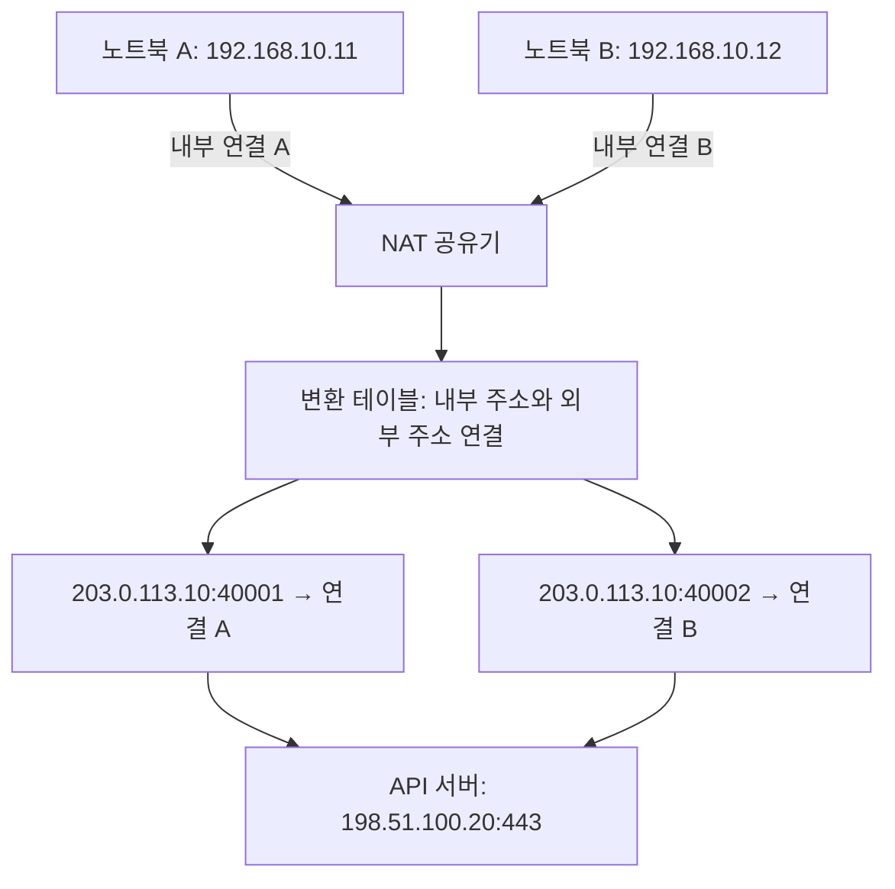
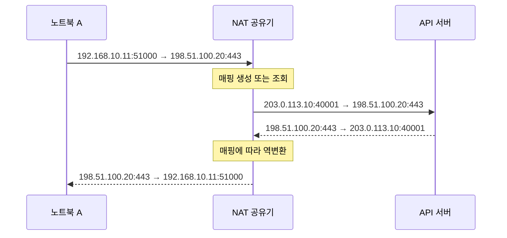

# 내 IP는 사설 IP인데, 인터넷은 어떻게 되는 걸까요?

노트북에서 IP를 확인하면 `192.168.10.11`이 나와요. 그런데 외부 서비스에서 확인한 IP는 전혀 다른 주소예요. 같은 와이파이에 연결한 휴대폰에서도 외부 IP가 똑같이 보일 수 있어요.

어느 쪽이 잘못된 걸까요? 둘 다 맞아요. **서로 다른 구간에서 관찰한 주소**이기 때문이에요.

그 사이에서 주소를 바꾸는 기술이 NAT예요. 이번에는 노트북 두 대가 같은 API 서버에 접속하는 과정을 따라가며, 주소가 언제 바뀌고 응답은 어떻게 돌아오는지 알아볼게요.

> 그림과 표의 `203.0.113.0/24`, `198.51.100.0/24`, `192.0.2.0/24`는 문서용 주소예요. 아래에서는 외부 주소 역할로 사용하지만 실제 인터넷 접속을 시험할 수 있는 공인 주소는 아니에요.

## 목차

1. [먼저 사설 IP를 이해해요](#1-먼저-사설-ip를-이해해요)
2. [NAT는 패킷의 주소를 바꿔요](#2-nat는-패킷의-주소를-바꿔요)
3. [같은 공인 IP를 써도 응답이 섞이지 않는 이유](#3-같은-공인-ip를-써도-응답이-섞이지-않는-이유)
4. [요청과 응답을 한 번에 따라가요](#4-요청과-응답을-한-번에-따라가요)
5. [SNAT와 DNAT는 무엇이 다를까요](#5-snat와-dnat는-무엇이-다를까요)
6. [Static NAT와 Dynamic NAT는 다른 분류예요](#6-static-nat와-dynamic-nat는-다른-분류예요)
7. [서버 로그에는 누구의 IP가 남을까요](#7-서버-로그에는-누구의-ip가-남을까요)
8. [NAT가 해결하지 않는 문제도 있어요](#8-nat가-해결하지-않는-문제도-있어요)
9. [운영에서 확인해야 할 것들](#9-운영에서-확인해야-할-것들)
10. [다시 질문으로 확인해볼게요](#10-다시-질문으로-확인해볼게요)

## 1. 먼저 사설 IP를 이해해요

집과 회사는 내부 기기에 사설 IP를 할당할 수 있어요. 서로 독립된 네트워크라면 같은 주소를 사용해도 괜찮아요. 우리 집과 옆집에 각각 `192.168.0.10`이라는 기기가 존재할 수 있는 거예요.

대표적인 IPv4 사설 대역은 세 가지예요.

| CIDR | 범위 |
|---|---|
| `10.0.0.0/8` | `10.0.0.0 ~ 10.255.255.255` |
| `172.16.0.0/12` | `172.16.0.0 ~ 172.31.255.255` |
| `192.168.0.0/16` | `192.168.0.0 ~ 192.168.255.255` |

`172.`로 시작한다고 모두 사설 IP는 아니에요. 예를 들어 `172.32.0.1`은 위 사설 대역에 포함되지 않아요. 또 사설 대역이 아니라고 모두 일반적인 공인 주소는 아니에요. 루프백, 링크 로컬 등 다른 특수 목적 대역도 있어요.

사설 주소는 공용 인터넷에서 전역적으로 라우팅되는 주소가 아니에요. 외부 서버가 `192.168.0.10`으로 응답하려고 해도 어느 집의 기기인지 구분할 수 없어요.

그래서 내부 기기가 IPv4 인터넷으로 직접 통신하는 흔한 구성에서는, 외부에서 응답할 수 있는 주소로 바꿔주는 장치가 필요해요. 가정에서는 공유기가 그 역할을 맡는 경우가 많아요.

모든 사설망 통신에 NAT가 필요한 것은 아니에요. 내부 라우팅이나 VPN으로 연결한 사설망끼리는 주소를 유지한 채 통신할 수도 있어요.

## 2. NAT는 패킷의 주소를 바꿔요

NAT는 **Network Address Translation**, 네트워크 주소 변환이에요. 패킷의 출발지 또는 목적지 IP 주소를 다른 주소로 바꿔 전달해요. 구성에 따라 TCP나 UDP 포트도 바꿀 수 있어요.

다음 환경을 가정해볼게요.

| 역할 | 주소 |
|---|---|
| 노트북 A | `192.168.10.11` |
| 노트북 B | `192.168.10.12` |
| 공유기 내부 인터페이스 | `192.168.10.1` |
| 공유기 외부 주소 | `203.0.113.10` |
| 외부 API 서버 | `198.51.100.20:443` |

공유기는 내부망과 외부망에 연결되어 있어요. 내부 기기는 공유기를 기본 게이트웨이로 사용해 외부 목적지로 패킷을 보내요.

이때 노트북이 보내는 IP 패킷의 목적지는 여전히 API 서버예요. 다음 홉이 공유기라는 이유로 목적지 IP를 공유기 내부 주소로 바꿔 보내는 것은 아니에요. 이더넷 환경에서는 다음 홉으로 전달하기 위한 MAC 주소와 최종 목적지 IP 주소를 구분해야 해요.



위 그림의 두 외부 포트는 예시예요. NAT가 항상 이 번호를 할당하거나 모든 연결의 포트를 반드시 바꾼다는 뜻은 아니에요.

## 3. 같은 공인 IP를 써도 응답이 섞이지 않는 이유

노트북 A와 B가 우연히 같은 출발지 포트 `51000`으로 같은 서버에 접속했다고 해볼게요.

| 기기 | 내부에서 보낸 출발지 | 목적지 |
|---|---|---|
| A | `192.168.10.11:51000` | `198.51.100.20:443` |
| B | `192.168.10.12:51000` | `198.51.100.20:443` |

출발지 IP만 둘 다 `203.0.113.10`으로 바꾸고 포트까지 같게 두면, 외부에서 관찰한 두 TCP 연결을 구분할 수 없어요.

그래서 공유기는 외부에서 사용할 포트를 다르게 배정할 수 있어요.

| 프로토콜 | 내부 출발지 | 변환 후 외부 출발지 | 외부 목적지 |
|---|---|---|---|
| TCP | `192.168.10.11:51000` | `203.0.113.10:40001` | `198.51.100.20:443` |
| TCP | `192.168.10.12:51000` | `203.0.113.10:40002` | `198.51.100.20:443` |

서버에서 `203.0.113.10:40001`로 보낸 응답은 A에게, `40002`로 보낸 응답은 B에게 돌아가요.

이렇게 주소와 포트를 함께 변환하는 방식을 **NAPT(Network Address Port Translation)** 또는 **PAT(Port Address Translation)**라고 불러요. NAT overload라는 표현도 만날 수 있어요.

정리하면, NAT는 더 넓은 개념이고 여러 기기가 하나의 외부 IPv4 주소를 공유하는 익숙한 방식은 PAT/NAPT에 해당해요.

### NAT 테이블은 주소록보다 연결 기록에 가까워요

위 표는 이해를 위한 단순화된 모습이에요. 실제 장치는 프로토콜, 주소와 포트, 연결 상태, 타임아웃 등 필요한 정보를 관리해요. 정확한 매핑 키와 재사용 방식은 구현에 따라 달라요.

TCP 연결은 일반적으로 출발지 IP와 포트, 목적지 IP와 포트, 프로토콜의 조합으로 식별해요. 따라서 포트 번호만 보고 전체 연결을 식별할 수는 없어요.

UDP에는 TCP처럼 연결 수립 절차가 없지만 NAT 장치는 일정 시간 유지되는 매핑을 만들 수 있어요. 한동안 트래픽이 없으면 해당 매핑이 만료될 수 있어요.

## 4. 요청과 응답을 한 번에 따라가요

이번에는 노트북 A만 볼게요. 요청이 외부로 나갈 때와 응답이 내부로 돌아올 때, 바뀌는 필드를 비교해보면 이해하기 쉬워요.

| 관찰 구간 | 출발지 | 목적지 |
|---|---|---|
| A → 공유기 | `192.168.10.11:51000` | `198.51.100.20:443` |
| 공유기 → API | `203.0.113.10:40001` | `198.51.100.20:443` |
| API → 공유기 | `198.51.100.20:443` | `203.0.113.10:40001` |
| 공유기 → A | `198.51.100.20:443` | `192.168.10.11:51000` |

요청에서는 출발지가 바뀌고, 그 요청의 응답에서는 목적지가 원래 내부 주소로 복원돼요.



NAT는 변경한 필드에 맞춰 필요한 체크섬도 조정해요. 노트북과 서버의 애플리케이션은 보통 이 변환 테이블을 직접 관리하지 않아요.

API 서버 입장에서는 A의 내부 주소를 알 필요가 없어요. 자신에게 도착한 연결의 상대 주소로 응답하면 돼요. 어떤 내부 기기로 되돌릴지는 NAT 장치가 담당해요.

## 5. SNAT와 DNAT는 무엇이 다를까요

NAT 설정을 보면 SNAT와 DNAT라는 용어가 자주 나와요. 이때는 **어느 주소를 바꾸는지** 보면 돼요.

| 구분 | 바꾸는 필드 | 대표적인 용도 |
|---|---|---|
| SNAT | 출발지 주소, 필요하면 출발지 포트 | 내부 서버의 외부 통신, 응답 경로 유지 |
| DNAT | 목적지 주소, 필요하면 목적지 포트 | 외부 주소로 받은 요청을 내부 서버로 전달 |

### SNAT: 외부 서버가 보는 출발지를 바꿔요

앞에서 본 노트북의 외부 접속은 SNAT 예시예요.

`192.168.10.11:51000 → 203.0.113.10:40001`

Source NAT의 Source는 출발지예요. 특정 제품에서는 SNAT 약어를 별도의 제품 용어로 설명하기도 하므로 실제 장비 매뉴얼도 확인해야 해요. 여기서는 일반적인 Source NAT 의미로 사용해요.

SNAT가 반드시 사설 IP를 공인 IP로 바꾸는 것은 아니에요. 내부 로드밸런서가 클라이언트의 출발지를 자신의 사설 IP로 바꾸는 경우도 있어요.

### DNAT: 요청을 받을 실제 목적지를 바꿔요

외부에 공개한 주소가 `203.0.113.50:443`이고 실제 서버는 `10.20.0.15:8443`이라고 해볼게요.

| 단계 | 출발지 | 목적지 |
|---|---|---|
| 변환 전 | `192.0.2.30:53000` | `203.0.113.50:443` |
| DNAT 후 | `192.0.2.30:53000` | `10.20.0.15:8443` |

목적지 주소와 포트가 바뀌었어요. 출발지는 그대로예요. 이것이 DNAT만 적용한 단순 예시예요.

포트 포워딩은 이런 목적지 변환을 이용하는 대표적인 구성인데, 변환 규칙 외에 방화벽 허용, 라우팅, 서버의 리스닝 포트도 맞아야 해요.

### 하나의 요청에 SNAT와 DNAT를 함께 적용할 수도 있어요

로드밸런서가 서버를 선택한 뒤 목적지를 바꾸고, 응답이 자신을 거쳐 돌아오도록 출발지까지 바꾸는 구성을 생각해볼게요.

| 관찰 위치 | 출발지 | 목적지 |
|---|---|---|
| 로드밸런서 진입 | `192.0.2.30:53000` | `203.0.113.50:443` |
| DNAT 후 | `192.0.2.30:53000` | `10.20.0.15:8443` |
| SNAT까지 적용 후 | `10.20.0.5:61000` | `10.20.0.15:8443` |

이때 서버가 네트워크 연결에서 보는 상대는 `10.20.0.5`예요. 원래 클라이언트 주소 `192.0.2.30`은 패킷 출발지에 남아 있지 않아요.

모든 로드밸런서가 이렇게 동작하는 것은 아니에요. 출발지를 보존하는 방식, DSR, TCP 프록시 방식 등 구성에 따라 달라져요. 위 표는 NAT 방식의 예시예요.

### SNAT의 응답도 목적지가 바뀌는데, DNAT 아닌가요?

응답 패킷의 목적지 주소가 바뀌는 것은 맞아요. 다만 연결에 적용한 정책을 설명할 때는 최초 요청에 적용한 변환을 기준으로 SNAT 또는 DNAT라고 부르는 경우가 일반적이에요.

SNAT 연결의 응답을 원래 출발지로 되돌리는 것은 기존 변환의 역방향 처리예요. 별도의 서비스 공개용 DNAT 규칙을 새로 만들었다는 의미는 아니에요.

## 6. Static NAT와 Dynamic NAT는 다른 분류예요

SNAT와 DNAT가 변환할 필드를 구분한다면, Static과 Dynamic은 매핑을 정하는 방식을 설명해요.

| 구분 | 핵심 | 예시 |
|---|---|---|
| Static NAT | 정해진 주소끼리 고정 매핑 | 내부 서버 A를 외부 주소 A에 연결 |
| Dynamic NAT | 사용 가능한 주소 풀에서 동적 할당 | 내부 기기에 외부 주소를 필요할 때 배정 |
| PAT/NAPT | 주소와 포트를 함께 사용 | 여러 기기가 하나의 외부 주소 공유 |

일반적인 Basic Dynamic NAT는 외부 주소 풀의 크기가 제약이 될 수 있어요. PAT는 포트를 활용해 주소 공유 범위를 늘려요. “동적이면 무조건 하나의 공인 IP를 함께 쓴다”라고 외우면 두 개념이 섞여요.

하나의 구성을 “출발지를 바꾸는 SNAT이고, 포트를 함께 변환하는 PAT 방식”이라고 설명할 수 있어요. 같은 수준의 선택지 중 하나만 고르는 관계가 아니에요.

Linux의 MASQUERADE도 자주 보여요. 출력 인터페이스의 주소를 이용하는 SNAT 방식으로, 외부 주소가 동적으로 바뀌는 환경에서 유용해요. 구체적인 훅과 명령어는 사용하는 커널과 도구의 매뉴얼을 기준으로 확인해야 해요.

## 7. 서버 로그에는 누구의 IP가 남을까요

개발자가 NAT를 알아야 하는 이유는 로그에서 드러나요.

오픈 API 서버가 받는 요청에 출발지 변환이 적용되었다면, 별도의 전달 장치 없이 애플리케이션 코드만으로 원래 주소를 복원할 수는 없어요.

### getRemoteAddr()는 관찰 위치에 따라 달라져요

일반적으로 Servlet의 `request.getRemoteAddr()`는 직접 연결한 상대 주소를 반환해요. 다만 컨테이너나 필터가 신뢰된 프록시 정보를 반영하도록 설정되어 있으면 애플리케이션에 노출되는 값은 재작성될 수 있어요.

따라서 이 메서드의 결과를 무조건 “최초 사용자 IP”라고 이름 붙이지 않는 편이 좋아요.

| 구성 | 서버가 관찰하는 연결 상대의 예 |
|---|---|
| 출발지를 보존하는 전달 | 클라이언트의 외부 출발지 주소 |
| 로드밸런서가 SNAT | 로드밸런서의 변환 주소 |
| 리버스 프록시가 새 연결 생성 | 프록시의 주소 |

### NAT가 X-Forwarded-For를 만들어주지는 않아요

기본적인 NAT는 패킷의 주소와 포트를 변환해요. HTTP 헤더인 X-Forwarded-For를 자동으로 추가하는 기능과는 달라요.

HTTP를 처리하는 프록시는 헤더로 원래 주소를 전달할 수 있어요. TCP 프록시 환경에서는 송수신 양쪽이 지원하는 PROXY protocol을 사용할 수도 있어요. PROXY protocol은 연결의 앞부분 등에 주소 정보를 전달하는 별도 규약이며 일반적인 HTTP 헤더가 아니에요.

HTTPS를 종료하지 않고 단순 전달하는 L4 장치가 암호화된 HTTP 내부에 임의의 헤더를 삽입할 수 있다고 가정하면 안 돼요.

전달된 주소도 아무 값이나 신뢰하면 안 돼요. 신뢰하는 프록시에서 온 연결에만 적용하고, 외부가 직접 주입한 헤더를 정리하는 정책이 필요해요. 원본 주소를 전달하는 기능 자체가 인증 기능은 아니에요.

### NAT와 프록시는 결과가 비슷해도 동작이 달라요

NAT는 기존 패킷 흐름의 주소 정보를 변환해요. TCP 프록시는 클라이언트와의 연결을 받아 서버에 별도의 연결을 만들어요.

둘 다 서버에 중간 장치 주소가 보이게 할 수 있지만, 연결 종료와 재시도, 타임아웃, TLS 처리의 책임이 다를 수 있어요. 장애를 분석할 때 “중간 장치 IP가 보인다”는 사실만으로 SNAT라고 단정하지 마세요.

## 8. NAT가 해결하지 않는 문제도 있어요

### 주소 변환은 접근 허가와 달라요

내부 주소가 외부에 직접 드러나지 않고, 동적 매핑이 없는 외부 요청이 내부 기기로 연결되지 않는 효과는 있을 수 있어요. 하지만 NAT 자체가 악성 요청을 판별하거나 사용자를 인증하지는 않아요.

포트 포워딩으로 공개한 서비스에는 공격 요청도 도착할 수 있어요. 방화벽의 허용 정책, 애플리케이션 인증과 인가, 취약점 방어는 별도로 필요해요.

“NAT 뒤에 있으니 안전하다”보다 “어떤 경로와 포트를 공개했고, 무엇으로 접근을 통제하는가”를 확인해야 해요.

### 공인 IP 한 개가 사용자 한 명을 의미하지 않아요

회사 직원이나 같은 집의 기기들이 외부에서는 같은 IP로 보일 수 있어요. 통신사의 CGN 환경에서는 더 많은 가입자가 외부 주소를 공유할 수도 있어요.

IP만 기준으로 자동 차단하면 정상 사용자도 함께 영향을 받을 수 있어요. IP 기반 판단은 유용하지만 인증된 계정, API 키, 요청 특성 등과 함께 해석해야 해요.

특정 연결을 추적하려면 외부 IP뿐 아니라 출발지 포트, 프로토콜, 정확한 시각과 NAT 매핑 기록 등이 필요할 수 있어요. 이 정보가 있다고 곧바로 실제 사람의 신원까지 알 수 있는 것은 아니에요.

### IPv6와 NAT는 같은 문제가 아니에요

IPv6는 주소 공간을 크게 늘려 IPv4 주소 공유의 필요를 줄여줘요. 그렇다고 보안 정책이 필요 없어지는 것은 아니에요.

IPv6와 IPv4 사이를 연결하는 NAT64 같은 기술도 있지만, 이는 이 글의 IPv4 주소 공유 예시와 다른 주제예요. “NAT는 IPv6 전환 기술”이라고만 설명하면 범위가 너무 넓어져요.

## 9. 운영에서 확인해야 할 것들

### 응답도 변환 상태를 아는 경로로 돌아와야 해요

요청이 NAT 장치 A를 거쳤는데 응답이 아무 상태도 모르는 장치 B로 돌아오면, 필요한 역변환을 못 할 수 있어요. 상태 동기화를 지원하는 이중화 구성인지, 응답 경로가 유지되는지 확인해야 해요.

DNAT만 적용했는데 서버의 기본 게이트웨이가 다른 방향을 가리키는 상황도 살펴봐야 해요. 무조건 SNAT를 켜기 전에 출발지 보존의 필요성과 라우팅을 함께 검토해요.

### 포트와 상태 테이블도 자원이에요

외부 주소 하나를 공유할 수 있다고 연결을 무한히 만들 수는 없어요. 포트 할당 정책, 목적지별 연결 수, 상태 테이블 크기, 타임아웃과 장비 용량이 제약이 돼요.

포트 번호가 16비트라는 사실만으로 “공인 IP 하나당 전체 연결은 정확히 65,535개”라고 단정할 수도 없어요. 사용 가능한 포트 범위와 목적지에 따른 재사용 정책 등이 다르기 때문이에요.

외부 API 타임아웃이 늘었다면 애플리케이션 스레드뿐 아니라 NAT 포트 사용량과 연결 생성 실패 지표도 확인해보세요. HTTP 연결 재사용은 불필요한 새 연결을 줄이는 데 도움이 될 수 있어요.

### 연결이 조용하면 매핑이 만료될 수 있어요

애플리케이션은 연결이 살아 있다고 생각하지만, 중간 NAT 장치는 유휴 타임아웃으로 상태를 제거했을 수 있어요. 이후 쓰기에서 오류나 지연이 발생할 수 있어요.

클라이언트 커넥션 풀의 유휴 정책, TCP keepalive, 중간 장치의 타임아웃을 함께 확인해야 해요. 특정 시간값을 모든 환경에 그대로 적용하면 안 돼요.

### 패킷은 변환 전후를 비교해요

권한이 있는 환경에서 인터페이스별 패킷의 출발지와 목적지를 비교하면 실제 변환을 확인할 수 있어요.

```bash
# Linux 예시: 인터페이스 이름은 환경에 맞게 바꿔요.
# 실제 공인 주소가 아닌 문서용 예시 주소예요.
sudo tcpdump -ni eth0 -nn 'host 198.51.100.20 and tcp port 443'
```

명령은 NAT 설정을 변경하지 않지만 패킷 관찰 권한이 필요해요. NAT 장치 양쪽에서 같은 연결을 관찰해야 변환 전후를 비교할 수 있어요. API 서버 한 곳의 캡처만으로 사라진 원본 주소를 복구할 수는 없어요.

네트워크 담당자와는 다음 내용을 맞춰보면 좋아요.

| 확인 사항 | 이유 |
|---|---|
| 어느 장비에서 SNAT 또는 DNAT를 하나요? | 주소가 바뀌는 지점을 특정해요 |
| 변환 전후 주소와 포트는 무엇인가요? | 로그와 패킷을 연결해요 |
| 응답은 어느 경로로 돌아오나요? | 역변환이 가능한지 확인해요 |
| NAT 상태와 포트 사용량은 어떤가요? | 자원 고갈 여부를 확인해요 |
| 이중화 시 상태가 유지되나요? | 장애 전환 중 연결 끊김을 해석해요 |
| 원본 주소는 어떤 방식으로 전달하나요? | 애플리케이션의 IP 취득 기준을 정해요 |

## 10. 다시 질문으로 확인해볼게요

**내 노트북과 휴대폰의 외부 IP가 같아도 괜찮을까요?**

네. PAT/NAPT를 이용하면 서로 다른 내부 연결을 외부 포트 등의 매핑으로 구분할 수 있어요.

**NAT와 SNAT는 다른 기술인가요?**

SNAT는 NAT 중 출발지를 바꾸는 방식이에요. NAT는 더 넓은 개념이에요.

**외부에서 내부 서버로 들어오면 무조건 DNAT인가요?**

아니요. 외부에서 들어온다는 방향보다 실제 목적지 주소를 바꾸는지 봐야 해요. 라우팅만 하거나 프록시가 연결을 새로 만드는 구성도 있어요.

**L4 뒤에서 사설 IP가 보이면 공격자의 사설 IP인가요?**

그렇게 단정할 수 없어요. SNAT 주소, 프록시 주소, 전달 헤더 처리 결과일 수 있어요. 실제 연결 상대와 신뢰된 원본 주소 정보를 구분해야 해요.

**NAT가 있으면 방화벽은 없어도 되나요?**

아니요. 주소 변환과 통신 허용 여부는 따로 설계해야 해요.

서버 로그의 IP가 예상과 다르면, 먼저 요청 경로의 각 구간에 출발지와 목적지를 적어보세요. 어느 지점에서 어떤 값이 바뀌는지 보이면 NAT 설정과 애플리케이션의 IP 처리도 함께 이해할 수 있어요.

## 함께 읽기

- [실패 기반 IP 자동 차단 설계](../system-design/failure-based-auto-blocking.md)
- [CORS와 CSRF, CSRF 토큰](../security/cors-csrf-and-csrf-token.md)

## 참고 자료

- [슈고링: 네트워크 주소 변환 개념과 그림](https://sugoring-it.tistory.com/268) — 학습 출발점으로 읽은 글이에요. 여러 내부 기기와 NAT 테이블을 함께 보는 관점을 참고했어요.
- [RFC 1918: 사설 주소 대역](https://www.rfc-editor.org/rfc/rfc1918)
- [RFC 3022: Basic NAT와 NAPT](https://www.rfc-editor.org/rfc/rfc3022)
- [RFC 6888: Carrier-Grade NAT 요구사항](https://www.rfc-editor.org/rfc/rfc6888)
- [Netfilter: nftables NAT statements](https://www.netfilter.org/projects/nftables/manpage.html)
- [HAProxy: PROXY protocol 명세](https://github.com/haproxy/haproxy/blob/master/doc/proxy-protocol.txt)

기술 설명은 RFC와 구현체 공식 문서를 기준으로 보완했어요. 본문의 주소 예제, 표, Mermaid 다이어그램은 이 글을 위해 새로 구성했어요.
