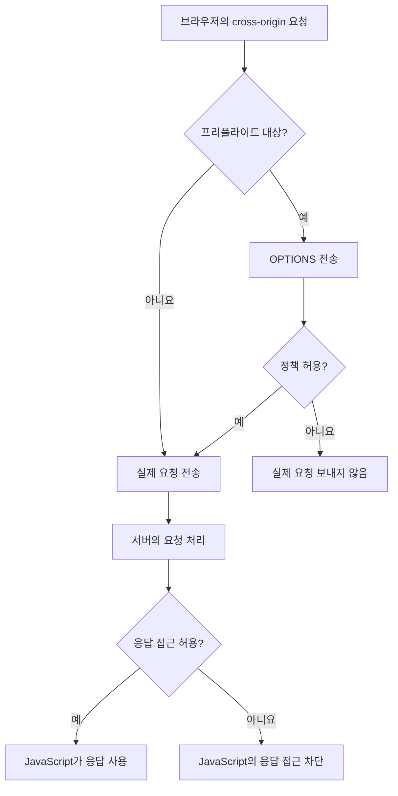
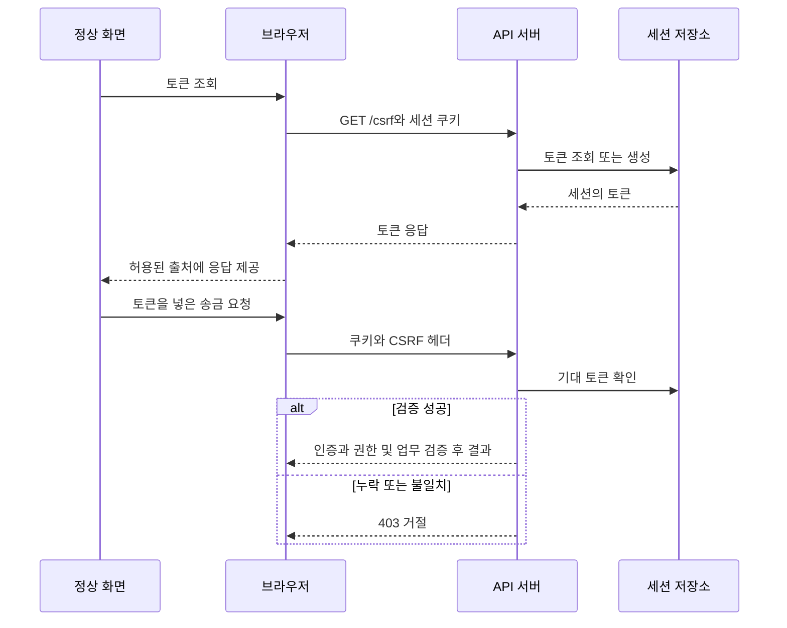

# CORS를 풀었는데, 왜 CSRF는 또 막아야 할까요?

React에서 송금 API를 호출했는데 브라우저에 CORS 오류가 나타났어요. 서버에서는 요청을 받은 것 같고, Postman에서는 잘 동작해요. 검색하다 보면 이런 설정도 만나죠.

```java
http.csrf(csrf -> csrf.disable());
```

오류는 사라질 수 있어요. 하지만 어떤 보호 장치를 껐는지 이해하지 못했다면, 문제를 해결했다고 보기 어려워요.

이 글에서는 가상의 송금 서비스를 따라가며 세 가지 질문에 답해볼게요.

- 다른 출처의 응답을 브라우저에서 읽으려면 무엇이 필요할까요?
- 로그인한 사용자의 요청인데도 위조된 요청일 수 있을까요?
- CSRF 토큰은 쿠키와 함께 보내는데, 왜 별도의 방어가 될까요?

예제는 설명을 위한 가상 도메인과 코드예요. 실제 회사의 시스템이나 고객 정보는 포함하지 않아요.

## 목차

1. [출처부터 구분해볼게요](#1-출처부터-구분해볼게요)
2. [CORS는 브라우저와 서버의 약속이에요](#2-cors는-브라우저와-서버의-약속이에요)
3. [요청이 전송되는 시점을 나눠서 봐야 해요](#3-요청이-전송되는-시점을-나눠서-봐야-해요)
4. [쿠키가 붙는 조건은 별도로 확인해요](#4-쿠키가-붙는-조건은-별도로-확인해요)
5. [이 틈에서 CSRF가 발생해요](#5-이-틈에서-csrf가-발생해요)
6. [CSRF 토큰으로 요청을 한 번 더 확인해요](#6-csrf-토큰으로-요청을-한-번-더-확인해요)
7. [Spring과 React로 연결해볼게요](#7-spring과-react로-연결해볼게요)
8. [쿠키에 토큰을 저장한다면 달라지는 점](#8-쿠키에-토큰을-저장한다면-달라지는-점)
9. [결제 서비스에서는 요청의 성격을 나눠요](#9-결제-서비스에서는-요청의-성격을-나눠요)
10. [장애를 만났을 때 확인할 순서](#10-장애를-만났을-때-확인할-순서)
11. [직접 검증해볼 시나리오](#11-직접-검증해볼-시나리오)

## 1. 출처부터 구분해볼게요

브라우저의 출처, 즉 Origin은 **스킴, 호스트, 포트의 조합**이에요. 경로는 포함하지 않아요.

기준 주소를 `https://app.example.com`으로 잡아볼게요.

| 비교 주소 | 같은 출처인가요? | 이유 |
|---|---|---|
| `https://app.example.com/transfers` | 예 | 경로만 달라요 |
| `https://app.example.com:443` | 예 | HTTPS 기본 포트예요 |
| `http://app.example.com` | 아니요 | 스킴이 달라요 |
| `https://api.example.com` | 아니요 | 호스트가 달라요 |
| `https://app.example.com:8443` | 아니요 | 포트가 달라요 |

회사가 같거나 같은 서버에 배포되어 있어도 출처는 다를 수 있어요. 로컬 개발에서 React의 `localhost:5173`과 Spring의 `localhost:8080`도 다른 출처예요.

브라우저는 동일 출처 정책(SOP)을 통해 서로 다른 출처의 문서와 데이터에 대한 접근을 제한해요. 로그인한 은행 사이트의 응답을 전혀 다른 사이트의 JavaScript가 마음대로 읽을 수 있다면 곤란하겠죠.

여기서 기억할 점이 있어요. **다른 출처로 요청을 보내는 것과, 그 응답을 JavaScript로 읽는 것은 다른 동작**이에요. 링크 이동이나 HTML 폼 제출 같은 동작도 웹에서는 필요하니까요.

### Same-origin과 Same-site도 달라요

쿠키의 `SameSite`는 출처와 다른 기준을 사용해요. 일반적인 도메인에서는 스킴과 등록 가능한 도메인을 중심으로 사이트를 구분하고, 포트는 구분 기준에 넣지 않아요.

`https://app.example.com`과 `https://api.example.com`은 cross-origin이면서 same-site예요. 반면 `https://evil.example.net`은 두 주소와 cross-site예요.

이 차이는 뒤에서 중요해져요. 프런트엔드와 API가 cross-origin이라고 해서 세션 쿠키에 무조건 `SameSite=None`을 붙여야 하는 건 아니에요.

## 2. CORS는 브라우저와 서버의 약속이에요

CORS는 Cross-Origin Resource Sharing의 약자예요. 서버가 “이 출처의 웹 페이지는 내 응답에 접근해도 된다”는 정책을 응답 헤더로 알려주고, 브라우저가 이를 적용해요.

React 화면이 다음 요청을 보낸다고 해볼게요.

```javascript
const response = await fetch("https://api.example.com/api/balance", {
  credentials: "include"
});
```

브라우저는 요청 출처를 표시해요.

```http
Origin: https://app.example.com
```

서버가 해당 출처의 자격 증명 포함 요청을 허용한다면 응답은 이런 형태가 돼요.

```http
Access-Control-Allow-Origin: https://app.example.com
Access-Control-Allow-Credentials: true
Vary: Origin
```

`credentials: "include"`는 다른 출처 요청에서도 쿠키 같은 자격 증명을 포함하도록 요청하는 옵션이에요. 쿠키의 SameSite나 브라우저의 쿠키 차단 정책까지 해제하지는 않아요.

`Vary: Origin`은 Origin에 따라 응답이 달라진다는 캐시 힌트예요. 여러 허용 출처 중 요청에 맞는 하나를 반환할 때 특히 필요해요. 다만 이 헤더만으로 개인별 잔액 응답이 안전하게 캐시되는 것은 아니에요. 민감한 응답에는 별도의 캐시 정책도 필요해요.

### CORS는 API 인증이 아니에요

curl이나 서버 간 HTTP 클라이언트는 브라우저의 CORS 응답 접근 제한을 적용하지 않아요. Origin 헤더도 직접 만들어 보낼 수 있어요.

따라서 CORS 허용 목록에 등록되어 있다는 이유로 호출자를 신뢰해서는 안 돼요. API에는 여전히 인증, 계좌 소유권 확인, 거래 권한 검사가 필요해요.

프런트엔드 도메인이 허용되었다고 그 사용자가 모든 계좌를 조회할 수 있는 건 아니니까요.

## 3. 요청이 전송되는 시점을 나눠서 봐야 해요

CORS 문제를 이해하려면 두 가지 흐름을 구분해야 해요.

### 프리플라이트 없이 보내는 요청

조건을 만족하는 GET, HEAD, POST 요청은 사전 확인 없이 전송될 수 있어요. 흔히 단순 요청이라고 불러요. 메서드뿐 아니라 직접 설정한 헤더, Content-Type 등의 조건도 만족해야 해요.

대표적인 Content-Type은 다음과 같아요.

- `application/x-www-form-urlencoded`
- `multipart/form-data`
- `text/plain`

이 경우 서버가 요청을 처리한 뒤, 브라우저가 응답 헤더를 보고 JavaScript의 응답 접근을 막을 수 있어요.

**브라우저에 CORS 오류가 떴어도 서버에서는 상태 변경이 끝났을 수 있어요.**

서버 측 CORS 필터가 허용하지 않은 Origin을 먼저 거부하도록 구현되어 있다면 처리가 차단될 수 있어요. 하지만 브라우저의 CORS 오류 자체가 서버 미처리를 보장하지는 않아요.

### 프리플라이트로 먼저 확인하는 요청

JSON 본문이나 사용자 정의 헤더를 사용하는 cross-origin 요청은 일반적으로 프리플라이트 대상이에요.

```http
OPTIONS /api/transfers HTTP/1.1
Origin: https://app.example.com
Access-Control-Request-Method: POST
Access-Control-Request-Headers: content-type,x-csrf-token
```

서버는 허용하는 출처, 메서드, 헤더를 알려줘요.

```http
HTTP/1.1 204 No Content
Access-Control-Allow-Origin: https://app.example.com
Access-Control-Allow-Credentials: true
Access-Control-Allow-Methods: GET, POST
Access-Control-Allow-Headers: Content-Type, X-CSRF-TOKEN
Vary: Origin, Access-Control-Request-Method, Access-Control-Request-Headers
```

이 확인이 실패하면 브라우저는 실제 POST를 보내지 않아요. 허용 결과는 브라우저에 캐시될 수 있어서 매번 OPTIONS가 나타나는 것은 아니에요. 실제 POST의 응답에도 적절한 CORS 헤더가 필요해요.



### 자주 헷갈리는 헤더

| 설정 | 하는 일 |
|---|---|
| `Access-Control-Allow-Origin` | 응답 접근을 허용할 출처 |
| `Access-Control-Allow-Methods` | 프리플라이트에서 허용할 실제 요청 메서드 |
| `Access-Control-Allow-Headers` | 실제 요청에서 사용할 헤더 허용 |
| `Access-Control-Expose-Headers` | JavaScript가 읽을 수 있도록 추가로 공개할 응답 헤더 |
| `Access-Control-Max-Age` | 프리플라이트 허용 결과의 캐시 시간 |

`Allow-Headers`와 `Expose-Headers`를 바꿔 쓰면 문제가 해결되지 않아요. 예를 들어 요청에 보낼 `X-CSRF-TOKEN`은 Allow-Headers에 해당해요.

자격 증명 포함 요청에서 Allow-Origin을 `*`로 지정할 수는 없어요. 요청 Origin을 검증 없이 그대로 반사하는 설정도 피해야 해요. 사실상 임의의 사이트에 사용자의 응답을 열어줄 수 있기 때문이에요.

## 4. 쿠키가 붙는 조건은 별도로 확인해요

로그인하면 서버가 세션 쿠키를 발급한다고 가정해볼게요.

```http
Set-Cookie: JSESSIONID=example-session; Path=/; Secure; HttpOnly; SameSite=Lax
```

각 속성은 담당하는 일이 달라요.

| 속성 | 의미 | 해결하지 못하는 문제 |
|---|---|---|
| Secure | HTTPS 요청에서 전송 | 요청 위조 자체 |
| HttpOnly | JavaScript의 쿠키 값 직접 읽기 제한 | 브라우저의 쿠키 자동 전송 |
| SameSite | cross-site 상황의 쿠키 전송 제한 | 모든 CSRF와 같은 사이트 내 악성 출처 |
| Domain 생략 | 발급 호스트에만 쿠키 적용 | 해당 호스트의 XSS |
| Path | 쿠키를 보낼 경로 범위 | 강력한 보안 격리 |

`SameSite=Strict`는 cross-site 전송을 엄격하게 제한해요. `Lax`는 일반적인 cross-site fetch나 POST 폼에서는 쿠키를 제한하지만, 최상위 페이지로 이동하는 안전한 메서드의 요청에는 허용할 수 있어요. 그래서 GET 요청으로 송금이나 계좌 삭제를 구현하면 안 돼요.

`None`은 cross-site 전송을 허용하는 값이며 Secure가 필요해요. 브라우저가 서드파티 쿠키를 차단하면 이 설정만으로 해결되지 않을 수도 있어요. 속성을 생략했을 때의 기본 처리에는 브라우저별 예외도 있으니 운영에서는 의도를 명시하는 편이 좋아요.

예제의 app과 api는 HTTPS의 같은 사이트예요. API가 발급한 host-only 쿠키는 app의 JavaScript가 읽을 수 없어도 API로 향하는 요청에는 붙을 수 있어요. 쿠키를 읽는 주체와 쿠키를 받는 서버를 구분해보세요.

## 5. 이 틈에서 CSRF가 발생해요

CSRF는 Cross-Site Request Forgery예요. 피해자의 브라우저를 통해 피해자가 의도하지 않은 요청을 보내게 만드는 공격이에요.

피해자가 가상의 송금 사이트에 로그인한 상태에서 악성 페이지를 열었다고 해볼게요. 해당 페이지에 아래 폼이 있을 수 있어요.

```html
<!-- 취약한 수신 서버의 동작을 설명하기 위한 예제 -->
<form action="https://api.example.com/api/transfers" method="post">
  <input type="hidden" name="recipientId" value="attacker-recipient">
  <input type="hidden" name="amount" value="10000">
  <button type="submit">당첨 결과 확인</button>
</form>
```

이 예제가 실제 공격으로 성립하려면 조건이 맞아야 해요. 대상 서버가 해당 폼 형식을 받아야 하고, 쿠키 정책상 인증 쿠키가 전송되어야 하며, CSRF 방어와 추가 거래 검증이 없어야 해요. 뒤에 작성할 JSON 전용 예제에 이 폼을 그대로 보내면 같은 공격이 성립한다고 가정하지 않아요.

공격자는 피해자의 세션 쿠키 값을 몰라도 돼요. 브라우저가 조건에 맞는 쿠키를 자동으로 붙여주기 때문이에요. 또 송금 결과를 읽지 못해도 공격 목적을 달성할 수 있어요. 송금이 실행되는 것만으로 충분하니까요.

여기서 세 가지 검사가 분리돼요.

| 검사 | 확인하는 질문 |
|---|---|
| 인증 | 누구의 자격 증명으로 요청했나요? |
| 인가 | 그 사용자가 이 계좌와 기능을 사용할 수 있나요? |
| CSRF 방어 | 외부 페이지가 인증 정보를 자동으로 이용해 만든 요청은 아닌가요? |

CSRF 토큰도 사용자의 최종 송금 의사까지 증명하지는 않아요. 거래 확인 화면, 추가 인증, 수취인과 금액 검증은 별도의 역할이에요.

### JSON만 받으면 충분할까요?

JSON 전용 처리와 필수 사용자 정의 헤더, 엄격한 CORS 정책을 함께 적용하면 브라우저 기반 CSRF 방어 수단이 될 수 있어요. 하지만 JSON만 받는다고 선언한 API가 `text/plain`도 파싱하거나, 다른 폼 엔드포인트가 같은 업무를 수행하면 가정이 깨져요.

이 글에서는 쿠키 세션을 사용하는 서비스를 가정하므로 프레임워크의 CSRF 토큰 검증을 유지해요. CORS와 CSRF의 역할을 각각 확인할 수 있는 구성이기도 해요.

## 6. CSRF 토큰으로 요청을 한 번 더 확인해요

세션 방식에서는 서버가 예측하기 어려운 토큰을 만들어 세션에 연결해 저장해요. 정상 화면은 그 토큰을 전달받고, 상태를 변경하는 요청에서 헤더나 폼 필드로 다시 보내요. 서버는 해당 세션의 기대값과 요청의 토큰을 검증해요.

세션 쿠키는 브라우저가 자동으로 보내요. CSRF 토큰은 화면의 코드가 명시적으로 넣어요. 이 차이가 핵심이에요.

공격자가 토큰 발급 주소를 알아도 피해자 세션의 토큰 응답을 읽을 수 없다면 필요한 값을 알아내기 어려워요. 공격자가 자신의 브라우저에서 받은 토큰은 자신의 세션에 연결되어 있으므로 피해자 세션에 그대로 사용할 수 없어야 해요.



토큰을 URL에 넣으면 접근 로그나 기록으로 남을 수 있어요. 요청 헤더나 본문을 사용하고 로그에서는 마스킹해요. 토큰 응답도 공유 캐시에 저장하지 않아요.

토큰을 매 요청마다 폐기하는 일회용 값으로 설계해야만 하는 것은 아니에요. 오히려 여러 탭과 동시 요청에서 충돌할 수 있어요. 프레임워크의 수명 관리에 맞추고, 로그인과 로그아웃처럼 인증 상태가 바뀌는 시점을 처리하는 것이 중요해요.

XSS로 정상 출처에서 악성 JavaScript가 실행되면 토큰 조회와 요청 전송도 가능해질 수 있어요. CSRF 방어와 출력 인코딩, 안전한 DOM 사용 등의 XSS 방어는 함께 필요해요.

## 7. Spring과 React로 연결해볼게요

다음 예제는 **Java 21, Spring Boot 3 계열과 Spring Security 6.5의 Servlet 구성 방식**을 기준으로 작성한 학습용 코드예요. 웹 및 시큐리티 스타터를 사용하는 프로젝트를 전제로 해요. 완성된 송금 서비스가 아니며, 실제 컴파일과 브라우저 통합 실행을 완료한 예제는 아니에요.

화면은 `https://app.example.com`, API는 `https://api.example.com`에서 서비스한다고 가정해요. 쿠키 기반 세션 인증을 사용하고 CSRF 토큰은 세션에 보관해요. 실제 사용자는 별도의 인증 저장소에 등록되어 있어야 해요.

### CORS와 CSRF를 각각 설정해요

```java
package example.security;

import java.util.List;

import org.springframework.context.annotation.Bean;
import org.springframework.context.annotation.Configuration;
import org.springframework.http.HttpStatus;
import org.springframework.security.config.annotation.web.builders.HttpSecurity;
import org.springframework.security.web.SecurityFilterChain;
import org.springframework.security.web.authentication.HttpStatusEntryPoint;
import org.springframework.security.web.csrf.HttpSessionCsrfTokenRepository;
import org.springframework.security.web.csrf.XorCsrfTokenRequestAttributeHandler;
import org.springframework.web.cors.CorsConfiguration;
import org.springframework.web.cors.UrlBasedCorsConfigurationSource;

@Configuration
public class SecurityConfig {

    @Bean
    SecurityFilterChain securityFilterChain(
            HttpSecurity http,
            UrlBasedCorsConfigurationSource corsSource) throws Exception {

        http
            .cors(cors -> cors.configurationSource(corsSource))
            .csrf(csrf -> csrf
                .csrfTokenRepository(new HttpSessionCsrfTokenRepository())
                .csrfTokenRequestHandler(
                    new XorCsrfTokenRequestAttributeHandler()))
            .authorizeHttpRequests(auth -> auth
                .requestMatchers("/csrf", "/login").permitAll()
                .anyRequest().authenticated())
            .formLogin(form -> form
                .loginProcessingUrl("/login")
                .successHandler((request, response, authentication) ->
                    response.setStatus(204))
                .failureHandler((request, response, exception) ->
                    response.setStatus(401)))
            .logout(logout -> logout
                .logoutUrl("/logout")
                .logoutSuccessHandler((request, response, authentication) ->
                    response.setStatus(204)))
            .exceptionHandling(errors -> errors
                .authenticationEntryPoint(
                    new HttpStatusEntryPoint(HttpStatus.UNAUTHORIZED)));

        return http.build();
    }

    @Bean
    UrlBasedCorsConfigurationSource corsConfigurationSource() {
        CorsConfiguration cors = new CorsConfiguration();
        cors.setAllowedOrigins(List.of("https://app.example.com"));
        cors.setAllowedMethods(List.of("GET", "POST", "OPTIONS"));
        cors.setAllowedHeaders(List.of("Content-Type", "X-CSRF-TOKEN"));
        cors.setAllowCredentials(true);
        cors.setMaxAge(600L);

        UrlBasedCorsConfigurationSource source =
            new UrlBasedCorsConfigurationSource();
        source.registerCorsConfiguration("/**", cors);
        return source;
    }
}
```

`permitAll()`은 인가 규칙이에요. CSRF 검사를 생략하는 설정이 아니므로 로그인 POST에도 토큰을 보내야 해요. 반대로 CSRF 토큰이 유효하다고 인증이 완료되는 것도 아니에요.

프리플라이트에는 일반적으로 세션 쿠키가 없어요. 인증 필터가 OPTIONS부터 막지 않도록 시큐리티 체인에 CORS를 통합했어요. 단순히 OPTIONS를 permitAll로 바꿔도 CORS 응답 헤더를 생성해주는 것은 아니에요.

여기서는 프리플라이트 정책을 전체 경로에 동일하게 적용했어요. 실제로 공개 API와 관리 API의 정책이 다르면 경로별로 분리해야 해요.

### 토큰을 응답 본문으로 전달해요

```java
package example.security;

import org.springframework.http.CacheControl;
import org.springframework.http.ResponseEntity;
import org.springframework.security.web.csrf.CsrfToken;
import org.springframework.web.bind.annotation.GetMapping;
import org.springframework.web.bind.annotation.RestController;

@RestController
public class CsrfController {

    @GetMapping("/csrf")
    public ResponseEntity<CsrfResponse> csrf(CsrfToken csrfToken) {
        CsrfResponse body = new CsrfResponse(
            csrfToken.getHeaderName(),
            csrfToken.getToken()
        );
        return ResponseEntity.ok()
            .cacheControl(CacheControl.noStore())
            .body(body);
    }

    public record CsrfResponse(String headerName, String token) {}
}
```

Spring Security 6 계열의 지연 로딩된 토큰은 이처럼 값을 사용하는 시점에 구체화돼요. 프런트엔드에는 헤더 이름과 전송할 값을 함께 전달해요.

XOR 요청 핸들러가 노출하는 값은 저장된 원본과 표현이 다를 수 있어요. 압축 기반 정보 노출 공격인 BREACH를 완화하기 위해 무작위성을 포함하기 때문이에요. 프런트엔드는 응답으로 받은 값을 그대로 보내고, 서버 핸들러가 이를 해석하게 두면 돼요. 문자열이 바뀌었다고 매번 세션 토큰이 폐기됐다고 판단하면 안 돼요.

세션 쿠키의 예시 설정은 다음과 같아요.

```yaml
server:
  servlet:
    session:
      cookie:
        http-only: true
        secure: true
        same-site: lax
```

이 설정은 Boot가 관리하는 내장 서블릿 컨테이너를 전제로 해요. 외부 WAS에 WAR로 배포한다면 WAS의 세션 설정과 실제 Set-Cookie 응답을 함께 확인해야 해요. HTTPS가 앞단에서 종료되는 환경도 실제 응답 기준으로 점검해요.

### React에서 사용할 API 함수를 작성해요

토큰은 메모리에 두고, 요청은 고정된 API 주소로만 보내요. 임의의 URL을 받아 CSRF 헤더를 붙이는 공통 함수는 토큰 유출이나 잘못된 요청을 만들 수 있어요.

```javascript
// paymentApi.js
const API_BASE = "https://api.example.com";
let csrf = null;

export async function refreshCsrf() {
  const response = await fetch(API_BASE + "/csrf", {
    credentials: "include",
    cache: "no-store"
  });
  if (!response.ok) {
    throw new Error("보안 정보를 불러오지 못했어요.");
  }
  csrf = await response.json();
  return csrf;
}

async function post(path, contentType, body) {
  const token = csrf ?? await refreshCsrf();

  const response = await fetch(API_BASE + path, {
    method: "POST",
    credentials: "include",
    headers: {
      "Content-Type": contentType,
      [token.headerName]: token.token
    },
    body
  });

  if (response.status === 401) {
    csrf = null;
    throw new Error("로그인이 필요해요.");
  }
  if (response.status === 403) {
    csrf = null;
    // 권한 부족과 CSRF 실패를 운영에서는 오류 코드로 구분해요.
    // 송금 요청을 여기서 자동 재전송하지 않아요.
    throw new Error("요청 권한 또는 보안 정보를 확인해주세요.");
  }
  if (!response.ok) {
    throw new Error("요청 결과를 확인해주세요.");
  }
  return response;
}

export async function login(username, password) {
  // 기존 세션 상태와 맞는 토큰을 먼저 받아요.
  await refreshCsrf();
  await post(
    "/login",
    "application/x-www-form-urlencoded",
    new URLSearchParams({ username, password })
  );
  csrf = null;
  await refreshCsrf();
}

export async function logout() {
  await post("/logout", "application/x-www-form-urlencoded", "");
  csrf = null;
  await refreshCsrf();
}

export async function requestTransfer({ recipientId, amount }) {
  const response = await post(
    "/api/transfers",
    "application/json",
    JSON.stringify({ recipientId, amount })
  );
  return response.json();
}
```

로그인과 로그아웃 성공 후에는 기존 토큰이 정리되므로 새 토큰을 받아요. 새로고침으로 메모리가 비어도 다시 조회하면 돼요. 여러 탭에서 로그인 상태가 바뀌면 다른 탭의 토큰은 오래된 상태일 수 있어요.

로그인 자체는 성공했지만 그 직후 토큰 조회가 실패할 수도 있어요. 운영 화면에서는 이를 로그인 실패와 구분해 보안 정보만 다시 조회할 수 있게 만드는 것이 좋아요.

React 화면은 사용자가 요청한 순간에 함수를 호출해요.

```jsx
import { useState } from "react";
import { requestTransfer } from "./paymentApi";

export default function TransferButton({ recipientId, amount }) {
  const [pending, setPending] = useState(false);
  const [message, setMessage] = useState("");

  async function handleTransfer() {
    if (pending) return;
    setPending(true);
    setMessage("");

    try {
      const result = await requestTransfer({ recipientId, amount });
      setMessage("요청을 접수했어요. 거래번호: " + result.transferId);
    } catch (error) {
      setMessage(
        error instanceof Error ? error.message : "요청 결과를 확인해주세요."
      );
    } finally {
      setPending(false);
    }
  }

  return (
    <section>
      <button disabled={pending} onClick={handleTransfer}>
        {pending ? "처리 중이에요" : "송금 요청"}
      </button>
      <p role="status">{message}</p>
    </section>
  );
}
```

서버의 `POST /api/transfers` 업무 구현은 별도예요. 인증된 사용자를 서버에서 식별하고, 계좌 소유권, 수취인, 금액, 한도와 중복 요청을 검증한 뒤 거래번호를 반환해야 해요. 화면에서 전달한 사용자 ID를 소유자 증명으로 사용하면 안 돼요.

버튼 비활성화는 사용자 경험을 위한 장치예요. 서버의 멱등성을 보장하지 않아요. 네트워크 오류로 응답을 못 받았더라도 송금은 접수됐을 수 있으므로, 무조건 재시도하지 말고 거래 조회와 멱등성 키를 설계해야 해요.

## 8. 쿠키에 토큰을 저장한다면 달라지는 점

여기까지는 세션 저장 방식이었어요. 다른 선택으로 Double Submit Cookie 방식이 있어요.

이 방식에서는 CSRF용 쿠키와 요청 헤더 등에 담긴 토큰을 서버가 검증해요. 쿠키만 자동으로 붙는 것으로는 통과할 수 없고, 별도의 요청 값도 필요해요.

다만 두 문자열이 같다는 조건만 직접 구현하면 쿠키 주입 등의 위험을 놓칠 수 있어요. 직접 설계해야 한다면 세션에 결합된 서명 방식 등 검증된 설계를 사용해야 해요.

Spring의 `CookieCsrfTokenRepository`는 기본적으로 `XSRF-TOKEN` 쿠키와 `X-XSRF-TOKEN` 헤더를 사용해요. 앞의 세션 예제에서 사용한 `X-CSRF-TOKEN`과 이름이 달라요.

JavaScript가 쿠키 값을 읽어 헤더에 넣는 구성이면 CSRF 쿠키는 읽을 수 있어야 해요. 그렇다고 **로그인 세션 쿠키의 HttpOnly를 해제하는 것은 아니에요.**

특히 API의 host-only 쿠키를 다른 호스트의 React에서 읽을 수는 없어요. 편의를 위해 Domain을 넓히기 전에 하위 도메인까지 신뢰해도 되는지 검토해야 해요. 이 글의 예제는 토큰 응답 본문을 사용해서 그런 쿠키 공유를 요구하지 않아요.

Spring Security 6의 쿠키 기반 SPA 구성은 원본 쿠키 값과 XOR로 표현된 토큰 값의 처리, 지연 생성, 인증 후 갱신을 함께 맞춰야 해요. 저장소만 바꿔 붙이면 앞의 코드와 동일하게 동작한다고 가정하지 마세요. 공식 SPA 구성 예제를 기준으로 요청 핸들러까지 확인해야 해요.

## 9. 결제 서비스에서는 요청의 성격을 나눠요

모든 요청에 같은 설정을 적용하면 외부 연동이 깨지거나, 반대로 브라우저용 보호를 너무 넓게 해제하게 돼요.

| 요청 유형 | 우선 확인할 보호 |
|---|---|
| 사용자의 세션 쿠키로 보내는 송금 요청 | 인증, 거래 권한, CSRF, 추가 거래 검증 |
| 브라우저가 명시적 Bearer 헤더로만 보내는 API | 토큰 검증과 인가, CORS, 토큰 탈취 방어 |
| 제휴사 서버 간 API | 서명 또는 적절한 서버 인증, 재전송 방어, 권한 |
| 결제사 서버의 webhook | 서명 검증, 시각 검증, 이벤트 중복 처리 방지 |
| 외부 인증 후 브라우저 복귀 요청 | 거래와 연결된 일회성 상태값, 결과 진위 확인 |
| 관리자 화면 | 세션 보호, CSRF, 최소 권한, 중요 변경 감사 |

### JWT를 쓰면 CSRF가 없어질까요?

JWT라는 형식보다 전달 방식이 중요해요. JWT를 인증 쿠키에 넣으면 브라우저가 자동으로 보내므로 CSRF를 고려해야 해요.

JavaScript가 보관한 토큰을 Authorization 헤더에 명시적으로 넣고, 서버가 쿠키나 다른 자동 인증 수단을 전혀 사용하지 않는 엔드포인트라면 전형적인 쿠키 기반 CSRF의 조건은 달라져요. 그래도 XSS와 토큰 유출 문제는 남아요. 특히 refresh token을 쿠키로 보내는 갱신 API는 따로 평가해야 해요.

`SessionCreationPolicy.STATELESS`도 CSRF가 불가능하다는 뜻은 아니에요. 서버가 세션을 생성하는지와 브라우저가 인증 정보를 자동으로 보내는지는 다른 문제예요.

### 결제사 콜백에는 브라우저 토큰이 없어요

서버 간 webhook은 사용자 브라우저의 CSRF 토큰을 가질 수 없어요. 필요한 경우 정확한 엔드포인트만 CSRF 검사에서 제외하고, 그 경로에는 별도의 서명 검증과 중복 처리 방지를 적용해요. `/api/**` 전체를 제외하면 사용자 송금 API까지 보호가 사라질 수 있어요.

브라우저의 인증 복귀 요청은 webhook과도 달라요. 외부 사이트를 거쳐 돌아오면 기존 세션 쿠키가 붙지 않을 수 있어요. 그렇다고 URL의 성공 표시만 보고 결제 완료로 처리하면 안 돼요. 시작한 거래와 연결된 상태값, 만료와 재사용 여부, 제공사의 검증 가능한 결과를 확인해야 해요.

## 10. 장애를 만났을 때 확인할 순서

“CORS 오류예요”라는 메시지만으로 설정부터 바꾸지 말고, 브라우저 Network와 서버 로그를 같은 요청 기준으로 비교해보세요.

| 증상 | 먼저 확인할 내용 |
|---|---|
| OPTIONS만 있고 POST는 없어요 | 허용 출처, 메서드, 헤더와 OPTIONS 응답 상태 |
| OPTIONS가 401 또는 로그인 화면으로 이동해요 | CORS와 인증 처리 순서 |
| POST는 서버에 도착했는데 화면은 CORS 오류예요 | 실제 응답 및 오류 응답의 CORS 헤더 |
| 응답 접근은 되는데 쿠키가 없어요 | credentials, Domain, Path, Secure, SameSite, 브라우저 정책 |
| 토큰을 보냈는데 403이에요 | 같은 세션인지, 헤더 이름, 토큰 표현과 요청 핸들러 |
| 로그인 직후에만 403이에요 | 인증 후 새 토큰 조회 여부 |
| 인스턴스가 바뀔 때 실패해요 | 세션 공유나 라우팅 정책, 세션 만료 |
| Postman에서는 되는데 브라우저에서 실패해요 | 브라우저의 CORS 및 쿠키 정책 |
| 특정 프록시 경로에서만 실패해요 | 앞단의 헤더 제거, 중복 추가, 리다이렉트 |

멀티 인스턴스에서 세션 토큰을 쓴다면 세션 인증과 토큰이 함께 유지되어야 해요. 세션을 공유하거나 적절한 라우팅을 구성해야 하고, sticky session만으로 장애 시 연속성까지 보장되는 것은 아니에요.

Origin과 Referer를 추가 검증할 때는 문자열 포함 여부로 판단하지 마세요. URL을 파싱해서 허용한 스킴, 호스트, 포트와 비교해야 해요. `https://app.example.com.attacker.test`는 허용 출처가 아니에요. 헤더가 없거나 Origin이 `null`인 경우의 처리도 정해야 해요.

`Sec-Fetch-Site` 같은 Fetch Metadata도 보조 방어에 사용할 수 있어요. 다만 same-site인 하위 도메인을 모두 신뢰할 수 있는지, 헤더가 없는 클라이언트는 어떻게 처리할지 먼저 결정해야 해요.

운영 로그에는 요청 ID, 경로, 메서드, 응답 상태, 검증 실패 유형을 남기는 편이 좋아요. 세션 ID, 인증 토큰, CSRF 토큰, 계좌 정보 원문은 기록하지 않아요.

## 11. 직접 검증해볼 시나리오

설정을 읽는 것만으로는 충분하지 않아요. 아래 표를 브라우저 통합 검증의 출발점으로 사용할 수 있어요.

| 시나리오 | 기대 결과 |
|---|---|
| 허용된 화면에서 로그인 후 토큰을 포함해 POST | 인증, CSRF, 업무 검증을 각각 통과 |
| 인증된 세션으로 토큰 없이 POST | CSRF 검증에서 거절 |
| 세션 A의 토큰을 세션 B와 전송 | CSRF 검증에서 거절 |
| 허용하지 않은 출처에서 JSON POST | 프리플라이트 실패, 실제 POST 미전송 |
| 허용하지 않은 출처에서 토큰 응답 읽기 | 브라우저가 응답 접근을 허용하지 않음 |
| 폼 형식 POST로 변경 시도 | 서버의 Content-Type 또는 CSRF 검사 등에서 거절, 상태 불변 |
| 로그인 또는 로그아웃 후 이전 토큰 재사용 | 이전 토큰 거절, 새 토큰으로 정상 흐름 확인 |
| 세션 만료 후 POST | 인증 및 CSRF 상태에 따라 거절, 재로그인 안내 |
| 다른 인스턴스로 라우팅 | 같은 세션을 유지하거나 정책에 맞게 명확히 거절 |
| 업무 오류 응답 발생 | 허용된 화면이 오류 상태와 본문을 읽을 수 있음 |

curl은 프리플라이트 응답 헤더를 살펴보는 데 쓸 수 있어요.

```bash
curl -i -X OPTIONS 'https://api.example.com/api/transfers' \
  -H 'Origin: https://app.example.com' \
  -H 'Access-Control-Request-Method: POST' \
  -H 'Access-Control-Request-Headers: content-type,x-csrf-token'
```

하지만 curl은 브라우저의 응답 접근 차단이나 SameSite 동작을 재현하지 않아요. 쿠키와 CORS의 최종 동작은 서로 다른 출처의 실제 브라우저 화면에서 확인해야 해요.

CORS 오류를 만나면 우선 요청이 어디까지 진행됐는지 확인해보세요. OPTIONS에서 멈췄는지, 실제 요청이 처리됐는지, 응답 접근만 막혔는지를 나누면 다음 조치가 명확해져요. 그다음 자동으로 붙는 인증 정보와 명시적으로 보내는 CSRF 토큰을 함께 살펴보면, 두 보호 장치를 왜 각각 설정해야 하는지 이해할 수 있어요.

## 참고 자료

- [MDN: Same-origin policy](https://developer.mozilla.org/en-US/docs/Web/Security/Defenses/Same-origin_policy)
- [MDN: CORS](https://developer.mozilla.org/en-US/docs/Web/HTTP/Guides/CORS)
- [MDN: Set-Cookie](https://developer.mozilla.org/en-US/docs/Web/HTTP/Reference/Headers/Set-Cookie)
- [WHATWG: Fetch Standard](https://fetch.spec.whatwg.org/)
- [OWASP: CSRF Prevention Cheat Sheet](https://cheatsheetseries.owasp.org/cheatsheets/Cross-Site_Request_Forgery_Prevention_Cheat_Sheet.html)
- [Spring Security 6.5: CSRF](https://docs.spring.io/spring-security/reference/6.5/servlet/exploits/csrf.html)
- [Spring Security: CORS integration](https://docs.spring.io/spring-security/reference/servlet/integrations/cors.html)

공식 문서의 동작과 제약을 확인해 독립적으로 작성한 설명과 예제예요. 특정 기업의 공식 기술 문서가 아니에요.
