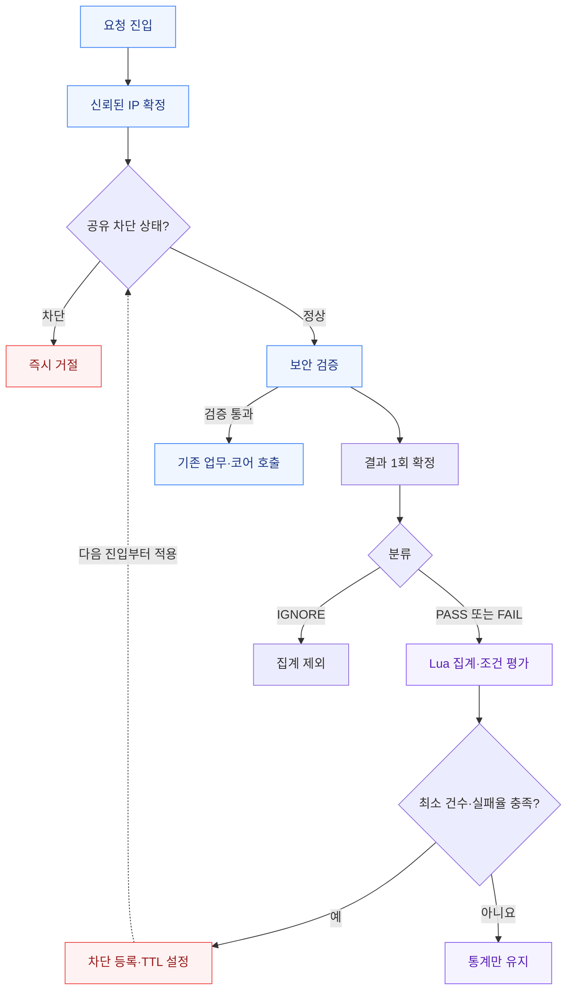

# 실패 기반 IP 자동 차단 설계

> 설계안이며 운영 적용 코드가 아니다. 수치는 초기 예시다. 실제 로그로 보정하고 관찰 모드로 검증한다.

## 1. 목표와 범위

최근 보안 검증 결과를 매번 평가하여 조건을 만족한 IP를 임시 차단한다. 같은 IP의 모든 MID·대상 API 결과를 합산하고 전체 WAS가 차단 상태를 공유한다.

[Rate Limiter](rate-limiter.md)는 요청량을 제한한다. 이 설계는 **실패 집계 + 차단 상태 관리 + 진입 필터**가 핵심이다. Bucket4j의 토큰 소모만으로 실패율·제외 사유·차단 만료 정책이 구현되지는 않는다. 요청량 제한은 별도 방어 계층으로 병행한다.

## 2. 판단 정책

| 항목 | 초기 예시 |
| --- | --- |
| 관찰 구간 | 최근 10초 |
| 최소 판단 건수 | 20건 |
| 실패율 임계치 | 80% 이상 |
| 차단 기간 | 120초 |
| 집계 단위 | 신뢰된 동일 IP의 모든 MID·대상 API 합산 |
| 평가 시점 | 보안 검증 결과가 확정될 때마다 |
| 판단 식 | total >= 20 AND fail × 100 >= total × 80 |

예: 3초 동안 판단 가능한 요청 20건 중 실패 17건이면 85%다. 10초 종료를 기다리지 않고 즉시 차단을 등록한다. 이후 차단 검사를 받는 요청부터 거절하며 이미 검사를 통과한 요청을 취소하지는 않는다.

최소 건수는 1건 중 1건 실패를 공격으로 오인하지 않기 위한 장치다. PASS가 많아 실패율이 희석되는 공격이나 저속 공격은 이 규칙으로 놓칠 수 있다. 절대 실패 건수·더 긴 관찰 구간은 필요 시 별도 정책으로 검토한다.

## 3. 실패 분류 계약

| 결과 | 분류 | 처리 기준 |
| --- | --- | --- |
| 해시·서명 불일치 | FAIL | 정책에 포함 |
| 유효하지 않은 인증정보 | FAIL | 클라이언트 오류와 인증 서버 장애 구분 |
| 존재하지 않는 MID | 정책 확정 전 후보 | 오설정·테스트 호출의 정상 빈도 확인 |
| 반복적인 필수값 누락·잘못된 형식 | 정책 확정 전 후보 | 반복 판정 기준과 적용 API 명시 |
| 보안 검증 통과 | PASS | 이후 업무 실패와 분리 |
| 잔액 부족·한도 초과·사용자 취소 | 추가 FAIL 없음 | 이미 기록한 PASS 유지 |
| 코어 타임아웃·은행 장애·서버 오류 | 추가 FAIL 없음 | 검증이 확정됐으면 기존 결과 유지, 미확정이면 IGNORE |
| 이미 차단하여 거절 | IGNORE | 차단 TTL 연장·재집계 없음 |
| 헬스체크·정적 파일 | 대상 제외 | 판단 표본에 섞지 않음 |

```java
enum AbuseOutcome {
    PASS,   // 보안 검증 통과
    FAIL,   // 정책에서 지정한 보안 검증 실패
    IGNORE  // 판단 불가 또는 집계 대상 제외
}
// total = PASS + FAIL
// failureRate = FAIL / total
```

HTTP 4xx/5xx나 예외 메시지 문자열만으로 판정하지 않는다. 검증 단계가 정형화된 오류 코드로 결과를 남기고 classifier가 정책 버전에 따라 분류한다.

**논리 요청당 보안 결과를 한 번만 확정한다.** 검증 통과 후 코어 호출을 오래 기다리느라 PASS 기록이 늦어지면 빠르게 실패한 표본만 모여 실패율이 왜곡될 수 있다. 따라서 업무 완료 시점보다 보안 검증 확정 시점을 기준으로 집계한다.

## 4. 구성과 요청 흐름

| 구성 | 책임 |
| --- | --- |
| AbuseBlockFilter | 진입 시 차단 확인, 차단이면 Body 파싱·코어 호출 전 거절 |
| TrustedClientIpResolver | 프록시 신뢰 경계에 따라 IP 확정·정규화 |
| AbuseOutcomeClassifier | 검증 결과를 PASS/FAIL/IGNORE로 분류 |
| AbuseDetectionService | 결과 1회 기록, 정책 버전 전달, 장애 시 전환 |
| Redis + Lettuce | 인스턴스 간 통계·차단 상태 공유 |
| Lua | 중복 검사·통계 갱신·판단·차단 등록의 원자적 실행 |
| 로컬 캐시 | 이미 확인한 차단 보관, 장애 중 제한적인 대체 집계 |



공유 저장소와 통신이 정상이고 차단 키를 직접 읽는 모드에서, 차단 등록 완료 이후 실행되는 검사가 해당 상태를 관찰한다. 검사와 실제 업무 실행 사이의 경합까지 없애는 보장은 아니다.

## 5. 멀티 인스턴스 집계

6개 인스턴스에 실패 3건씩 분산되면 로컬 카운터는 각각 3건만 보고 공유 카운터는 18건을 본다. 다만 이 정책에서는 최소 20건 미만이므로 **공유 실패 18건만으로도 아직 차단하지 않는다.** 임계치 의미를 정확히 유지해야 한다.

차단 목록만 공유하고 통계는 로컬로 두면 전체 실패율을 계산할 수 없다. 이 문서는 정상 운영에서 공유 집계, Redis 장애에서 로컬 집계를 선택한다. 로컬 전용 방식보다 네트워크 비용이 늘어난다.

### 키 설계 예시

```text
abuse:{ipKey}:stats:v1
abuse:{ipKey}:block
abuse:{ipKey}:seen:<observationId>
abuse:{ipKey}:epoch
```

ipKey는 정규화한 IP로부터 서버가 생성한다. Redis Cluster에서는 같은 IP의 관련 키를 같은 hash slot에 배치한다. 모든 IP에 동일한 태그를 쓰면 한 shard에 집중된다. TTL과 활성 IP 상한을 두고 통계·중복 방지 키의 메모리를 산정한다.[1]

### 근사 슬라이딩 윈도우

초 단위 슬롯 10개에 epoch-second, PASS, FAIL을 저장하는 고정 크기 ring을 사용할 수 있다. 현재 초와 직전 9초만 합산하면 실제 포함 구간 길이는 약 9~10초이며, 정확한 최근 10초의 가장 오래된 일부를 제외한다. 시간 오차는 1초 미만이지만 버스트가 경계에 몰리면 **건수·실패율 오차는 클 수 있다.**

슬롯 재사용 시 과거 카운터를 초기화한다. 키 TTL만 10초로 갱신하는 방식으로는 오래된 카운터가 제거되지 않는다. 정확성이 더 중요하면 이벤트별 시각을 저장하는 구조와 메모리 비용을 비교한다.

### 원자적 처리 계약

```text
recordAndEvaluate(ipKey, observationId, epoch, outcome, policy):
    검증된 인자와 키 타입 확인
    IGNORE 또는 오래된 epoch이면 종료
    observationId가 이미 기록되었으면 중복 종료
    차단 중이면 집계하지 않고 종료
    observationId를 TTL과 함께 등록
    만료 슬롯 정리 후 현재 슬롯 증가
    total과 fail 합산
    조건 충족:
        관찰 모드 → WOULD_BLOCK 이벤트 생성
        차단 모드 → 차단 키를 NX + TTL로 생성
    통계 TTL 갱신
    판단 결과와 남은 차단 시간을 반환
```

Lua는 다른 요청과의 끼어들기를 막지만, 실행 도중 오류가 나면 앞선 쓰기를 자동 롤백하는 DB 트랜잭션은 아니다. 입력·키 타입을 쓰기 전에 확인하고 스크립트를 짧게 유지한다. Sorted Set을 사용해도 여러 명령의 전체 흐름은 별도로 원자화해야 한다.[2]

Redis 응답 타임아웃은 실행 실패를 뜻하지 않는다. 재전송이 필요하면 서버가 만든 동일 observationId를 재사용한다. 중복 방지 TTL은 허용 재시도 기간을 덮어야 한다. 업무 거래의 멱등성 키와 관측 이벤트 ID는 목적이 다르다.

## 6. 시간·만료·수동 해제

- 시간은 인스턴스별 시계 혼용을 피하고 하나의 기준을 정한다. Redis 시간 사용 가능 여부와 Lua 복제 동작은 실제 배포 버전에서 검증한다.
- 차단은 최초 등록부터 120초다. 차단된 요청마다 TTL을 갱신하지 않는다.
- 차단 기간보다 통계 보존 기간을 짧게 관리해 만료 직후 과거 실패로 바로 재차단되는 일을 막는다.
- 수동 해제는 차단 키뿐 아니라 해당 통계와 로컬 차단 캐시도 다룬다.
- 해제 전 시작된 느린 요청이 나중에 실패를 기록할 수 있다. 필요한 경우 epoch를 증가시켜 이전 세대 결과를 무시한다. 적용 범위·보존 비용을 명시한다.
- Pub/Sub만으로 해제 전파를 보장하지 않는다. 알림 누락 시 TTL까지 남을 수 있으므로 짧은 재검증 또는 버전 확인을 조합한다.

## 7. IP와 MID의 신뢰 경계

직접 연결 주소가 신뢰된 프록시인지 확인한 뒤 프록시가 보장하는 전달 헤더를 해석한다. 외부 사용자가 보낸 X-Forwarded-For 첫 값만 신뢰하지 않는다. 프록시 우회 접근 차단, 헤더 덮어쓰기/추가 규칙, IPv4·IPv6 정규화를 함께 확인한다.

MID를 바꿔도 같은 IP면 합산한다. IP가 다르면 인증으로 입증된 공통 주체가 없는 한 같은 공격자로 합치지 않는다. 실패 요청에 적힌 MID를 기준으로 정상 가맹점을 차단하면 공격자가 타인의 MID로 차단을 유발할 수 있다.

공유 NAT IP에서는 정상 호출자도 영향을 받는다. 관찰 모드, 짧은 초기 차단, 범위가 제한된 예외 정책, 운영자 해제와 감사 이력을 준비한다. 검증된 공통 호출 주체 기준 정책은 별도 축으로 추가한다.

## 8. Redis 장애 정책

| 상태 | 동작 | 보장 한계 |
| --- | --- | --- |
| 정상 | 공유 차단 조회 + 공유 결과 집계 | 저장소 처리·통신 지연 존재 |
| 장애 | 기존 로컬 차단은 원래 만료까지 유지 | 각 인스턴스가 이미 아는 차단만 유지 |
| 장애 중 신규 요청 | 로컬 실패 집계와 임시 차단 | 전체 합산·전체 동시 차단 불가 |
| 복구 | 제한적인 probe 후 공유 모드 복귀 | 장애 중 통계를 무작정 재전송하지 않음 |

짧은 타임아웃, Circuit Breaker, 연결·대기열 상한을 적용한다. 재접속 중 명령이 무한히 쌓이지 않게 하고, Redis 실패가 정상 결제 응답을 예외로 덮어쓰지 않게 한다.

차단 전파가 중요하면 정상 모드에서 '미차단' 결과를 캐시하지 않는다. 미차단 캐시를 쓴다면 TTL만큼 신규 차단을 놓칠 수 있음을 운영 계약에 포함한다. 이미 차단된 결과의 로컬 캐시는 Redis 부하를 줄이지만 수동 해제 지연을 만든다.

정상 대상 요청당 차단 조회 1회와 결과 갱신 1회면 대략 2R회의 저장소 작업이 발생한다. 예를 들어 R=5,000이면 약 10,000회/초다. 가정치이며 실측 성능이 아니다. shard별 hot IP와 메모리, p99 지연을 부하 시험한다.

## 9. 검증·운영 기준

| 시나리오 | 기대 결과 |
| --- | --- |
| 1건 FAIL | 최소 건수 미달, 미차단 |
| 20건 중 16건 FAIL | 80% 도달, 차단 |
| 20건 중 15건 FAIL | 미차단 |
| 3초 내 20건 중 17건 FAIL | 10초를 기다리지 않고 차단 |
| 6개 WAS에 표본 분산 | 전체 표본 기준 판단 |
| 차단 후 반복 요청 | 통계·TTL 불변 |
| 중복 결과 보고 | 한 번만 집계 |
| PASS 후 잔액 부족 | PASS 한 건 유지 |
| 검증 전 시스템 오류 | IGNORE |
| 윈도우 경계·시계 역행 | 정의한 시간 정책과 오차 범위 확인 |
| Redis 타임아웃·failover | 중복 집계·예외 전파·대기열 폭증 점검 |
| 수동 해제와 늦은 결과 경합 | 이전 결과로 즉시 재차단되지 않게 확인 |

관찰 → 제한된 API/대상 적용 → 전체 확대 순서로 진행한다. 정책 버전, 총 판단·실패 건수, 판정 사유, 신규 차단, 해제, fallback 진입을 남긴다. IP·MID·원문 URL을 메트릭 라벨로 사용하지 말고 접근 통제된 로그로 분리한다.

## 참고

- 정책 수치·분류·fallback 방향: 본 문서에 제공된 요구사항. 운영 사실을 의미하지 않는다.
- [1. Redis Cluster 명세](https://redis.io/docs/latest/operate/oss_and_stack/reference/cluster-spec/)
- [2. Redis Lua 실행](https://redis.io/docs/latest/develop/programmability/eval-intro/)
- [Bucket4j 공식 문서: 토큰 버킷·분산 기능](https://bucket4j.com/8.10.1/toc.html)
- [Rate Limiter 설계](rate-limiter.md)
