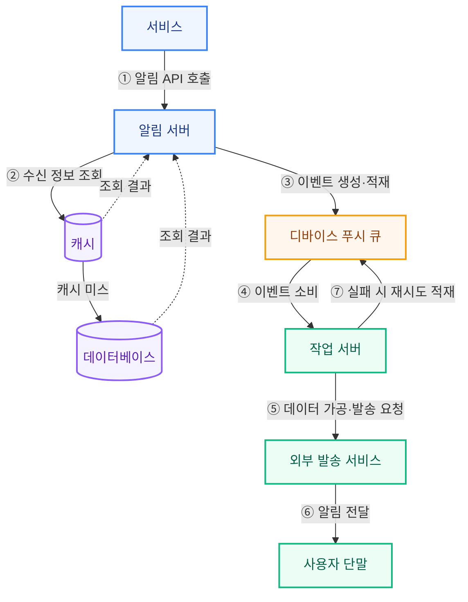
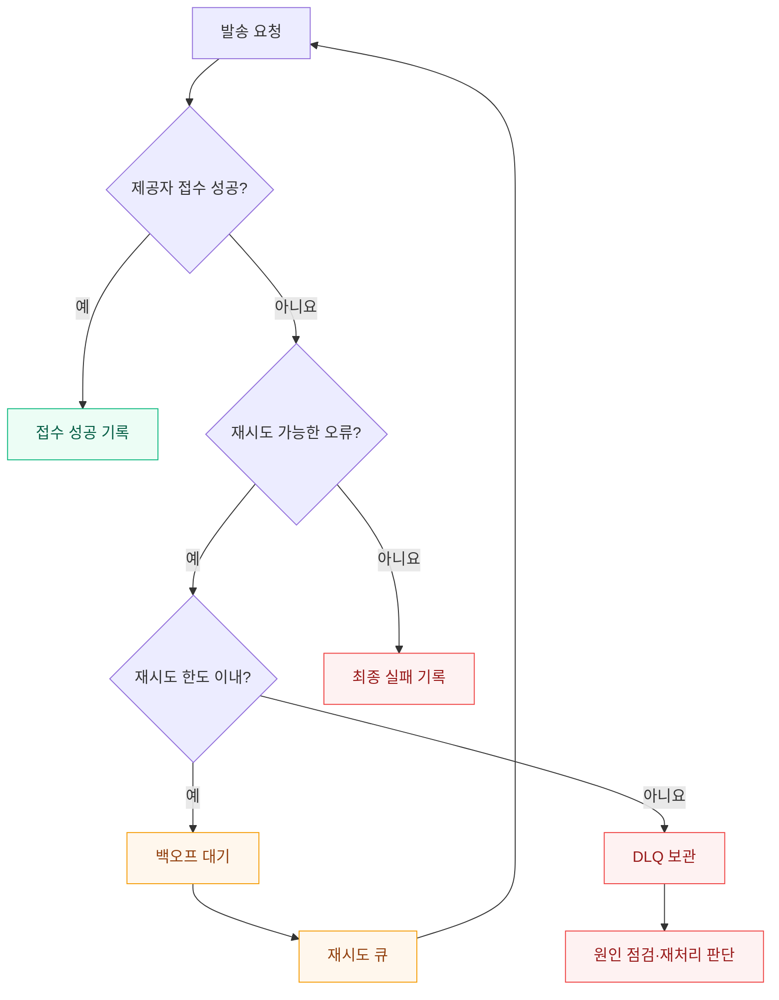

# 알림 시스템 설계

## 개요

푸시·SMS·이메일을 비동기로 발송한다. 알림 API와 발송 작업을 큐로 분리하고, 채널별 작업 서버를 확장한다.

## 기본 처리 흐름

아래는 제공된 이미지의 처리 흐름을 Mermaid로 재구성한 것이다. 캐시 미스 시 DB를 조회하는 방식으로 가정했다.

외부 발송 서비스 예: APNs, FCM, SMS 게이트웨이. 이메일은 이메일 발송 서비스와 연동한다.

## 블로그 핵심 정리

| 설계 항목 | 핵심 |
| --- | --- |
| 요구사항 | 높은 부하에서 약간의 지연을 허용하고, 수신 거부 설정을 지원한다. |
| 수신 정보 | 단말 토큰·전화번호·이메일을 관리하고 사용자별 여러 단말을 지원한다. |
| 장애 격리 | 채널별 큐와 작업 서버로 장애 영향을 줄인다. |
| 신뢰성 | 발송 이력과 상태를 저장하고 이벤트 ID로 중복 처리를 제어한다. |
| 재시도 | 백오프를 적용하고 한도 초과 건은 DLQ로 보낸다. |
| 발송 정책 | 템플릿, 인증, 사용자·채널별 전송률 제한을 적용한다. |
| 모니터링 | 큐 적체, 처리 시간, 실패율, 재시도 횟수, 제공자 응답 코드를 관찰한다. |

## 재시도 흐름

아래는 기본 흐름에 실패 분류와 재시도 한도를 추가한 설계 예시다.

## 구현 시 구분할 점

- **접수와 전달:** 제공자의 성공 응답만으로 단말 수신을 확정하지 않는다.
- **유실 방지:** 큐 도입만으로 보장되지 않는다. 영속화·ACK·DB와 큐 간 기록 일관성을 함께 설계한다.
- **중복 방지:** ID 조회 후 발송하는 방식에는 경쟁 조건이 있다. 원자적 처리권 획득이 필요하며, 외부 발송 성공 직후 장애가 나면 결과가 불확실할 수 있다.
- **오류 분류:** 일시 장애와 영구 오류를 구분한다. 재시도 가능 여부는 제공자 응답 규격으로 판단한다.

## 참고 자료

- [꽥블로그 — 대규모 시스템 설계 기초 10장: 알림 시스템 설계](https://thewayitwas.tistory.com/651)
- 블로그의 핵심을 요약하고 제공된 프로세스 이미지를 도식화했다. 재시도 상세 흐름과 구현 시 구분할 점은 보충 설명이다.
