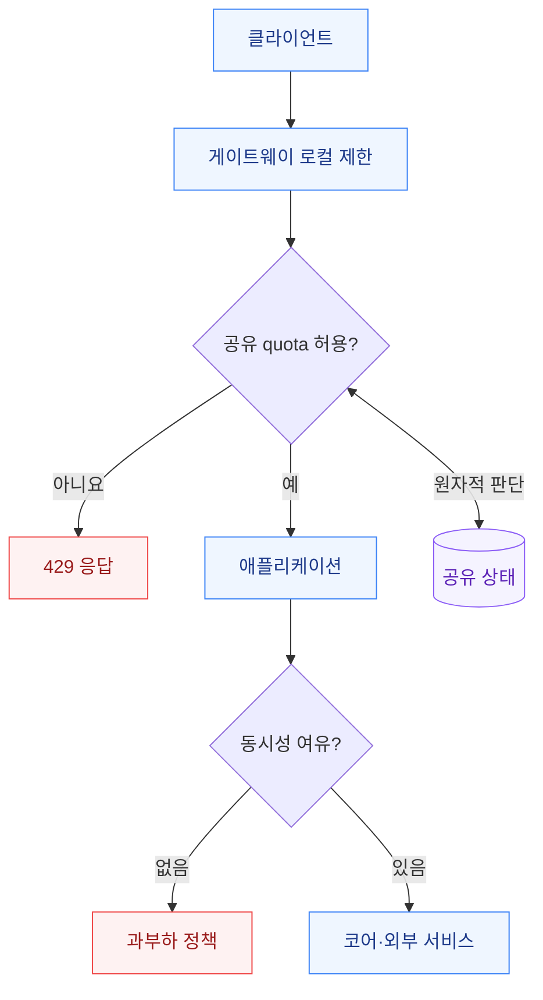

# Rate Limiter 설계: 알고리즘에서 분산 운영까지

> 『가상 면접 사례로 배우는 대규모 시스템 설계 기초』 4장 학습을 위한 실무 해설.
> 책 전문을 재현한 문서가 아니다. 블로그를 비교해 읽기 자료를 선정했고, 기술 설명은 공식 문서로 교차 확인했다. 수치·시나리오는 설명용 예시이며 벤치마크가 아니다.

## 1. 어떤 블로그부터 읽을까?

검토한 3개 글 중 **민석강의 4장 정리**를 첫 읽기 자료로 선정했다. 절대적인 순위가 아니라, 요구사항 → 배치 위치 → 알고리즘 → 분산 처리 → 운영이라는 범위를 기준으로 한 선택이다.

| 자료 | 확인한 특징 | 읽는 목적 |
| --- | --- | --- |
| [민석강 — 처리율 제한 장치의 설계](https://kkminseok.github.io/posts/2022-12-12-InterviewBook04/) | 5개 알고리즘과 상세 설계·경쟁 조건·모니터링을 함께 다룸 | 전체 흐름 파악 |
| [대우니 — 처리율 제한 장치의 설계](https://daewoony.tistory.com/112) | 거절 요청을 이동 윈도 로그에 넣는 정책에 의문을 제기 | 집계 의미 검토 |
| [폭간 — 4장 처리율 제한 장치 설계](https://sejoung.github.io/2023/01/2023-01-26-system_design_interview_4/) | 알고리즘의 인자·장단점을 간결하게 정리 | 빠른 복습 |

블로그의 구현 설명을 그대로 운영 계약으로 삼지 않는다. 특히 Sorted Set 자체가 여러 명령을 원자화하지 않으며, 모든 분산 제한에 최종 일관성이 적합한 것도 아니다. 이하 내용은 공식 자료 [1]~[6]과 이를 바탕으로 한 설계 판단이다.

## 2. 알고리즘보다 먼저 정할 계약

Rate Limiter는 일정 시간 동안 허용할 요청량 또는 비용을 제어한다. 다음 질문의 답이 없으면 '초당 100건'도 불완전한 정책이다.

| 질문 | 설계에 미치는 영향 |
| --- | --- |
| 누구를 제한하는가? | IP, 인증된 사용자, API 키, 테넌트, 전체 서비스 |
| 무엇을 세는가? | 진입 시도, 허용 요청, 성공 요청, 가중 비용 |
| 어느 범위인가? | 프로세스, 클러스터, 리전, 전 세계 |
| 버스트를 허용하는가? | 평균 처리율과 순간 허용량을 분리 |
| 오차를 허용하는가? | 정확한 이동 윈도 vs 근사·quota 분배 |
| 초과 시 어떻게 하는가? | 거절, 짧은 대기, 비동기 큐 |
| 저장소 장애 때는? | 통과, 거절, 로컬 축소 모드 |
| 보호하려는 자원은? | CPU, 동시 연결, 코어 처리량, 외부 API 비용 |

Rate Limiter는 [실패 기반 자동 차단](failure-based-auto-blocking.md)과 목적이 다르다. 정상 요청도 한도를 넘으면 제한할 수 있다. Circuit Breaker는 의존 서비스의 장애를 감지하고 호출을 줄이는 장치이고, 동시성 제한은 실행 중 작업 수를 제한한다.

설계 예: 100 RPS가 허용돼도 평균 처리 시간이 0.1초에서 3초로 늘면, 안정 상태에서 평균 실행 중 요청은 약 10개에서 300개가 된다. 처리율 제한만으로 스레드·커넥션 고갈을 막는다고 가정하지 않는다. 타임아웃과 동시성 상한을 함께 정한다.

## 3. 대표 알고리즘 비교

공식 Redis 비교 자료 [1]의 메커니즘을 기준으로 정리했다. 메모리는 제한 키 하나 기준이며 N은 윈도 내 저장 이벤트 수다.

| 알고리즘 | 동작 | 상태 비용 | 중요한 제약 | 어울리는 요구 |
| --- | --- | --- | --- | --- |
| Token Bucket | 시간에 따라 토큰 충전, 요청 비용만큼 차감 | O(1) | 버스트 B를 허용하므로 엄격한 모든 1초 상한과 다름 | 버스트 허용 API |
| Leaky Bucket | 큐형 구현은 일정 속도로 배출 | O(큐 용량) | 대기 지연·취소·큐 상한 필요 | 일정 출력의 비동기 작업 |
| Fixed Window | 정렬된 시간 구간별 카운터 | O(1) | 구간 경계에 요청 집중 | 단순 구간 quota |
| Sliding Window Log | 이벤트 시각 저장, 만료 제거 후 판단 | O(N) | 메모리·만료 정리 비용 | 정확한 최근 W초 상한 |
| Sliding Window Counter | 이전·현재 구간의 가중 합 | O(1) | 시간 분포를 추정하므로 오차 존재 | 근사 허용 고빈도 API |

누출 버킷은 큐형 traffic shaping과 누적량으로 즉시 거절하는 policing 구현을 구분한다. 명칭만 같다고 대기열이 존재한다고 가정하지 않는다.

### Token Bucket의 수치 해석

연속 충전 모델에서 용량 B, 초당 충전 r, 요청 비용 c라면:

```text
elapsed = max(0, now - lastRefill)
available = min(B, oldTokens + r × elapsed)
allowed = available >= c
newTokens = allowed ? available - c : available
```

B=40, r=20이면 가득 찬 상태에서 순간 40건을 허용한다. 길이 Δt 구간의 허용량은 대략 B+rΔt의 상한을 갖는다. '모든 최근 1초에서 최대 20건'과는 다른 계약이다.

정수 시간·토큰 단위와 반올림을 정의하고 비용 c가 B보다 큰 요청은 별도 처리한다. 키가 너무 일찍 만료돼 가득 찬 버킷으로 복원되면 한도가 새로 생긴다. 유휴 TTL은 정상적으로 가득 충전될 시간을 고려한다. 주기적 일괄 충전과 연속 충전은 경계 동작이 다르다.[2]

### 윈도우 경계 예시

고정 60초 구간당 100건이면 12:00:59.9에 100건, 12:01:00.1에 100건이 허용될 수 있다. 고정 구간 계약은 지켰지만 약 0.2초에 200건이 통과한다.

가중 카운터는 이전 구간 80건, 현재 20건, 현재 구간 25% 경과일 때 다음처럼 추정한다.

```text
estimate = current + previous × (1 - elapsed / window)
         = 20 + 80 × 0.75
         = 80
```

이전 구간 요청이 균등하다는 근사다. 실제 요청이 구간 끝에 몰렸다면 과소 추정할 수 있다. 신규 비용까지 포함하여 estimate+cost가 한도 이내인지 판단한다.[1]

### 허용 건수와 시도 건수

이 문서의 일반 API 제한 기본안은 **허용 요청만 quota에 반영**한다. 이동 윈도 로그라면 만료 제거 → 개수 확인 → 여유가 있을 때만 삽입한다. 거절 시도까지 저장하는 정책은 지속 공격 시 거절이 길어지고 상태가 커질 수 있다.

시도 자체가 보안 신호라면 별도 시도 카운터로 기록한다. 보안 차단 통계와 자원 할당 quota를 같은 키로 섞지 않는다. 동일 밀리초의 여러 요청이 덮어써지지 않도록 로그 member에는 서버 생성 고유 ID를 쓴다.

## 4. 어디에 배치할 것인가?



게이트웨이는 인증 전 트래픽과 거친 IP 제한을 처리하고, 애플리케이션은 인증된 주체·업무 비용 기준 판단을 맡을 수 있다. Envoy 공식 문서도 로컬 제한과 글로벌 제한을 함께 적용해 공유 제한 서비스의 부하를 줄이는 구성을 설명한다.[3]

같은 정책을 두 계층에서 이중 차감하지 않도록 소유자를 정한다. raw URL 대신 정규화한 route ID를 사용하고, 호출자가 만든 임의 식별자로 무한한 키를 생성하지 못하게 한다. 프록시 뒤 IP 신뢰는 자동 차단 문서의 규칙을 따른다.

## 5. Redis를 써도 원자성이 자동으로 생기지는 않는다

```text
잘못된 구현:
  A와 B가 count=99를 각각 조회
  둘 다 limit=100 미만이라고 판단
  둘 다 통과 → 한도 초과

필요한 계약:
  상태 조회 + 시간 반영 + 허용 판단 + 조건부 갱신 + TTL
  전체를 하나의 원자적 작업으로 실행
```

INCR 한 번의 원자성과 복합 판단의 원자성은 다르다. Lua로 묶을 수 있지만 실행 중 해당 서버의 다른 작업을 막으므로 무제한 순회·대량 삭제를 피한다. 스크립트 내부 오류에 대한 롤백도 기대하지 않는다. failover 뒤 NOSCRIPT에 대응하는 재로딩 경로가 필요하다.[4]

Lettuce는 연결과 명령 실행을 담당한다. 클라이언트 라이브러리가 실패 분류·quota 정책을 결정하지는 않는다. 연결 수명, 타임아웃, 재접속 대기열 상한은 별도 설계 대상이다.[2]

## 6. 분산 환경의 보장 범위

### 로컬 100은 글로벌 100이 아니다

6개 인스턴스가 각각 100 RPS를 허용하면 분산된 트래픽은 합계 600 RPS까지 허용될 수 있다. sticky routing도 재배치·장애·증설 시 상태 이동 문제를 만든다.

| 방식 | 이점 | 비용·한계 |
| --- | --- | --- |
| 요청별 공유 판단 | 정상 상태에서 같은 키의 판단 직렬화 | 매 요청 네트워크 비용, hot key |
| 로컬 제한 | 지연·의존성 감소 | 인스턴스 수와 분산에 따라 총량 변화 |
| 로컬 quota 임대 | 공유 저장소 호출 감소 | 미사용 quota, 회수·갱신·중복 할당 문제 |
| 리전별 예산 분배 | 리전 간 동기 호출 감소 | 리전별 불균형, 재분배 필요 |

예산 임대에서 100개를 미리 예약했다면 남은 토큰을 다른 노드가 사용할 수 없을 수 있다. 반대로 각 노드에 전체 quota를 복제하면 전역 상한이 깨진다. 성능 최적화에는 명시적인 오차·재할당 정책이 따라야 한다. 이것은 본 문서의 설계 분석이다.

### Cluster·failover·다중 규칙

같은 주체의 상태 키는 hash tag로 같은 slot에 둘 수 있다. 다른 사용자 키와 전역 키를 한 Lua에서 갱신하려 하면 slot 제약이 생긴다. 전부 같은 slot에 몰아넣는 방식은 확장성을 잃는다.[5]

사용자 quota는 차감됐지만 전역 quota가 거절한 경우, 그 소비를 유지할지 보상할지 명시한다. 단순 순차 적용은 '모든 조건 성공 시에만 차감'과 다르다.

Redis Cluster의 비동기 복제에서는 failover 때 이미 확인된 쓰기가 유실될 여지가 있다. Lua의 원자 실행이 장애를 가로지르는 영구적인 정확한 quota를 의미하지 않는다.[5] 계약상 절대 초과가 불가한 quota는 예약·내구성·장애 중 거절 범위를 포함해 별도 검토한다.

## 7. 실패 시 동작과 HTTP 계약

| 상황 | 설계 선택 |
| --- | --- |
| quota 초과 | 429와 안정적인 오류 코드 |
| 제한기 저장소 장애 | 정책별 fail-open, fail-closed 또는 로컬 제한 |
| 업무 서비스 자체 과부하 | 제한기 위반과 구분된 과부하 응답 |
| 클라이언트 재시도 | 대기 지침 + jitter + 최대 횟수 |
| 결제 결과 불명 | 재승인 전에 멱등성·거래 상태 확인 |

RFC 6585에서 429는 일정 기간의 요청 과다를 나타내며 Retry-After를 포함할 수 있다. 표준 헤더를 임의의 X-RateLimit-Retry-After와 혼동하지 않는다.[6]

```http
HTTP/1.1 429 Too Many Requests
Content-Type: application/json
Retry-After: 2
Cache-Control: no-store

{"code":"RATE_LIMITED","message":"잠시 후 다시 요청해 주세요."}
```

위 2초는 예시다. 실제로는 토큰 부족량 또는 윈도 만료로 산정하고 정수 초로 올림한다. 재시도 가능 시각은 그때 다른 요청이 quota를 쓰지 않는다는 예약 보장이 아니다.

Redis 호출이 타임아웃됐어도 토큰 차감은 이미 일어났을 수 있다. 자동 재시도하면 이중 차감할 수 있으므로 결정 ID와 중복 방지 저장 기간을 설계하거나, 중복 차감 허용 범위를 명시한다. 요청 허용 결과의 재사용이 업무를 두 번 실행하도록 만들지 않게 업무 멱등성은 별도로 유지한다.

## 8. Bucket4j 선택 기준

Bucket4j는 토큰 버킷 라이브러리이며 분산 연동 기능을 제공한다. 로컬 Bucket 객체를 만들었다고 여러 JVM이 상태를 공유하지는 않는다. 여러 bandwidth를 사용하면 짧은 버스트와 긴 기간의 제한을 함께 표현할 수 있다.[7]

- **요청량·비용 제한:** Bucket4j의 충전 방식과 저장소 연동을 요구사항에 맞춰 검토한다.
- **실패율 기반 차단:** PASS/FAIL 집계, 최소 표본, 차단 만료와 해제가 별도 모델이므로 custom 정책 서비스가 중심이다.
- **게이트웨이가 이미 담당:** 동일 기능을 WAS에 중복 구현할 이유부터 검토한다.

참고한 Bucket4j 문서는 8.10.1이다. 최신 버전 추천을 의미하지 않으며 JDK·Spring·Redis·클라이언트의 실제 조합을 확인한 뒤 의존성을 고정한다.

## 9. 운영 적용 판단

아래는 자료를 바탕으로 제안하는 검증 항목이다.

1. 관찰 모드에서 정책별 would-reject와 실제 부하 감소 가능성을 측정한다.
2. 평균 RPS뿐 아니라 100ms 버스트, p95/p99 지연, 동시 처리 수를 측정한다.
3. 제한 키 수, hot key, Redis 메모리·eviction·스크립트 지연을 감시한다. 키 유실은 quota 재충전을 유발할 수 있다.
4. 정책 버전을 기록하고 롤링 배포 중 서로 다른 제한값이 같은 상태를 수정하지 않도록 한다.
5. 재시작 시 버킷이 가득 차는 효과, replica 승격, 네트워크 단절, 시계 역행을 시험한다.
6. 100건 quota에 동시 1,000건을 넣는 시험은 '어떤 윈도·충전·초기 상태인지'를 고정하고 검증한다.
7. 경계 시간과 거절 재집계 여부, 가중 비용, 비정상 식별자의 메모리 증가를 검증한다.
8. 규칙·거절 사유·저장소 장애를 메트릭으로 구분한다. 사용자 ID·IP는 메트릭 라벨로 무제한 확장하지 않는다.

처리율 제한의 완료 기준은 라이브러리 도입이 아니라 **누구의 어떤 비용을 어느 범위에서 얼마까지 허용하며, 장애 때 그 보장이 어떻게 달라지는지 설명하고 검증할 수 있는 상태**다.

## 공식 근거와 추가 읽기

- [1. Redis — 5가지 제한 알고리즘 비교](https://redis.io/tutorials/howtos/ratelimiting/)
- [2. Redis — Java/Lettuce 토큰 버킷](https://redis.io/docs/latest/develop/use-cases/rate-limiter/java-lettuce/)
- [3. Envoy — Global rate limiting](https://www.envoyproxy.io/docs/envoy/latest/intro/arch_overview/other_features/global_rate_limiting.html)
- [4. Redis — Scripting with Lua](https://redis.io/docs/latest/develop/programmability/eval-intro/)
- [5. Redis — Cluster specification](https://redis.io/docs/latest/operate/oss_and_stack/reference/cluster-spec/)
- [6. RFC 6585 §4 — 429 Too Many Requests](https://www.rfc-editor.org/rfc/rfc6585.html#section-4)
- [7. Bucket4j 8.10.1 Reference](https://bucket4j.com/8.10.1/toc.html)

블로그는 책 학습 자료 비교용으로, 공식 문서는 기술 검증용으로 사용했다. 운영 선택·수치 예시·검증 목록은 본 문서의 추가 분석이며 책이나 특정 블로그의 주장을 그대로 옮긴 것이 아니다.
