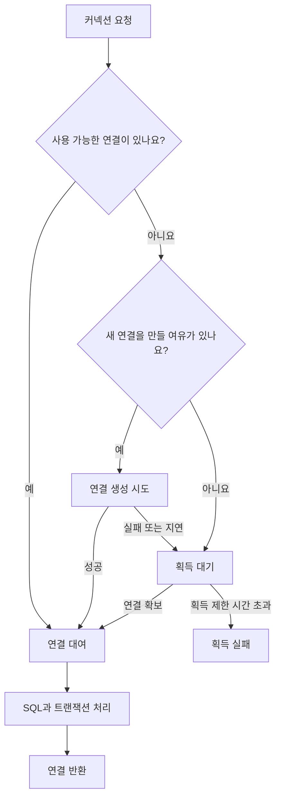
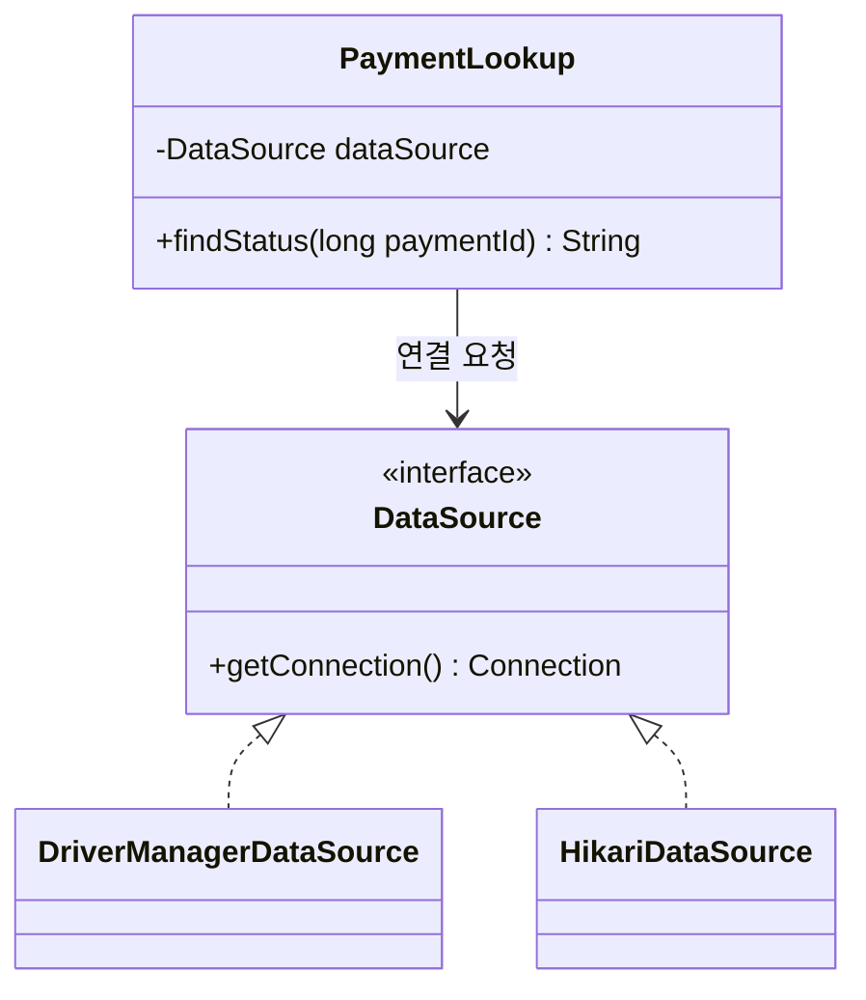
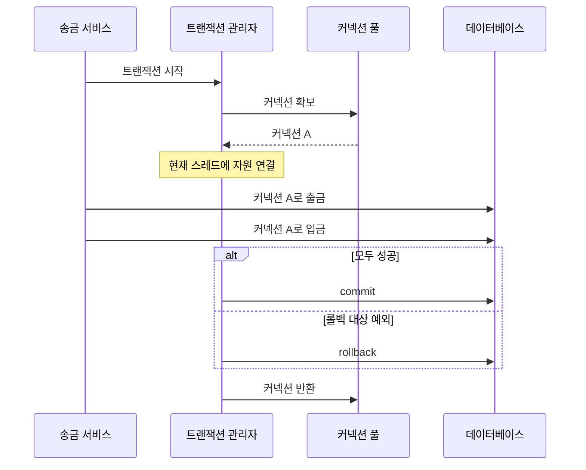

# 커넥션 풀과 DataSource 이해: DB 연결을 빌려 쓴다는 것

결제 내역을 조회하는 SQL은 짧아요. 그런데 데이터베이스를 사용하려면 SQL을 보내기 전에 연결부터 준비해야 해요.

그 연결을 요청마다 새로 만든다면 어떨까요? 쿼리를 실행할 때마다 통신 경로를 열고, 인증하고, 데이터베이스가 연결을 처리할 준비를 기다려야 해요.

커넥션 풀은 이 반복을 줄이는 방법이에요. 이미 만든 연결을 보관해두고 필요한 순간에 빌려줘요. DataSource는 애플리케이션이 그 연결을 얻는 공통 창구예요.

두 개념을 함께 배우면 “풀을 쓴다”는 설정을 넘어, 커넥션이 어디서 생기고 언제 돌아가는지 이해할 수 있어요.

이 글은 김영한 스프링 DB 1편을 정리한 공개 블로그들을 학습 출발점으로 삼고, Java와 Spring, HikariCP 공식 문서로 동작을 확인해 작성했어요. 설명과 결제 예제, 다이어그램은 새로 구성했어요.

## 목차

1. [커넥션을 만드는 데도 일이 필요해요](#1-커넥션을-만드는-데도-일이-필요해요)
2. [만들어둔 연결을 빌려 쓰면 어떨까요](#2-만들어둔-연결을-빌려-쓰면-어떨까요)
3. [close는 왜 연결을 끊지 않을까요](#3-close는-왜-연결을-끊지-않을까요)
4. [DataSource는 커넥션 풀이 아니에요](#4-datasource는-커넥션-풀이-아니에요)
5. [결제 조회 코드는 그대로 두고 연결 방식만 바꿔요](#5-결제-조회-코드는-그대로-두고-연결-방식만-바꿔요)
6. [작은 풀로 대기와 반환을 관찰해요](#6-작은-풀로-대기와-반환을-관찰해요)
7. [Spring Boot에서는 누가 풀을 만들까요](#7-spring-boot에서는-누가-풀을-만들까요)
8. [트랜잭션은 같은 커넥션에서 이어져야 해요](#8-트랜잭션은-같은-커넥션에서-이어져야-해요)
9. [풀 크기는 크게 잡을수록 좋을까요](#9-풀-크기는-크게-잡을수록-좋을까요)
10. [운영에서 풀을 읽는 방법](#10-운영에서-풀을-읽는-방법)
11. [헷갈리는 질문을 정리해요](#11-헷갈리는-질문을-정리해요)

## 1. 커넥션을 만드는 데도 일이 필요해요

JDBC는 Java에서 데이터베이스를 다루는 표준 API예요. 애플리케이션이 Connection과 PreparedStatement 같은 인터페이스를 사용하면, DB 드라이버가 실제 데이터베이스와 통신해요.

가장 단순한 연결 코드는 다음과 같아요.

```java
try (Connection connection =
         DriverManager.getConnection(url, username, password)) {
    // SQL을 실행해요.
}
```

실제 사용에는 java.sql.Connection과 java.sql.DriverManager import가 필요해요.

원격 데이터베이스를 사용하는 일반적인 환경에서 새 물리 커넥션을 만드는 일에는 네트워크 연결, 필요한 경우 TLS 협상, DB 인증과 세션 준비 등이 포함돼요. 세부 절차는 DB와 드라이버, 접속 방식에 따라 달라져요. 임베디드 DB라면 네트워크 연결 단계가 없을 수도 있어요.

그래서 DB 작업 시간을 볼 때는 단순히 SQL 실행 시간만 보면 안 돼요.

| 단계 | 필요한 시간의 예 |
|---|---|
| 커넥션 획득 | 새 연결 생성 또는 풀 대기 |
| SQL 수행 | 실행 계획, I/O, 락 대기 |
| 결과 처리 | 네트워크 전송, 행 읽기, 객체 변환 |
| 트랜잭션 종료 | commit 또는 rollback |
| 자원 정리 | Statement, ResultSet, Connection 반환 |

풀을 사용하면 주로 새 물리 연결을 반복 생성하는 비용을 줄일 수 있어요. 느린 SQL이나 락 대기까지 사라지는 것은 아니에요.

### Connection 객체와 DB 세션은 같을까요?

Connection은 Java 코드가 DB 연결을 사용하는 손잡이에 가까워요. DB 세션은 데이터베이스가 연결과 관련해 관리하는 실행 상태예요. 트랜잭션, 세션 설정 등이 이 맥락에서 처리돼요.

풀을 사용하면 애플리케이션에 전달되는 Connection은 실제 드라이버 연결을 감싼 프록시일 수 있어요. Java 객체 한 개를 봤다고 새 TCP 연결이나 새 DB 세션이 반드시 만들어졌다고 판단할 수는 없어요.

## 2. 만들어둔 연결을 빌려 쓰면 어떨까요

커넥션 풀은 사용할 수 있는 연결을 관리하고, 요청이 들어오면 대여해요. 사용이 끝난 연결은 반환받아 다시 사용할 수 있게 해요.

애플리케이션이 시작할 때 필요한 연결을 채워두거나, 요청과 설정에 따라 추가로 만들 수 있어요. “시작과 동시에 최대 개수의 연결을 전부 만들어 놓는다”는 것은 모든 풀에 공통인 규칙이 아니에요.



위 그림은 개념 흐름이에요. 생성 작업의 스레드 구성이나 대기 순서는 구현체마다 다를 수 있어요.

풀의 연결이 세 개이고 세 요청이 모두 빌려갔다면, 네 번째 요청은 당장 연결을 받을 수 없어요. 최대 크기에 도달했다면 연결이 돌아오기를 기다려야 해요.

여기서 풀은 재사용 장치이면서 **DB로 동시에 들어가는 연결 수를 제한하는 장치**이기도 해요. 다만 한 풀의 제한일 뿐이에요. 다른 서버의 풀과 관리 도구의 연결까지 모두 제한해주지는 않아요.

## 3. close는 왜 연결을 끊지 않을까요

같은 close() 호출인데 풀 사용 여부에 따라 결과가 달라요.

| 대상으로 받은 Connection | close()의 일반적인 의미 |
|---|---|
| 풀을 거치지 않은 드라이버 연결 | 실제 연결 자원 해제 |
| 풀에서 빌린 프록시 연결 | 사용 종료를 알리고 풀로 반환 |
| 이미 장애가 난 풀 연결 | 재사용하지 않고 제거될 수 있음 |

풀은 애플리케이션이 close()를 호출하는 지점을 알아야 다음 요청에 연결을 줄 수 있어요. 따라서 “풀을 쓰니까 close를 하지 않아도 된다”는 생각은 반대예요.

**풀을 쓰기 때문에 더 확실하게 반환해야 해요.**

```java
try (Connection connection = dataSource.getConnection();
     PreparedStatement statement =
         connection.prepareStatement("select status from payments where id = ?")) {
    statement.setLong(1, paymentId);
    try (ResultSet result = statement.executeQuery()) {
        // 조회 결과를 사용해요.
    }
}
```

위 코드는 독립적인 JDBC 작업의 자원 정리 예시예요. Spring이 관리하는 트랜잭션에 참여하는 코드는 뒤에서 별도로 다뤄요.

try-with-resources는 성공하거나 예외가 발생해도 자원을 닫아요. 선언한 자원의 역순으로 정리하므로 ResultSet, Statement, Connection의 수명을 좁게 유지할 수 있어요.

### 반환한 연결을 계속 쓰면 안 돼요

close() 이후의 손잡이는 사용이 끝났어요. 실제 물리 연결이 살아 있어도, 그 연결은 다른 요청에 대여될 수 있어요.

Connection을 싱글턴 서비스의 필드에 저장해 요청들이 공유하는 것도 피해야 해요. 풀 자체를 공유하는 것과, 빌린 연결 하나를 여러 요청이 공유하는 것은 달라요.

한 요청이 commit하는 동안 다른 요청이 같은 연결에서 작업하면 트랜잭션 경계가 무너질 수 있어요. 커넥션은 필요한 작업 범위 안에서 빌리고 돌려주는 자원으로 다루는 편이 안전해요.

### 풀 자체를 닫는 것과도 달라요

connection.close()는 빌린 연결의 사용을 끝내는 동작이에요. HikariDataSource.close()는 풀 자체를 종료하는 동작이에요.

요청마다 HikariDataSource를 생성하고 닫으면 재사용의 이점이 사라져요. 풀은 일반적으로 애플리케이션 수명에 맞춰 관리하고, 개별 연결은 작업 수명에 맞춰 관리해요.

## 4. DataSource는 커넥션 풀이 아니에요

DataSource는 **커넥션을 제공하는 Java 표준 인터페이스**예요. 커넥션을 새로 만들지, 풀에서 빌려줄지는 구현체가 결정해요.

```java
DataSource dataSource = /* 설정에서 주입 */;
Connection connection = dataSource.getConnection();
```

애플리케이션은 “커넥션이 필요하다”고 요청해요. 커넥션을 준비하는 방법은 DataSource 뒤에 숨겨져 있어요.

| 구성 요소 | 역할 |
|---|---|
| DriverManager | JDBC 드라이버를 통해 연결을 얻는 정적 API |
| DataSource | 연결 제공 방법을 추상화한 인터페이스 |
| DriverManagerDataSource | 호출할 때마다 새 연결을 만드는 Spring 구현체 |
| HikariDataSource | HikariCP 풀을 통해 연결을 제공하는 구현체 |
| Connection | 빌리거나 생성한 연결을 사용하는 JDBC API |

DriverManager 자체가 DataSource를 구현하는 것은 아니에요. Spring의 DriverManagerDataSource가 내부에서 DriverManager를 사용하는 방식으로 인터페이스를 맞춰줘요.

그리고 Spring Boot 3에서 Jakarta로 전환했더라도 DataSource의 import는 **javax.sql.DataSource**예요. JDBC는 Java SE API이므로 jakarta.sql.DataSource로 바꾸지 않아요. Connection도 java.sql.Connection을 사용해요.



이 구조가 인터페이스와 다형성을 실제 업무 코드에 적용한 예예요. 조회 코드는 “연결을 제공한다”는 역할에 의존하고, 설정에서 구현체를 선택해요.

## 5. 결제 조회 코드는 그대로 두고 연결 방식만 바꿔요

예제는 Java 21, Spring Boot 3 계열과 Spring JDBC, HikariCP를 사용하는 환경을 가정해요. DB 드라이버도 필요해요. 아래 코드는 학습용 조각이며 이 문서 작성 과정에서 컴파일이나 통합 실행을 수행하지 않았어요.

먼저 결제 상태를 조회하는 클래스를 만들어볼게요. 테이블과 컬럼은 가상의 예시예요.

```java
package example.payment;

import java.sql.Connection;
import java.sql.PreparedStatement;
import java.sql.ResultSet;
import java.sql.SQLException;
import javax.sql.DataSource;

public final class PaymentLookup {
    private final DataSource dataSource;

    public PaymentLookup(DataSource dataSource) {
        this.dataSource = dataSource;
    }

    // Spring 트랜잭션 바깥의 독립적인 조회 예제예요.
    public String findStatus(long paymentId) throws SQLException {
        String sql = "select status from payments where id = ?";

        try (Connection connection = dataSource.getConnection();
             PreparedStatement statement = connection.prepareStatement(sql)) {

            statement.setLong(1, paymentId);

            try (ResultSet result = statement.executeQuery()) {
                if (!result.next()) {
                    throw new IllegalArgumentException("결제 내역이 없어요.");
                }
                return result.getString("status");
            }
        }
    }
}
```

이 클래스에는 HikariCP 설정이나 DB 비밀번호가 없어요. 연결 제공 책임을 생성자로 전달받았기 때문이에요. 실제 서비스에서는 결제 ID 외에 인증된 사용자와 조회 권한도 검증해야 해요.

### 새 연결을 만드는 구현체를 전달해요

```java
DriverManagerDataSource source = new DriverManagerDataSource();
source.setUrl(System.getenv("DB_URL"));
source.setUsername(System.getenv("DB_USER"));
source.setPassword(System.getenv("DB_PASSWORD"));

PaymentLookup lookup = new PaymentLookup(source);
String status = lookup.findStatus(1001L);
```

DriverManagerDataSource는 org.springframework.jdbc.datasource 패키지에 있어요. 이 예에서는 getConnection()마다 새 연결을 얻어요.

### 풀을 사용하는 구현체로 바꿔요

```java
HikariConfig config = new HikariConfig();
config.setJdbcUrl(System.getenv("DB_URL"));
config.setUsername(System.getenv("DB_USER"));
config.setPassword(System.getenv("DB_PASSWORD"));
config.setMaximumPoolSize(5);
config.setPoolName("payment-pool");

try (HikariDataSource source = new HikariDataSource(config)) {
    PaymentLookup lookup = new PaymentLookup(source);
    String status = lookup.findStatus(1001L);
}
```

HikariConfig와 HikariDataSource는 com.zaxxer.hikari 패키지에 있어요. 최대 다섯 개는 설명용 값이지 운영 권장값이 아니에요. 이 코드는 짧게 실행하고 종료하는 독립 프로그램의 사용 예시예요. 서버에서는 풀을 요청마다 생성하지 말고 빈 등으로 관리해야 해요.

PaymentLookup의 코드는 바뀌지 않았어요. 구현체를 조립하는 코드만 바뀌었어요. 연결 방식과 조회 책임을 분리한 효과예요.

다만 DataSource를 바꾼다고 SQL 문법과 DB별 동작 차이까지 사라지지는 않아요. Oracle 전용 SQL이 다른 DB에서 그대로 실행되는 문제까지 해결해주는 추상화는 아니에요.

## 6. 작은 풀로 대기와 반환을 관찰해요

최대 크기가 1인 풀에서 연결을 하나 빌리고 돌려주지 않으면 어떤 일이 생길까요? 두 번째 획득은 기다리다가 실패해요.

다음 코드는 HikariCP와 H2 드라이버가 있는 로컬 프로젝트에서 실행해볼 수 있는 학습 예제예요.

```java
package example.pool;

import java.sql.Connection;
import java.sql.SQLException;
import com.zaxxer.hikari.HikariConfig;
import com.zaxxer.hikari.HikariDataSource;

public class PoolBorrowDemo {

    public static void main(String[] args) throws SQLException {
        HikariConfig config = new HikariConfig();
        config.setJdbcUrl("jdbc:h2:mem:pool_demo");
        config.setUsername("sa");
        config.setPassword("");
        config.setMaximumPoolSize(1);
        config.setMinimumIdle(1);
        config.setConnectionTimeout(1000);
        config.setValidationTimeout(500);
        config.setPoolName("borrow-demo");

        try (HikariDataSource pool = new HikariDataSource(config)) {
            try (Connection first = pool.getConnection()) {
                System.out.println("첫 번째 연결을 빌렸어요.");

                try (Connection second = pool.getConnection()) {
                    throw new IllegalStateException(
                        "최대 크기 1인데 두 번째 연결을 얻었어요.");
                } catch (SQLException expected) {
                    System.out.println("두 번째 획득 실패: "
                        + expected.getClass().getSimpleName());
                }
            }

            // first의 close()가 실행된 뒤예요.
            try (Connection next = pool.getConnection()) {
                System.out.println("반환 후 다시 빌릴 수 있어요: "
                    + !next.isClosed());
            }
        }
    }
}
```

예상 흐름은 첫 번째 대여 성공, 두 번째 획득의 시간 초과, 반환 후 재대여 성공이에요. 실행 시간은 환경에 따라 약간 달라질 수 있어요.

여기서 재대여 성공은 “풀이 다시 연결을 제공할 수 있다”는 확인이에요. 프록시 객체 주소가 같거나 다르다는 사실만으로 물리 커넥션의 재사용을 증명하면 안 돼요. 필요하면 DB 세션 식별자나 드라이버 수준의 관찰로 따로 확인해요. 장애나 수명 만료로 연결이 교체되는 경우도 고려해야 해요.

## 7. Spring Boot에서는 누가 풀을 만들까요

앞에서는 직접 DataSource를 생성했지만, Boot에서는 자동 구성을 많이 사용해요.

Spring Boot 3 계열에서 JDBC 또는 JPA 스타터를 사용하고 별도 설정으로 대체하지 않았다면, HikariCP가 클래스패스에 있어 기본 선택되는 일반적인 구성이에요. 실제 선택은 의존성, 사용자 정의 빈, JNDI 설정 등에 따라 달라져요.

```yaml
spring:
  datasource:
    url: ${DB_URL}
    username: ${DB_USER}
    password: ${DB_PASSWORD}
    hikari:
      pool-name: payment-pool
      maximum-pool-size: 10
      connection-timeout: 3000
      validation-timeout: 1000
```

값은 동작 설명을 위한 예시예요. 배포 환경에 그대로 적용할 권장 설정은 아니에요. 환경변수 등 외부 설정으로 접속 정보를 제공하고 실제 값은 저장소에 올리지 않아요.

Boot가 DataSource를 빈으로 만들면 애플리케이션은 이를 주입받아요. JdbcTemplate 역시 같은 DataSource를 사용하도록 구성할 수 있어요.

### WAS가 풀을 관리하는 환경도 있어요

외부 WAS가 제공하는 JNDI DataSource를 사용하는 구성에서는 WAS가 풀을 관리할 수 있어요. 그때 애플리케이션의 Hikari 설정만 바꿔서는 의도한 효과가 없을 수 있어요.

먼저 실제 DataSource 구현과 소유자를 확인해요. WAS가 관리하는 풀 위에 또 다른 풀을 무심코 겹치거나, 하나의 서비스에서 중복으로 풀을 만드는 상황을 피해야 해요.

직접 만든 HikariDataSource 빈은 애플리케이션 종료 시 정리되도록 수명을 관리해야 해요. 반대로 컨테이너가 소유한 자원은 애플리케이션이 임의로 종료하지 않도록 계약을 따라야 해요.

## 8. 트랜잭션은 같은 커넥션에서 이어져야 해요

송금은 출금과 입금이 함께 성공해야 해요. 출금만 반영되고 입금이 실패하면 곤란하죠.

일반적인 단일 DB의 로컬 JDBC 트랜잭션에서 두 SQL은 같은 커넥션의 트랜잭션 안에서 실행되어야 해요.



그림은 즉시 획득하는 일반적인 JDBC 트랜잭션의 개념 흐름이에요. 지연 획득 프록시 등을 사용하면 실제 커넥션을 빌리는 시점은 달라질 수 있어요.

### DataSource가 같다고 같은 커넥션이 나오는 것은 아니에요

앞의 PaymentLookup처럼 원시 DataSource.getConnection()을 직접 호출하면, 일반적인 풀에서는 그때마다 별도의 대여를 요청해요.

그 코드를 @Transactional 메서드 안에서 호출했다고 해서 자동으로 기존 트랜잭션의 커넥션을 얻는다고 생각하면 안 돼요. 트랜잭션을 인식하는 프록시 같은 별도 구성이 없다면 다른 커넥션을 빌릴 수 있어요.

Spring JDBC에서는 **JdbcTemplate 또는 DataSourceUtils를 사용해 트랜잭션에 연결된 자원에 접근**해요. 같은 DataSource를 사용하는 JDBC 트랜잭션 관리자와 함께 구성해야 해요.

직접 JDBC를 다뤄야 한다면 다음 패턴을 사용해요.

```java
Connection connection = DataSourceUtils.getConnection(dataSource);
try {
    // PreparedStatement와 ResultSet은 각각 정리해요.
    // 트랜잭션 제한 시간 적용도 별도로 고려해야 해요.
} finally {
    DataSourceUtils.releaseConnection(connection, dataSource);
}
```

DataSourceUtils는 org.springframework.jdbc.datasource 패키지에 있어요. 트랜잭션이 보유한 커넥션이라면 개별 작업이 끝났다고 즉시 풀로 돌려주지 않아요. 해당 트랜잭션의 종료까지 유지해요. 이 경우 Connection에 직접 try-with-resources를 적용해 조기 반환하지 않도록 주의해요.

### JdbcTemplate으로 송금 흐름을 표현해요

```java
package example.transfer;

import java.math.BigDecimal;
import org.springframework.jdbc.core.JdbcTemplate;
import org.springframework.stereotype.Service;
import org.springframework.transaction.annotation.Transactional;

@Service
public class TransferService {
    private final JdbcTemplate jdbcTemplate;

    public TransferService(JdbcTemplate jdbcTemplate) {
        this.jdbcTemplate = jdbcTemplate;
    }

    @Transactional
    public void transfer(long fromAccountId,
                         long toAccountId,
                         BigDecimal amount) {
        if (amount == null || amount.signum() <= 0) {
            throw new IllegalArgumentException("금액은 0보다 커야 해요.");
        }
        if (fromAccountId == toAccountId) {
            throw new IllegalArgumentException("서로 다른 계좌가 필요해요.");
        }

        int debited = jdbcTemplate.update(
            "update accounts set balance = balance - ? "
                + "where id = ? and balance >= ?",
            amount, fromAccountId, amount
        );
        if (debited != 1) {
            throw new IllegalStateException("출금할 수 없어요.");
        }

        int credited = jdbcTemplate.update(
            "update accounts set balance = balance + ? where id = ?",
            amount, toAccountId
        );
        if (credited != 1) {
            throw new IllegalStateException("입금할 수 없어요.");
        }
    }
}
```

다른 빈이 Spring 프록시를 통해 이 public 메서드를 호출하고, 동일한 DataSource에 대한 JDBC 트랜잭션 관리자가 구성되어 있다는 전제예요. 이 구조에서는 입금 시 발생한 런타임 예외가 트랜잭션 경계 밖으로 전달되면 앞의 출금도 롤백돼요.

금융 업무 완성 예제는 아니에요. 계좌 소유권, 통화와 소수 자릿수, 한도, 거래 원장, 멱등성, 락 순서와 교착상태 처리는 별도 설계가 필요해요. 여기서는 두 SQL이 같은 트랜잭션과 커넥션을 사용한다는 점에 집중해요.

또한 같은 클래스 내부 호출은 기본 프록시 방식의 @Transactional을 우회할 수 있어요. @Async의 다른 스레드로 기존 JDBC 트랜잭션이 자동 전달되는 것도 아니에요.

## 9. 풀 크기는 크게 잡을수록 좋을까요

풀을 늘리면 대기하던 요청이 연결을 더 많이 얻을 수 있어요. 하지만 DB가 동시에 처리할 일이 늘어나면서 CPU, 디스크와 락 경합이 악화될 수도 있어요.

따라서 풀 크기를 사용자 수나 WAS 스레드 수와 일대일로 맞추지 않아요. HTTP 요청이 항상 DB 연결을 사용하지도 않고, 한 요청이 처리되는 모든 시간 동안 연결을 잡아야 하는 것도 아니니까요.

### 여러 인스턴스의 합을 봐야 해요

가상의 서비스가 인스턴스 6개이고, 각 인스턴스에 최대 20개짜리 풀 하나를 갖는다고 해볼게요.

| 항목 | 연결 예산 |
|---|---|
| 평상시 애플리케이션 풀의 최대 합 | 6 × 20 = 120 |
| 기존 6개와 신규 6개가 겹치는 배포 예시 | 12 × 20 = 240 |
| 추가 고려 | 배치, 운영 도구, 다른 서비스, 장애 대응 여유 |

여기서 계산한 수치는 설정상 최대 합이에요. 항상 그만큼 물리 연결이 생성되거나 실제로 바쁘게 사용된다는 뜻은 아니에요. 읽기와 쓰기 풀을 나눴다면 풀별로 계산해야 해요.

DB의 허용 연결 수만 맞춰도 충분하지 않아요. 허용 가능한 세션 수와 원하는 지연으로 처리 가능한 동시 작업 수는 다른 값이에요.

### 연결을 오래 잡는 이유부터 찾아요

간단한 평균 부하 추정에는 다음 관계를 사용할 수 있어요.

> 평균 대여 중 연결 수 ≈ 초당 연결 대여 횟수 × 평균 대여 시간

예를 들어 초당 200번 대여하고 평균 0.05초 보유한다면 평균 대여 중 연결 수는 약 10개예요. 요청당 여러 번 빌린다면 요청 TPS 대신 실제 대여 횟수를 사용해야 해요.

이 값은 안정적인 흐름의 평균을 이해하는 계산이에요. 피크와 긴 꼬리 지연, DB 처리 한계를 반영한 최적 풀 크기 공식은 아니에요.

이제 같은 요청들이 외부 API를 기다리느라 연결을 평균 1초씩 잡는다고 해볼게요. 다른 조건이 같다면 필요한 평균 대여 수가 크게 늘어요. 풀 크기보다 **트랜잭션 안에서 무엇을 기다리는지**가 먼저 보이기 시작해요.

외부 통신을 트랜잭션 밖으로 옮길 때도 원자성이 저절로 해결되지는 않아요. 결제 상태 전이, 중복 방지, 재조회와 보상 처리를 함께 설계해야 해요.

### REQUIRES_NEW는 추가 연결을 요구할 수 있어요

외부 트랜잭션이 연결을 보유한 채 REQUIRES_NEW 내부 트랜잭션을 시작하면, 내부 작업용 연결을 추가로 빌릴 수 있어요.

풀 크기가 10이고 10개 스레드가 외부 연결을 하나씩 잡은 상태에서 모두 추가 연결을 기다리면 진행이 막힐 수 있어요. 획득 타임아웃으로 실패하더라도 업무 지연은 이미 발생해요.

중첩 깊이와 동시 실행 수, 풀 예산을 함께 검토해야 해요. 무조건 풀을 두 배로 늘리는 방식보다 불필요한 독립 트랜잭션을 줄이고 실제 대여 패턴을 확인하는 것이 먼저예요.

## 10. 운영에서 풀을 읽는 방법

풀 오류 메시지에 timeout이 있다고 모두 같은 타임아웃은 아니에요.

| 항목 | 기다리는 대상 |
|---|---|
| Hikari connectionTimeout | 풀에서 연결을 얻는 과정 |
| 드라이버 연결 타임아웃 | DB 접속 수립 |
| 쿼리 타임아웃 | SQL 실행 |
| 소켓 읽기 타임아웃 | 통신 응답 |
| 트랜잭션 타임아웃 | 트랜잭션 작업의 제한, 실제 적용은 관리자와 드라이버에 의존 |

connectionTimeout을 줄인다고 느린 SQL이 그 시간에 중단되지는 않아요. 단위를 포함해 실제 적용 계층을 확인해야 해요.

HikariCP를 사용하는 경우에는 다음 설정도 구분해서 봐요.

| 설정 | 확인할 의미 |
|---|---|
| maximumPoolSize | 사용 중과 유휴 연결을 합한 최대 수 |
| minimumIdle | 유지하려는 유휴 연결 수 |
| validationTimeout | 연결 유효성 검사 제한 시간 |
| idleTimeout | 조건에 따라 유휴 연결을 줄이는 기준 |
| maxLifetime | 연결의 최대 수명 관리 기준 |
| keepaliveTime | 유휴 연결의 생존 확인 주기 |
| leakDetectionThreshold | 장기 대여를 누수 의심으로 기록하는 기준 |

사용 중인 연결을 maxLifetime 시각에 무조건 끊어버리는 것으로 이해하면 안 돼요. 누수 감지도 오래 빌린 연결을 자동으로 회수하는 기능이 아니에요. 긴 정상 트랜잭션이 경고를 만들 수도 있어요. 속성별 제약과 기본값은 실제 사용하는 HikariCP 버전의 문서로 확인해요.

### 지표를 같이 보면 원인 후보가 좁혀져요

| 관찰 | 확인할 원인 후보 |
|---|---|
| 사용 중 연결과 대기 요청이 함께 증가 | 느린 SQL, 락 대기, 긴 트랜잭션 |
| 반환이 줄고 특정 요청 이후 포화 | 자원 정리 누락, 끝나지 않는 작업 |
| 최대 크기보다 연결 수가 적은데 획득 실패 | DB 접속 실패, 인증 오류, 네트워크 문제 |
| 사용 중 연결이 많지만 DB CPU는 낮음 | 외부 통신 대기, 락, 애플리케이션 처리 |
| 배포 시간에만 연결 수 급증 | 인스턴스 중첩, 풀 중복 생성 |
| 한동안 쉬었다가 첫 요청에서 오류 | 중간 장치 유휴 만료, 끊어진 DB 연결 |

사용 중이라는 것은 애플리케이션이 빌렸다는 뜻이에요. 그 연결이 지금 SQL을 실행하고 있다는 뜻은 아니에요.

풀 지표만으로 누수나 DB 장애를 확정할 수는 없어요. 대여 시간, 획득 시간, 대기 스레드, DB 세션과 락, 요청 추적을 함께 확인해요.

풀 반환 시 구현체가 일부 JDBC 상태를 복원하더라도, 임의의 DB 세션 변수나 벤더별 설정까지 모두 지워준다고 가정해서는 안 돼요. 다른 요청에 영향을 주는 세션 설정을 사용한다면 명시적인 정리 정책이 필요해요.

## 11. 헷갈리는 질문을 정리해요

**DataSource를 주입받으면 풀을 쓰는 건가요?**

아니요. DriverManagerDataSource도 DataSource예요. 실제 구현체와 설정을 확인해야 해요.

**풀 크기가 10이면 사용자 10명만 접속할 수 있나요?**

아니요. 동시 대여 가능한 DB 연결 수의 한도예요. 많은 사용자가 짧게 빌리고 반환하며 같은 풀을 이용할 수 있어요.

**connection.close()를 호출하면 트랜잭션도 커밋되나요?**

명시적인 commit이나 트랜잭션 관리자의 완료 처리와 구분해야 해요. 연결 정리에 업무 커밋을 맡기면 안 돼요. 풀의 미완료 트랜잭션 정리 동작도 업무 성공의 근거가 될 수 없어요.

**같은 DataSource를 쓰는 메서드는 같은 트랜잭션인가요?**

아니요. 동일한 트랜잭션 경계와 Spring의 자원 접근 방식 등이 맞아야 해요.

**커넥션 풀을 쓰면 SQL 결과도 재사용하나요?**

아니요. 커넥션 재사용과 쿼리 결과 캐시는 별도예요.

**풀에서 빌린 커넥션을 다른 스레드에 넘겨도 되나요?**

스레드 간 수명과 트랜잭션 경계를 직접 책임져야 하는 위험한 구성이에요. 일반적인 서비스에서는 다른 스레드의 작업이 자신의 트랜잭션과 연결을 관리하도록 설계해요.

다음에 DB 연결 오류를 만나면 세 가지를 확인해보세요. 어떤 DataSource가 연결을 제공하는지, 어느 작업이 얼마나 오래 빌리는지, 누가 반환을 책임지는지예요. 이 흐름이 보이면 풀 설정과 트랜잭션 코드가 하나의 이야기로 연결돼요.

## 함께 읽기

- [스프링 컨테이너와 빈 생성 원리](container-bean-lifecycle.md)
- [트랜잭션 전파: 결제와 송금 예제](transaction-propagation.md)

## 참고한 강의 정리 글

- [내가 기억하려고 만든 블로그: 커넥션 풀과 DataSource 이해](https://memory-dev.tistory.com/entry/KimSprDbCor06)
- [내가 기억하려고 만든 블로그: DataSource 예제](https://memory-dev.tistory.com/entry/KimSprDbCor07)
- [힘차게, 열심히 공대생: 커넥션풀과 데이터소스 이해](https://thalals.tistory.com/368)

위 글들은 강의를 수강한 작성자들의 정리예요. 원 강의를 직접 열람한 것으로 표시하거나 강의 자료를 복제하지 않았어요. 연결 생성, 풀 재사용, 구현 교체라는 학습 순서를 참고했고, 기술적 판단은 아래 공식 자료로 확인했어요.

## 동작을 확인한 공식 자료

- [Java 21: DataSource](https://docs.oracle.com/en/java/javase/21/docs/api/java.sql/javax/sql/DataSource.html)
- [Spring: DriverManagerDataSource](https://docs.spring.io/spring-framework/docs/current/javadoc-api/org/springframework/jdbc/datasource/DriverManagerDataSource.html)
- [Spring: JDBC 연결과 트랜잭션 자원 관리](https://docs.spring.io/spring-framework/reference/data-access/jdbc/connections.html)
- [Spring Boot 3.5: DataSource 구성](https://docs.spring.io/spring-boot/3.5/reference/data/sql.html)
- [Spring: 트랜잭션 전파](https://docs.spring.io/spring-framework/reference/data-access/transaction/declarative/tx-propagation.html)
- [HikariCP: 설정과 동작](https://github.com/brettwooldridge/HikariCP)
