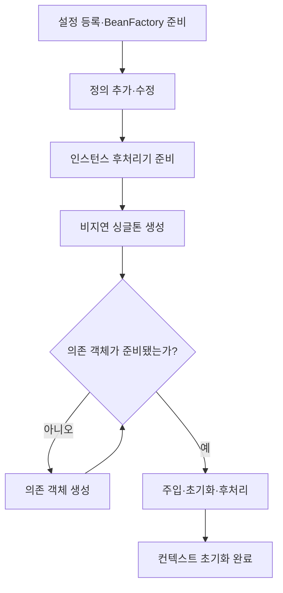
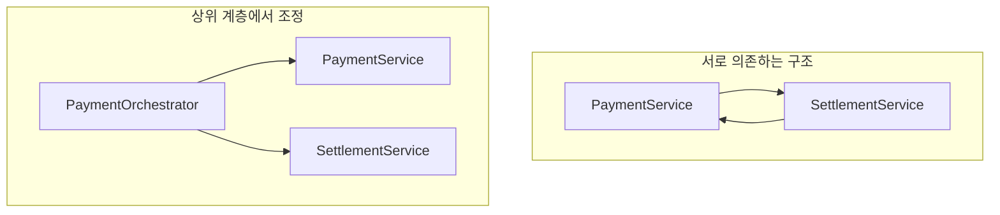
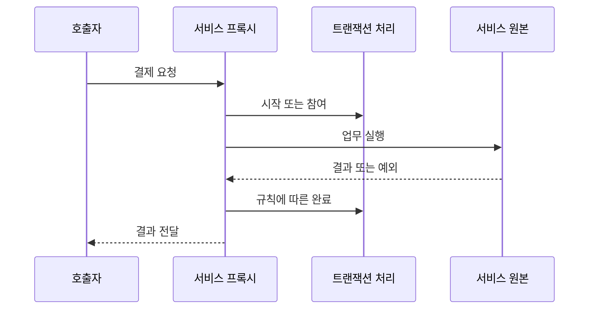

# 스프링 컨테이너와 빈 생성 원리

결제 서비스를 만들 때는 보통 `@Service`를 붙이고, 생성자로 저장소와 PG 클라이언트를 받아 사용한다. 매번 객체를 만들지 않아도 필요한 의존성이 들어오니 개발하는 데 큰 불편은 없다. 다만 설정을 바꾸다가 빈 생성 오류가 나거나, 같은 서비스를 여러 곳에서 주입받는 상황을 설명하려고 하면 익숙했던 코드가 다르게 보이기 시작한다.

PaymentService는 누가 만들었을까. PgClient가 먼저 만들어져야 한다는 것은 어떻게 알았을까. 설정 메서드에는 분명 `new`가 있는데, 여러 서비스가 같은 객체를 사용하는 이유는 무엇일까. 이 질문들은 따로 떨어져 있지 않다. 객체의 생성과 연결을 누가 책임지는지부터 살펴보면 빈 등록, 의존관계 주입, 싱글톤, 생명주기를 하나의 흐름으로 이해할 수 있다.

이 글에서는 결제 서비스와 PG 클라이언트를 예로 들어 그 과정을 따라간다. 처음에는 평범한 Java 코드로 객체를 조립하고, 이후 컨테이너가 그 일을 대신하면서 어떤 기능을 더해 주는지 살펴본다. Java 17 이상과 Spring Framework 6.x를 기준으로 하며, PG 응답은 설명을 위한 가상 값이다. 각 절의 비교 코드는 별개의 예제이고 실제 결제 API를 호출하지 않는다.

## 1. 컨테이너가 해결하는 문제: 객체 사용과 조립의 분리

### 인터페이스만 두면 구현체에서 자유로워질까?

결제 승인 요청을 처리하는 PaymentService가 있다고 하자. 서비스는 PG에 승인 요청을 보내야 하므로 PgClient가 필요하다. 처음에는 다음과 같이 작성하기 쉽다.

```java
class PaymentService {
    private final PgClient pgClient = new SandboxPgClient();
}
```

필드의 타입은 인터페이스다. 그래서 서비스가 추상화에 의존하고 있다고 생각할 수 있다. 하지만 코드를 조금 더 보면 PaymentService는 SandboxPgClient라는 구체 클래스도 알고 있다. PG 구현이 바뀔 때 수정해야 하는 곳이 설정이 아니라 PaymentService가 되는 이유다.

여기에는 두 가지 결정이 섞여 있다. 하나는 “결제를 승인하려면 PG 클라이언트를 호출해야 한다”는 업무상의 결정이고, 다른 하나는 “그 클라이언트로 어떤 구현체를 사용할 것인가”라는 구성상의 결정이다. 서비스가 두 가지를 모두 책임지면 구현체 교체가 업무 코드의 변경으로 이어진다.

생성자로 필요한 객체를 받으면 이 둘을 나눌 수 있다.

```java
class PaymentService {
    private final PgClient pgClient;

    PaymentService(PgClient pgClient) {
        this.pgClient = pgClient;
    }
}
```

이제 서비스는 자신에게 전달된 PgClient를 사용한다. 어떤 구현체를 선택할지는 서비스를 만드는 쪽의 일이다.

```java
PgClient pgClient = new SandboxPgClient();
PaymentService paymentService = new PaymentService(pgClient);
```

개발 환경에서는 샌드박스 구현을, 단위 테스트에서는 가짜 구현을 전달할 수 있다. 서비스가 기대하는 계약을 유지한다면 조립하는 코드에서 구현체를 바꿀 수 있다. 다만 PG마다 승인·취소의 의미가 다르다면 그 차이를 어댑터에서 처리해야 한다. 인터페이스를 만들었다고 업무 규칙까지 자동으로 같아지는 것은 아니다.

### DI와 IoC를 지금 코드에 연결해 보기

위 코드처럼 필요한 협력 객체를 외부에서 전달하는 것이 DI다. 여기에는 아직 Spring이 등장하지 않는다. 생성자에 객체를 넘겨주는 평범한 Java 코드만으로도 의존관계 주입은 이루어진다.

IoC는 조금 더 넓게, 객체가 스스로 결정하던 구성과 제어의 일부를 바깥으로 옮기는 관점이다. PaymentService가 PG 구현체를 직접 고르고 만들던 구조에서, 외부 구성 코드가 구현체를 결정해 주는 구조로 바뀌었다. 서비스는 자신이 사용할 객체가 어떤 절차로 만들어졌는지 몰라도 된다.

이렇게 보면 “Spring이 DI를 한다”는 말은 새로운 종류의 객체를 만들어 준다는 뜻이 아니다. **개발자가 직접 작성하던 객체 조립 작업을 설정에 따라 대신 수행한다**는 뜻에 가깝다.

### 직접 조립할 수 있는데 컨테이너는 왜 필요할까?

객체가 두세 개일 때는 직접 조립하는 방식도 충분하다. 문제는 결제, 취소, 조회 서비스가 같은 PG 클라이언트를 사용하고, 그 클라이언트가 연결 풀과 설정 객체에 의존하기 시작할 때다. 어떤 객체를 공유할지, 어떤 순서로 만들지, 사용 전에 무엇을 준비하고 종료할 때 무엇을 정리할지 결정해야 한다.

각 서비스에서 제각각 처리하면 같은 연결 풀이 여러 번 만들어지거나, 어떤 객체는 초기화를 거치고 다른 객체는 거치지 않는 일이 생길 수 있다. 컨테이너는 이런 관리 규칙을 한곳에 모은다. 애플리케이션은 필요한 의존성과 생성 방법을 선언하고, 컨테이너는 그 선언에 맞게 객체를 준비한다.

스프링 빈은 이 관리 과정에 참여하는 객체다. 클래스에 @Service를 붙였어도 스캔 대상이 아니라면 등록되지 않을 수 있다. 반대로 @Bean 메서드가 new로 만들어 반환한 객체는 정상적인 관리 대상이 된다. 어노테이션의 존재만 보기보다 그 객체가 어느 컨테이너의 관리 경로를 거쳤는지 보는 것이 중요하다.


## 2. BeanFactory와 ApplicationContext

### 객체를 꺼내는 기능에서 애플리케이션을 구성하는 기능으로

컨테이너를 가장 단순하게 보면 이름이나 타입으로 필요한 객체를 요청하는 곳이다. “PaymentService를 달라”는 요청을 받으면 이미 만들어 둔 객체를 찾아 주거나, 설정에 따라 새로 준비해야 한다. 이 빈 관리 기능의 기본 계약이 BeanFactory다.

ApplicationContext는 이 기능을 포함하면서 애플리케이션 구성에 필요한 기능을 함께 제공한다. 환경 설정을 다루고, 메시지를 조회하고, 리소스를 읽고, 내부 이벤트를 발행하는 기능 등이 여기에 속한다. 일반적인 Spring 애플리케이션에서는 기본 BeanFactory를 직접 조립하기보다 ApplicationContext를 진입점으로 사용한다.

```java
ApplicationContext context =
        new AnnotationConfigApplicationContext(PaymentConfig.class);
```

왼쪽 ApplicationContext는 인터페이스이고, 오른쪽 AnnotationConfigApplicationContext는 자바 설정 클래스를 사용하는 구체적인 구현이다. PaymentConfig.class는 이 컨테이너에 어떤 객체를 어떻게 준비할지 알려주는 구성 정보다.

| 기능 | 결제 애플리케이션에 연결해 보기 |
| --- | --- |
| 빈 생성·조회·주입 | 결제 서비스에 PG 클라이언트 연결 |
| Environment | 실행 환경에 맞는 설정 읽기 |
| MessageSource | 사용자 오류 메시지 다국어 처리 |
| ResourceLoader | 클래스패스의 정책 리소스 읽기 |
| 이벤트 발행 | 애플리케이션 내부의 후속 처리 연결 |

이벤트 발행 기능이 있다는 것과 메시지를 영속적으로 보관한다는 것은 다르다. 메모리에서 결제 완료 이벤트를 발행했다고 해서 프로세스 장애 후 반드시 다시 전달되는 것은 아니다. 컨테이너의 편의 기능과 거래의 신뢰성 설계는 구분해야 한다.

### 컨테이너는 Map 하나로 설명할 수 있을까?

이름을 키로 객체를 보관한다고 생각하면 조회는 쉽게 이해된다. 그러나 그 객체가 아직 없을 때 어떻게 만드는지, 생성에 필요한 다른 객체를 어떻게 찾는지, 어떤 초기화 과정을 거쳐야 하는지는 Map만으로 설명되지 않는다.

컨테이너에는 “어떻게 만들 것인가”를 나타내는 정보와 “이미 만들어 사용할 수 있는 객체”가 함께 관리된다. 전자가 BeanDefinition이고 후자가 실제 빈 인스턴스다. 이 구분이 다음 절의 핵심이다.

### getBean을 호출할 때마다 객체가 생기는 것은 아니다

```java
PaymentService first = context.getBean(PaymentService.class);
PaymentService second = context.getBean(PaymentService.class);
```

기본 singleton이라면 두 변수는 같은 객체를 참조한다. getBean은 곧 new라는 뜻이 아니다. 이미 준비된 singleton이면 재사용하고, 아직 생성되지 않은 lazy 빈이면 생성이 시작될 수 있다. prototype이면 조회 요청에 맞춰 새로운 인스턴스를 준비한다.

서비스 코드에서 매번 context.getBean을 호출할 필요는 없다. 생성자에 필요한 타입을 선언하면 컨테이너가 주입 과정에서 이 일을 처리한다. getBean은 이 글처럼 컨테이너를 직접 관찰하거나 동적인 조회가 필요한 경우에 사용하고, 일반적인 업무 코드는 필요한 의존성을 생성자에 드러내는 편이 읽기 쉽다.


## 3. 빈 정의 등록과 인스턴스 생성은 다르다

### “등록했다”는 말에서 빠지기 쉬운 구분

paymentService라는 이름이 컨테이너에 등록됐다고 하자. 이 말은 두 가지 상태를 가리킬 수 있다. 하나는 그 이름의 객체를 만드는 방법이 등록됐다는 뜻이고, 다른 하나는 객체 생성과 초기화까지 끝났다는 뜻이다. 처음 공부할 때 이 둘을 같은 것으로 생각하면 lazy나 prototype을 이해하기 어려워진다.

BeanDefinition은 객체 자체가 아니라 생성에 필요한 메타데이터다. 어떤 클래스 또는 팩토리 메서드를 사용할지, 어떤 스코프로 관리할지, 초기화와 종료 메서드는 무엇인지 등의 정보가 들어간다.

| 구분 | 정의 등록 단계 | 생성 완료 단계 |
| --- | --- | --- |
| paymentService 이름 | 존재할 수 있음 | 존재함 |
| 생성 방법 | 알고 있음 | 알고 있음 |
| 생성자 실행 | 아직 아닐 수 있음 | 실행됨 |
| 초기화 콜백 | 아직 아닐 수 있음 | 정상 생성 경로라면 완료 |
| 실제 서비스 객체 | 없을 수 있음 | 존재함 |

자바 설정, 컴포넌트 스캔, XML은 입력 방식이 다르지만 빈 정의로 연결될 수 있다. 컨테이너의 생성 과정이 매번 입력 형식을 처음부터 해석할 필요가 줄어드는 것이다. 다만 @Bean 메서드의 모든 실행 결과를 정의 등록 때 미리 계산하는 것은 아니다. 그 메서드의 본문은 실제 팩토리 호출 시 실행된다.

### register와 refresh를 나눠 보면 이해하기 쉽다

```java
try (var context = new AnnotationConfigApplicationContext()) {
    context.register(PaymentConfig.class);

    // 설정 클래스를 등록한 상태.
    // @Bean 메서드의 업무 객체 생성까지 모두 끝난 상태는 아니다.
    context.refresh();

    PaymentService service = context.getBean(PaymentService.class);
}
```

PaymentConfig를 인자로 받는 생성자를 쓰면 등록과 초기화가 이어서 진행된다. 반면 위처럼 기본 생성자, register, refresh를 분리하면 “구성 정보를 전달하는 일”과 “그 정보를 바탕으로 컨테이너를 초기화하는 일”을 나누어 볼 수 있다.

refresh는 단순히 모든 클래스에 new를 호출하는 메서드가 아니다. 설정 정보를 처리하고, 추가 정의를 등록하거나 수정하는 후처리기를 실행하며, 실제 빈을 처리할 후처리 체인을 준비한다. 이후 남아 있는 비지연 singleton을 생성하고 컨텍스트 초기화를 마무리한다.



이 그림은 일반적인 비순환 의존성을 단순화한 것이다. 모든 객체가 반드시 같은 순간에 생성되는 것도 아니고, 모든 정의가 처음부터 한꺼번에 확정되는 것도 아니다. 설정 파싱 중 정의가 추가될 수 있으며, 인프라 빈과 후처리기는 업무 빈보다 먼저 준비될 수 있다.

### 코드의 위아래 순서보다 의존관계가 먼저다

PaymentService의 생성에 PgClient가 필요하다면 PgClient를 먼저 준비해야 한다. 설정 파일에서 paymentService 메서드가 위에 있고 pgClient 메서드가 아래에 있어도 이 관계는 달라지지 않는다. 컨테이너는 소스 파일의 줄 순서를 업무상의 생성 순서로 사용하지 않는다.

반대로 서로 의존하지 않는 빈 두 개의 상대적인 생성 순서에 기대면 안 된다. 특정 객체가 반드시 필요하다면 의존관계로 표현해야 한다. @Order를 붙였다고 임의의 모든 빈 생성 순서가 정해지는 것도 아니다. 주입할 대상은 없지만 선행 초기화가 반드시 필요한 경우에 @DependsOn의 적합성을 검토한다.

### 정의를 직접 확인해 보면

아래 코드는 4절의 PaymentConfig로 초기화한 AnnotationConfigApplicationContext에서 실행하는 예다.

```java
var definition = context.getBeanFactory()
        .getBeanDefinition("paymentService");

System.out.println(definition.getFactoryBeanName());
System.out.println(definition.getFactoryMethodName());
System.out.println(definition.isSingleton());
```

기본 이름 전략이라면 paymentConfig, paymentService, true를 기대할 수 있다. 이 정보는 “PaymentService라는 클래스를 무조건 기본 생성자로 만든다”가 아니라 “설정 객체의 팩토리 메서드를 사용한다”는 것을 보여준다. 이름 전략이나 등록 방식에 따라 값은 달라질 수 있다.


## 4. 결제 예제로 등록부터 종료까지 확인하기

아래 클래스들은 각각 별도 파일에 두고 같은 패키지를 사용한다. 실제 PG 호출 없이 생명주기만 관찰하는 예제다.

필요 라이브러리는 `spring-context`와 `jakarta.annotation-api`다. Boot 프로젝트라면 사용하는 Boot BOM에 맞춰 버전을 관리한다.

```java
// PgClient.java
public interface PgClient {
    String approve(String requestId, long amount);
}
```

```java
// SandboxPgClient.java
public class SandboxPgClient implements PgClient {
    public SandboxPgClient() {
        System.out.println("1. SandboxPgClient 생성");
    }

    @Override
    public String approve(String requestId, long amount) {
        // 실제 승인 결과가 아닌 학습용 값
        return "SIMULATED_APPROVED:" + requestId;
    }
}
```

```java
// PaymentService.java
import jakarta.annotation.PostConstruct;
import jakarta.annotation.PreDestroy;

public class PaymentService {
    private final PgClient pgClient;

    public PaymentService(PgClient pgClient) {
        this.pgClient = pgClient;
        System.out.println("2. PaymentService 생성·생성자 주입");
    }

    @PostConstruct
    public void initialize() {
        System.out.println("3. PaymentService 초기화");
    }

    public String approve(String requestId, long amount) {
        if (requestId == null || requestId.isBlank() || amount <= 0) {
            throw new IllegalArgumentException("invalid payment");
        }
        return pgClient.approve(requestId, amount);
    }

    @PreDestroy
    public void shutdown() {
        System.out.println("5. PaymentService 종료");
    }
}
```

```java
// PaymentConfig.java
import org.springframework.context.annotation.Bean;
import org.springframework.context.annotation.Configuration;

@Configuration(proxyBeanMethods = false)
public class PaymentConfig {
    @Bean
    public PgClient pgClient() {
        return new SandboxPgClient();
    }

    @Bean
    public PaymentService paymentService(PgClient pgClient) {
        // 메서드 인자에 컨테이너가 관리하는 PgClient를 주입
        return new PaymentService(pgClient);
    }
}
```

```java
// PaymentDemo.java
import org.springframework.context.annotation.AnnotationConfigApplicationContext;

public class PaymentDemo {
    public static void main(String[] args) {
        try (var context =
                     new AnnotationConfigApplicationContext(PaymentConfig.class)) {

            PaymentService first = context.getBean(PaymentService.class);
            PaymentService second = context.getBean(PaymentService.class);

            System.out.println("동일 빈: " + (first == second));
            System.out.println("4. " + first.approve("demo-001", 10_000));
        } // close() → 관리 대상 싱글톤의 종료 콜백
    }
}
```

예상 관찰 결과:

```text
1. SandboxPgClient 생성
2. PaymentService 생성·생성자 주입
3. PaymentService 초기화
동일 빈: true
4. SIMULATED_APPROVED:demo-001
5. PaymentService 종료
```

이는 실행 검증 결과가 아닌 예제의 예상 출력이다. 이 구성에서는 AOP를 활성화하지 않았으므로 조회한 객체가 트랜잭션 프록시라고 가정하지 않는다.

### 코드가 실행되는 순서를 따라가 보기

PaymentDemo에서 컨텍스트를 생성하면 먼저 구성 정보가 처리된다. PaymentService를 만들기 위해서는 @Bean 메서드 인자로 PgClient가 필요하므로 컨테이너가 그 타입의 후보를 찾는다. 해당 객체를 아직 만들지 않았다면 pgClient 메서드를 실행하고, 이미 준비했다면 기존 객체를 사용한다.

그다음 PaymentConfig의 paymentService 메서드에 준비된 참조를 전달한다. 메서드는 그 참조를 PaymentService 생성자에 넘기면서 객체를 만든다. 따라서 서비스 생성자가 실행되는 순간에는 PgClient가 이미 인자로 들어와 있다. 이후 생명주기 처리를 거쳐 initialize가 호출되고, 사용 가능한 서비스가 컨테이너에서 노출된다.

실제 생성 시도가 항상 PaymentService부터 시작한다는 뜻은 아니다. PgClient를 먼저 만들어 두었더라도 결과는 같다. 중요한 것은 PaymentService에 전달되는 시점에 필요한 의존 객체가 준비되어 있다는 사실이다.

### @Bean은 메서드에 붙지만 관리 대상은 반환 객체다

@Bean이 붙은 paymentService 메서드는 객체를 만드는 방법이다. 관리 대상은 그 메서드가 반환하는 PaymentService다. 내부에서 new를 사용했다고 컨테이너 관리가 깨지는 것은 아니다. 오히려 이 예제에서는 그 new가 실제 인스턴스를 만드는 지점이다.

반면 Controller의 임의 메서드에서 new PaymentService(...)를 호출하면 해당 객체는 별도 관리 절차를 거치지 않는다. 클래스가 같아도 초기화 콜백이나 프록시 적용 여부는 다를 수 있다. **Spring 객체인지 아닌지는 클래스 이름만으로 정해지지 않는다.**

마지막으로 try-with-resources가 끝나면 context.close가 호출된다. 컨테이너가 관리하는 singleton에 종료 처리를 적용하므로 shutdown 로그가 남는 것을 기대할 수 있다. 이는 정상 종료를 관찰하는 예제이며 프로세스 강제 종료까지 보장하는 것은 아니다.

여기서 동일 빈이 true라는 결과는 객체 공유에 대한 확인이다. 동일 결제 요청이 한 번만 처리된다는 의미는 아니다. 멱등성은 거래 키와 저장 상태를 기준으로 별도로 구현해야 한다.


## 5. 빈 하나는 어떤 순서로 만들어질까?

### 생성자가 끝났다고 사용 준비까지 끝난 것은 아니다

객체 생성과 초기화는 평소에 비슷한 말로 쓰지만 빈 생명주기에서는 구분하는 것이 좋다. 객체 생성은 생성자나 팩토리 메서드로 인스턴스를 만드는 일이다. 초기화는 만들어진 객체가 필요한 값과 협력 객체를 갖춘 뒤 역할을 수행할 준비를 하는 일이다.

예를 들어 PG 연결을 관리하는 객체가 endpoint를 setter로 받는다고 하자. 생성자 시점에는 아직 endpoint가 없을 수 있다. 그때 연결을 열면 설정이 누락된 상태로 동작하게 된다. 이 문제는 Spring의 오류라기보다, 값을 전달받는 시점과 사용하는 시점이 맞지 않아서 생긴다.

필드 주입도 같은 원리로 볼 수 있다.

```java
@Service
class InvalidPgGateway {
    @Autowired
    private PgClient pgClient;

    InvalidPgGateway() {
        System.out.println(pgClient); // 아직 null
    }
}
```

필드에 값을 넣으려면 먼저 객체가 있어야 한다. 따라서 생성자가 실행된 뒤 주입이 이루어진다. 어노테이션이 있다고 생성자가 실행되기 전에 필드가 채워지는 것은 아니다.

### 생성자 주입에는 별도의 순서가 필요하다

“객체 생성 → 의존관계 주입”이라는 설명을 모든 주입 방식에 그대로 적용하면 생성자 주입에서 모순이 생긴다. 생성자는 호출할 때 인자를 전달해야 한다. PaymentService를 만들려면 먼저 PgClient를 해결해야 한다.

일반적인 비순환 직접 주입에서는 의존 객체를 생성하고 초기화한 뒤 그 참조를 전달한다. 의존 객체에 AOP가 적용됐다면 원본이 아니라 노출된 프록시를 받을 수 있다. 지연 프록시나 요청 스코프 프록시를 사용하는 경우에는 실제 대상 생성이나 선택이 뒤로 미뤄질 수 있으므로 별도로 생각해야 한다.

보통의 생성 흐름을 정리하면, 먼저 생성자·팩토리 메서드 인자를 해결하고 객체를 만든다. 이어 필요한 필드·setter 주입을 수행한 뒤 초기화 전 처리, 초기화 콜백, 초기화 후 처리를 거친다. 이 과정에서 최종적으로 노출할 객체가 정해지고 singleton이면 재사용된다.

### 초기화 콜백은 어디에 들어갈까?

@PostConstruct는 초기화 전 단계에서 관련 BeanPostProcessor가 호출한다. 그래서 “모든 초기화 전 후처리기가 끝난 다음 PostConstruct가 별도 단계로 실행된다”고 외우면 정확하지 않다.

서로 다른 메서드에 여러 초기화 방식을 설정한 일반적인 경우의 순서는 다음과 같다.

| 초기화 순서 | 대응하는 정상 종료 순서 |
| --- | --- |
| @PostConstruct | @PreDestroy |
| InitializingBean.afterPropertiesSet | DisposableBean.destroy |
| 사용자 지정 initMethod | 사용자 지정 destroyMethod |

이 순서를 모두 활용하라는 뜻은 아니다. 같은 준비 작업을 여러 콜백에 나누어 중복 실행하면 오히려 동작을 파악하기 어려워진다. 직접 작성하는 일반 클래스에서는 목적에 맞는 한 가지 방식을 선택하는 편이 좋다.

### 내부 코드를 볼 때 연결할 지점

컨테이너 소스를 처음 읽으면 많은 메서드 때문에 흐름을 놓치기 쉽다. 일반적인 생성 경로에서는 AbstractAutowireCapableBeanFactory의 createBeanInstance, populateBean, initializeBean을 먼저 연결해 보면 된다.

createBeanInstance에서는 생성자 또는 팩토리 경로를 살펴보고, populateBean에서는 객체가 만들어진 후의 주입을 본다. initializeBean에서는 Aware 콜백과 초기화 전후 처리가 이어지는 모습을 확인한다. Aware는 빈이 자신의 이름이나 컨테이너 같은 인프라 정보를 전달받는 통로이며, 일반 업무 서비스에서 반드시 구현해야 하는 것은 아니다.

생성 전 객체 대체나 순환 참조의 조기 노출 같은 특수 경로도 있다. 처음에는 일반 경로를 이해한 뒤 예외를 추가하는 편이 낫다. “프록시는 무조건 마지막에 처음 만들어진다”와 같은 절대적인 규칙으로 외우지는 않는다.


## 6. 생성자 주입과 자동 등록

### 등록 방식과 주입 방식은 서로 다른 선택이다

@Bean으로 객체를 명시적으로 등록할 수도 있고, @ComponentScan으로 컴포넌트를 발견해 등록할 수도 있다. 어느 쪽이든 등록과 주입은 같은 말이 아니다. 등록은 관리할 객체의 정의를 알려주는 일이고, 주입은 그 객체가 사용할 의존성을 연결하는 일이다.

@Service는 업무 서비스라는 역할을 나타내는 컴포넌트 어노테이션이다. 스캔 범위에 포함되면 정의 등록의 후보가 된다. 스캔은 이미 생성된 객체를 찾아오는 기능이 아니라 클래스 메타데이터를 확인하는 과정이므로, 임의로 new 한 객체가 나중에 자동으로 관리 대상이 되는 것은 아니다.

```java
@Configuration
@ComponentScan(basePackages = "com.example.payment")
class PaymentScanConfig {
}
```

이 설정은 지정한 패키지 아래를 대상으로 한다. 그 밖의 PgClient 구현은 다른 등록 경로가 없다면 자동으로 발견되지 않는다. 어노테이션은 있는데 주입이 안 되는 상황이라면 스캔 범위와 프로파일·조건부터 확인해야 한다.

### 생성자 주입을 기본으로 선택하는 이유

생성자는 객체를 만드는 사람에게 필요한 의존성을 보여준다. PaymentService(PgClient pgClient)라는 선언만 보아도 이 서비스가 PG 클라이언트 없이는 제대로 구성되지 않는다는 것을 알 수 있다. final 필드를 사용하면 생성 이후 참조를 바꾸지 않겠다는 의도도 드러난다.

```java
@Service
class PaymentFacade {
    private final PgClient pgClient;

    public PaymentFacade(PgClient pgClient) {
        this.pgClient = pgClient;
    }
}
```

생성자가 하나라면 이 경우 @Autowired를 생략할 수 있다. 다만 final은 참조 재할당을 막는 것이지 PgClient 내부까지 불변 또는 thread-safe로 만드는 것은 아니다.

생성자 주입의 장점은 단위 테스트에서 더 분명해진다. 필요한 가짜 구현을 직접 넘길 수 있으므로 Spring을 띄우지 않고 업무 로직을 확인할 수 있다.

```java
PgClient fakePg = (requestId, amount) -> "TEST_APPROVED";
PaymentService service = new PaymentService(fakePg);

String result = service.approve("test-001", 1_000);
```

반대로 필드 주입만 사용하면 일반 Java 코드로 생성했을 때 필드는 비어 있다. 추가적인 주입 수단 없이 호출하면 뒤늦게 실패할 수 있다. 생성자 주입은 필요한 의존성을 생성 시점에 드러내 준다. @PostConstruct나 트랜잭션 프록시까지 확인하려는 테스트는 별도로 컨텍스트를 사용해야 한다.

setter는 선택적 의존성이나 실제 재설정 요구가 있을 때 검토할 수 있다. 여러 값을 일반 메서드로 주입할 수도 있다. 방식의 이름을 암기하기보다 필수 의존성이 언제 완성돼야 하는지, 생성 이후 변경을 허용할지를 먼저 판단하는 것이 좋다.

### 같은 타입이 둘이라면 어떤 객체가 들어올까?

국내 결제와 해외 결제에 각각 PgClient 구현이 있다고 가정하자. 단순히 PgClient 하나를 요구하면 컨테이너는 어느 구현을 원하는지 결정할 기준이 필요하다. 타입 후보가 여러 개라고 항상 오류가 나는 것은 아니지만, 선택 기준이 없다면 단일 의존성을 해결하지 못한다.

기본 구현을 정할 때는 @Primary를, 특정 역할을 명시할 때는 @Qualifier를 사용할 수 있다.

```java
public PaymentFacade(
        @Qualifier("domesticPgClient") PgClient pgClient) {
    this.pgClient = pgClient;
}
```

여기서는 해당 이름 또는 한정자에 맞는 타입 후보가 등록돼 있어야 한다. 한정자는 타입 조건을 무시하고 아무 객체나 가져오는 장치가 아니다.

모든 구현을 사용하는 라우터라면 Map<String, PgClient>나 List<PgClient>를 주입받는 방식도 가능하다. 이때 @Primary는 나머지 후보를 전체 목록에서 제거하는 역할을 하지 않는다. 단일 후보 선택과 전체 후보 수집은 다른 요구이기 때문이다. 라우팅 기준은 요청 문자열을 그대로 신뢰하기보다 검증된 업무 규칙으로 결정해야 한다.

### 수동 등록과 자동 등록을 나누는 실무 기준

컨트롤러·서비스처럼 반복적인 업무 컴포넌트는 스캔을 사용하면 설정 코드가 줄어든다. 외부 라이브러리 객체나 구성 방식이 중요한 인프라 자원은 @Bean으로 드러내면 조립 관계를 한눈에 보기 쉽다. 어느 방식이 항상 우월한 것이 아니라, 등록 의도를 어디에서 읽는 것이 명확한지의 문제다.

같은 PaymentService를 @Service와 @Bean으로 각각 등록해 두면 이름과 조건에 따라 충돌하거나 두 객체가 생길 수 있다. 이름 충돌을 허용하는 설정에 기대기보다 등록 경로를 하나로 정리하는 편이 안전하다.


## 7. @Configuration의 프록시는 왜 필요한가?

### 평범한 메서드처럼 보이는데 결과가 다른 이유

결제와 취소 서비스가 하나의 PG 클라이언트를 공유하도록 다음 설정을 작성했다고 하자.

```java
@Configuration
class SharedPgConfig {
    @Bean
    public PgClient pgClient() {
        return new SandboxPgClient();
    }

    @Bean
    public PaymentService paymentService() {
        return new PaymentService(pgClient());
    }

    @Bean
    public CancelService cancelService() {
        return new CancelService(pgClient());
    }
}

class CancelService {
    private final PgClient pgClient;

    CancelService(PgClient pgClient) {
        this.pgClient = pgClient;
    }
}
```

Java 코드만 보면 pgClient()를 호출할 때마다 new가 실행될 것 같다. 컨테이너가 pgClient를 등록하기 위해 한 번, PaymentService를 만들면서 한 번, CancelService를 만들면서 한 번 실행한다면 클라이언트가 세 개 생기는 것이 자연스럽다.

하지만 기본 @Configuration을 컨테이너가 처리하면 설정 클래스가 그대로 사용되는 것이 아니라 CGLIB로 확장된 형태로 관리된다. 이 객체를 통한 @Bean 메서드 간 호출은 컨테이너의 빈 조회·생성 규칙으로 연결된다. 따라서 기본 singleton인 pgClient가 이미 있으면 같은 참조가 돌아온다.

여기서 핵심은 @Bean 메서드 안의 new가 사라진다는 것이 아니다. **일반적인 직접 호출처럼 매번 원래 메서드 본문까지 진행하지 않도록 호출 경로가 바뀐다.** 빈이 필요할 때 생성하고, 같은 빈을 다시 요구할 때는 관리 중인 객체를 사용한다.

### proxyBeanMethods=false는 싱글톤 해제 옵션이 아니다

같은 설정에 proxyBeanMethods=false를 적용하면 메서드 간 직접 호출을 가로채는 기능이 꺼진다. 위 예제의 paymentService()와 cancelService()가 호출하는 pgClient()는 평범한 Java 메서드가 되고, 본문의 new가 실행된다.

| 생성 경로 | 만들어진 클라이언트의 위치 |
| --- | --- |
| 컨테이너가 pgClient 빈을 생성 | 컨테이너에 등록된 pgClient |
| paymentService 본문에서 직접 호출 | PaymentService가 참조하는 별도 객체 |
| cancelService 본문에서 직접 호출 | CancelService가 참조하는 별도 객체 |

세 경로를 모두 실행하면 이 예제에서는 세 인스턴스가 생길 수 있다. 그러나 컨테이너에서 pgClient를 두 번 getBean으로 조회하면 여전히 같은 singleton을 반환한다. 저장된 singleton이 갑자기 여러 개로 늘어난 것이 아니라, 관리 경로 밖에서 추가 객체를 만든 것이다.

이 차이를 놓치면 “Configuration이 없으면 Bean은 싱글톤이 아니다”라고 잘못 이해하기 쉽다. 정확히는 설정 메서드 직접 호출이 컨테이너의 재사용 규칙으로 연결되는지의 차이다.

### 메서드 인자로 주입받으면 의도가 더 명확하다

이 문제를 단순하게 피하려면 다른 @Bean 메서드를 직접 호출하는 대신 필요한 의존성을 인자로 받는다.

```java
@Bean
public CancelService cancelService(PgClient pgClient) {
    return new CancelService(pgClient);
}
```

컨테이너가 선택한 PgClient가 인자로 들어오므로 직접 호출의 의미를 고민할 필요가 줄어든다. 4절에서 proxyBeanMethods=false와 인자 주입을 함께 사용한 이유다.

또한 개발자가 직접 new SharedPgConfig()를 만들었다면 @Configuration이 붙어 있어도 컨테이너가 확장한 객체가 아니다. 어노테이션이 일반 Java 호출을 자동으로 가로채 주는 것은 아니다. 설정 클래스의 프록시와 뒤에서 다룰 트랜잭션 프록시는 모두 호출을 중간에서 처리하지만 목적은 다르다.


## 8. BeanFactoryPostProcessor와 BeanPostProcessor

### 컨테이너가 확장되는 두 지점

앞에서는 컨테이너가 정의를 등록하고 객체를 만든다고 설명했다. 그런데 Spring은 이 과정이 고정되어 있지 않다. 다른 기능이 생성 정보를 조정하거나, 생성 중인 객체에 추가 동작을 적용할 수 있는 지점을 제공한다. 이름이 비슷해 헷갈리지만 BeanFactoryPostProcessor와 BeanPostProcessor는 서로 다른 대상을 다룬다.

BeanFactoryPostProcessor는 일반적으로 실제 업무 객체를 만들기 전에 생성 메타데이터를 다루는 쪽이다. 반면 BeanPostProcessor는 생성 중인 객체를 받아 초기화 전후 처리를 적용한다. 생성 방법을 조정하는 것과 생성된 객체를 감싸는 것은 같은 작업이 아니다.

| 구분 | 주로 다루는 대상 | 흐름에서 이해할 위치 |
| --- | --- | --- |
| BeanDefinitionRegistryPostProcessor | 빈 정의 레지스트리 | 정의를 추가하는 단계 |
| BeanFactoryPostProcessor | 생성 메타데이터 | 객체 생성 전 정의를 조정하는 단계 |
| BeanPostProcessor | 실제 빈 인스턴스 | 초기화 전후에 객체를 처리하는 단계 |

예를 들어 컨테이너가 서비스 객체를 만든 뒤 공통 처리를 적용한 프록시로 바꿔 노출한다면, 그 결과 호출자가 받는 참조는 최초의 원본 참조와 다를 수 있다. 앞 절에서 “컨테이너가 만든 원본”과 “컨테이너가 노출하는 객체”를 구분한 이유다.

### 어노테이션은 스스로 실행되지 않는다

@Autowired 필드에 객체가 들어오거나 @PostConstruct 메서드가 호출되는 것은 어노테이션에 실행 능력이 있어서가 아니다. 관련 처리기가 메타데이터를 읽고 그 시점에 맞는 작업을 수행하기 때문이다. 생성자 선택은 객체 생성 전의 의존성 해결과 연결되고, 필드·메서드 주입은 만들어진 객체를 대상으로 진행된다.

같은 클래스를 일반 Java 코드에서 new 했을 때 필드 자동 주입과 초기화 콜백이 저절로 실행되지 않는 이유도 여기에 있다. 클래스의 모양이 같아도 처리기를 거친 객체와 그렇지 않은 객체는 다른 관리 과정을 거쳤다.

다음 코드를 PaymentConfig에 추가하면 paymentService가 초기화 후 처리에 도달했는지 관찰할 수 있다.

```java
@Bean
public static BeanPostProcessor paymentLifecycleTracer() {
    return new BeanPostProcessor() {
        @Override
        public Object postProcessAfterInitialization(
                Object bean, String beanName) {

            if ("paymentService".equals(beanName)) {
                System.out.println(
                        "초기화 후 관찰: " + bean.getClass().getName());
            }
            return bean;
        }
    };
}
```

BeanPostProcessor는 org.springframework.beans.factory.config 패키지의 인터페이스다. 이 예제는 객체를 그대로 돌려주므로 별도의 프록시를 만들지 않는다. 또한 이 처리기 뒤에 다른 후처리기가 실행될 수 있으므로 출력한 클래스가 최종 노출 타입이라는 보장도 없다.

### 후처리기는 왜 일찍 만들어지는가?

일반 빈을 후처리하려면 후처리기 자체가 먼저 준비되어 있어야 한다. 그러므로 후처리기와 그 생성에 필요한 의존성은 비교적 이른 단계에 만들어질 수 있다. 이것은 자연스러운 순서이지만 업무 서비스를 후처리기에 연결하면 예상하지 못한 조기 생성이 발생할 수 있다.

가령 후처리기가 PaymentService를 생성자로 받으면, 후처리기를 만들기 위해 PaymentService부터 준비해야 한다. 이때 전체 처리 체인이 완성되지 않았다면 서비스가 일부 처리를 받지 못할 수 있다. 트랜잭션 같은 프록시 기능을 기대했다면 경고만 보고 넘길 문제가 아니다.

그래서 예제는 의존성 없는 static @Bean 메서드로 후처리기를 등록한다. 설정 클래스의 불필요한 조기 생성도 줄일 수 있다. 후처리기는 가벼운 인프라 역할로 유지하고, 생성 중인 업무 메서드를 호출해 실제 결제나 외부 통신을 수행하는 구조는 피한다.


## 9. 싱글톤: 하나의 객체를 여러 요청이 공유한다

### 요청마다 서비스를 새로 만들어야 할까?

결제 요청이 들어올 때마다 서비스와 그 의존 객체를 모두 새로 만들 필요는 없는 경우가 많다. 서비스가 요청 데이터를 저장하지 않고 주어진 인자로 업무를 처리한다면, 같은 객체를 여러 요청이 함께 사용할 수 있다. Spring의 기본 singleton 스코프는 이런 공유를 컨테이너 차원에서 제공한다.

클래스마다 private 생성자와 static getInstance를 작성할 필요는 없다. 서비스는 평범한 Java 클래스로 두고, 컨테이너가 해당 정의의 인스턴스를 만들어 재사용한다. 단위 테스트에서는 직접 생성할 수도 있고, 다른 컨테이너에서는 별도의 인스턴스를 가질 수도 있다.

여기서 하나라는 범위를 정확히 봐야 한다. Spring의 singleton은 보통 컨테이너와 빈 정의를 기준으로 한다. 같은 클래스라도 다른 이름의 정의로 등록하면 두 객체가 될 수 있으며, 다른 WAS의 컨테이너에는 각각의 객체가 있다. JVM 전체나 여러 서버 전체에 하나라는 뜻은 아니다.

### 공유되는 객체에 요청 값을 저장하면

아래 코드는 현재 결제 금액을 서비스 필드에 보관한다.

```java
class UnsafePaymentService {
    private long currentAmount;

    public long prepare(long amount) {
        this.currentAmount = amount;
        return this.currentAmount;
    }
}
```

코드가 짧아 안전해 보일 수 있지만 두 스레드의 실행이 겹치면 문제가 생긴다. A가 10,000원을 저장한 뒤 값을 읽기 전에 B가 50,000원을 저장할 수 있다.

| 순서 | 요청 A | 요청 B | 공유 필드 |
| --- | --- | --- | --- |
| 1 | 10,000 저장 | 대기 | 10,000 |
| 2 | 실행 잠시 중단 | 50,000 저장 | 50,000 |
| 3 | 필드 읽기 | 실행 중 | A도 50,000을 읽을 수 있음 |

실제로 잘못된 값이 나타나는지는 실행 타이밍에 따라 달라진다. 그래서 개발 환경에서 몇 번 호출해 정상처럼 보였다고 안전하다고 판단하면 안 된다. 금액뿐 아니라 거래번호, MID, 고객 ID, 마지막 응답을 서비스 필드에 보관할 때도 같은 구조의 문제가 생길 수 있다.

요청 값은 인자와 지역 변수로 전달하면 다른 호출의 필드 갱신에 영향을 받지 않게 만들 수 있다.

```java
class PaymentCalculation {
    public long calculateTotal(long amount, long fee) {
        if (amount <= 0 || fee < 0) {
            throw new IllegalArgumentException("invalid amount");
        }
        long total = Math.addExact(amount, fee);
        return total;
    }
}
```

여기서는 각 호출의 값으로 계산한다. 다만 지역 변수에 담긴 것이 공유 가변 객체의 참조라면 그 객체 내부의 동시성은 별도로 검토해야 한다.

### 무상태라는 말은 필드를 모두 없애라는 뜻이 아니다

생성자로 받은 저장소나 PG 클라이언트 참조를 필드로 유지하는 것은 자연스럽다. 문제가 되는 것은 요청별로 달라지는 상태를 여러 요청이 함께 쓰는 객체의 필드에 넣는 것이다.

캐시나 카운터처럼 공유 가변 상태가 실제로 필요한 경우도 있다. 이때는 단순히 @Service로 만들었다는 이유로 안전해지지 않는다. 자료구조의 원자성, 복합 연산의 경합, 만료와 크기 정책을 설계해야 한다. 의존 객체가 thread-safe한지도 함께 확인해야 한다.

### 여러 WAS를 운영하면 공유 범위가 한 번 더 갈라진다

6개 WAS가 각각 컨텍스트를 가진다면 각 컨텍스트에 서비스와 로컬 상태가 존재한다. 한 WAS의 Map에 결제 요청 ID를 저장했다고 다른 WAS가 그 값을 알 수는 없다.

따라서 singleton, thread-safe, 분산 상태 공유는 각각 다른 질문이다. singleton은 같은 컨테이너에서 어느 객체를 재사용할지, thread-safe는 동시에 접근할 때 상태를 올바르게 유지할지, 분산 상태 공유는 여러 프로세스가 무엇을 함께 볼지를 다룬다.

로컬 목록만으로 전체 서버의 중복 결제를 막을 수 없는 이유도 이 구분으로 설명된다. 결제의 중복 방지는 DB의 유일성 제약과 상태 전이 등 전체 처리 경로에서 유효한 규칙으로 설계해야 한다.


## 10. 스코프와 지연 생성

### 스코프는 객체를 재사용하는 범위를 정한다

싱글톤을 이해했다면 스코프를 “컨테이너가 만든 객체를 어디까지 같은 것으로 취급할 것인가”라는 질문으로 볼 수 있다. singleton은 해당 정의의 객체를 컨테이너에서 공유하고, prototype은 새로운 인스턴스를 요청할 때마다 생성한다. 웹 환경에서는 요청이나 세션에 맞춘 범위도 사용할 수 있다.

| 설정 | 공유·생성 기준 | 함께 기억할 점 |
| --- | --- | --- |
| singleton | 컨테이너 내 해당 정의의 객체 공유 | 요청별 가변 상태를 저장하지 않음 |
| prototype | 새로운 조회 요청마다 생성 | 초기화 이후의 정리 책임을 고려 |
| request | 현재 HTTP 요청 범위 | 요청 문맥이 있어야 대상 선택 가능 |
| session | HTTP 세션 범위 | 한 세션에서도 동시 요청 가능 |
| @Lazy | 실제 생성 시점을 지연 | 스코프 자체를 바꾸지 않음 |

prototype도 생성과 주입, 초기화는 컨테이너의 도움을 받는다. 그러나 singleton처럼 컨테이너 종료 시 소멸 콜백까지 자동으로 관리해 주는 것은 아니다. 외부 자원을 가진 prototype을 쓴다면 사용자가 적절히 정리하는 방법을 마련해야 한다.

### prototype을 주입했는데 같은 객체가 계속 사용되는 이유

싱글톤 서비스가 생성될 때 prototype 의존성을 받는 상황을 생각해 보자. 컨테이너는 그 시점에 새 prototype 객체를 만들어 생성자에 전달한다. 이후 서비스는 전달받은 참조를 필드에 저장한다.

그다음 서비스 메서드를 호출하는 것은 컨테이너에 prototype을 다시 요청하는 일이 아니다. 이미 가지고 있는 참조를 사용하는 일이므로 같은 객체가 계속 사용된다. prototype의 의미는 “이 객체를 사용하는 모든 메서드 호출마다 새로 바꿔 준다”가 아니다.

매번 컨테이너에 새 인스턴스를 요청해야 한다면 Provider를 사용할 수 있다. 다음은 매 보고서 생성마다 별도의 작업 버퍼를 얻는 학습용 예제다.

```java
@Component
@Scope(ConfigurableBeanFactory.SCOPE_PROTOTYPE)
class SettlementBuffer {
    private final StringBuilder content = new StringBuilder();

    public void append(String value) {
        content.append(value);
    }

    public String result() {
        return content.toString();
    }
}

@Service
class SettlementReportService {
    private final ObjectProvider<SettlementBuffer> buffers;

    public SettlementReportService(
            ObjectProvider<SettlementBuffer> buffers) {
        this.buffers = buffers;
    }

    public String build(String settlementId) {
        SettlementBuffer buffer = buffers.getObject();
        buffer.append("settlementId=");
        buffer.append(settlementId);
        return buffer.result();
    }
}
```

@Component, @Scope는 각각 stereotype과 context.annotation 패키지, ConfigurableBeanFactory와 ObjectProvider는 beans.factory 계열 타입을 사용한다. 이 예제는 구조 설명을 위해 import를 생략했다.

여기서 서비스에 주입된 것은 SettlementBuffer 그 자체가 아니라 필요할 때 조회하는 Provider다. getObject를 호출할 때 prototype 조회가 일어나므로 작업마다 새 버퍼를 얻는다. 실제로 이런 단순 버퍼는 new로 생성하는 편이 더 간단하다. Spring이 조립해야 할 의존성이 있는 작업 객체에서 이 방식의 필요성을 검토하면 된다.

### 요청 스코프의 생성 시점은 singleton과 맞지 않는다

Controller는 서버 기동 때 만들어질 수 있지만 요청별 객체는 아직 존재하지 않는 HTTP 요청에 속할 수 없다. 이 시점 차이를 해결하는 방법 중 하나가 스코프 프록시다.

Controller에는 대리 객체를 주입하고, 실제 호출 시 현재 요청에 해당하는 대상 객체를 찾아 위임한다. 따라서 프록시 참조를 가지고 있다고 특정 요청 객체가 서버 기동 때 이미 만들어졌다고 볼 수는 없다.

이 프록시는 mock이 아니다. 현재 스코프를 찾아 실제 객체로 연결하는 역할을 한다. 요청 문맥이 없는 배치나 비동기 스레드에서 호출하면 실패할 수 있다. 비동기 작업에 필요한 거래 식별자나 요청 정보는 값을 명시적으로 넘기는 방식이 더 적합한 경우가 많다.

### lazy는 “몇 개”보다 “언제”에 관한 설정이다

lazy singleton을 첫 조회에서 만들었다면 이후에는 같은 객체를 재사용한다. 반면 prototype은 컨테이너에 새 인스턴스를 요청할 때 다시 생성된다. 두 설정은 해결하는 문제가 다르다.

또한 @Lazy를 붙인 빈도 비지연 singleton이 실제 의존 객체로 필요로 하면 기동 과정에서 생성될 수 있다. 빈 정의의 지연 생성과 주입 지점에 지연 프록시를 두는 방식을 구분해야 한다.

운영에서는 lazy를 기동 시간 단축만 보고 적용하면 안 된다. 필수 PG 설정이 잘못됐는데 첫 승인 요청에서야 발견되는 상황이 생길 수 있다. 일찍 실패해 배포 오류를 잡을 것인지, 사용하지 않는 기능의 생성을 미룰 것인지 판단해야 한다.


## 11. 순환 참조: 생성 순서보다 책임 분리를 먼저 본다

### 서로가 먼저 만들어져야 한다면

PaymentService의 생성자가 SettlementService를 요구하고, SettlementService의 생성자가 다시 PaymentService를 요구한다고 하자. 컨테이너가 결제 서비스를 만들려고 하면 정산 서비스가 필요하고, 정산 서비스를 만들려고 하면 아직 만들지 못한 결제 서비스가 필요하다.

두 객체 모두 생성자 호출을 완료하지 못했으므로 먼저 넘겨줄 인스턴스가 없다. 일반적인 직접 생성자 순환 의존이 해결되지 않는 이유다.



setter나 필드 주입은 먼저 인스턴스를 만들고 나중에 연결할 여지가 있다. 일부 설정에서는 이를 이용해 순환 관계를 처리할 수 있지만, 모든 스코프나 프록시 조합에서 가능한 것은 아니다. 허용 여부를 바꿔 기동시키는 것과 구조가 적절해지는 것은 다른 문제다.

### 결제와 정산이 서로 알아야 하는 이유를 다시 보기

결제 서비스는 결제 상태를 처리하고 정산 서비스는 정산 대상을 관리한다고 나눴는데, 둘이 서로의 업무를 호출한다면 실제로는 “결제 이후 정산 등록까지 이어가는 조정 책임”이 갈 곳을 찾지 못했을 수 있다.

상위 PaymentOrchestrator가 두 서비스를 사용하도록 바꾸면 하위 서비스가 서로를 알아야 할 필요가 줄어든다. 공통으로 조회하는 정보 때문에 얽혔다면 별도의 조회 컴포넌트를 추출하는 방법도 있다. 의존성을 끊는 방법은 실제 책임이 무엇인지에 따라 달라진다.

이때 클래스 의존성만 바꾸고 거래 경계를 잊으면 안 된다. 결제 상태 변경과 정산 등록을 같은 로컬 트랜잭션으로 확정해야 하는지, 커밋 후 별도 작업으로 수행해도 되는지 결정해야 한다. 이벤트로 연결했다는 사실만으로 재처리나 데이터 일관성이 보장되지는 않는다.

### @Lazy로 해결됐다고 끝내기 어려운 이유

지연 프록시를 주입하면 대상 조회를 뒤로 미뤄 일부 순환 생성 문제를 피할 수 있다. 그러나 초기화 중 프록시를 즉시 호출하면 다시 생성 문제를 만날 수 있다. 기동 시 발생하던 문제가 실행 시점으로 이동할 가능성도 있다.

그래서 순환 참조를 발견하면 우선 두 서비스가 서로의 책임을 얼마나 알고 있는지 살펴보는 것이 좋다. 임시로 지연시켜야 하는 상황이라면 무엇을 늦췄고 언제 실제 대상이 필요해지는지까지 설명할 수 있어야 한다.


## 12. @PostConstruct에서 결제 호출을 하면 안 되는 이유

### 객체를 사용할 준비와 실제 업무 실행은 다르다

초기화 콜백을 배우면 “서버가 시작할 때 필요한 일을 넣는 곳”으로 생각하기 쉽다. 하지만 이 범위를 넓게 잡아 실제 승인이나 송금 실행까지 넣으면 문제가 생긴다. 초기화는 해당 객체를 사용할 준비를 하는 단계이고, 거래 실행은 요청과 상태를 기준으로 통제해야 하는 업무다.

서버가 재기동될 때마다 초기화 메서드는 다시 호출될 수 있다. 여러 WAS가 동시에 뜨면 각 인스턴스에서 실행될 수 있다. 초기화에서 미처리 송금을 조회하고 무조건 실행한다면 재배포 자체가 거래 재시도의 계기가 된다. 한 번만 실행되리라는 기대를 빈 생명주기에 맡길 수는 없다.

@PostConstruct에는 가벼운 설정 검증 등 역할을 수행하기 위한 준비를 둘 수 있다. 외부 연결을 반드시 확인해야 한다면 타임아웃과 실패 정책을 명확히 해야 한다. 외부 PG가 느릴 때 기동이 무한정 멈추거나, 실패를 모두 무시해 준비되지 않은 앱이 트래픽을 받는 상황을 피해야 한다.

### 세 가지 생명주기 설정은 언제 쓰는가?

직접 작성하는 클래스에는 @PostConstruct와 @PreDestroy를 사용하면 의도가 잘 드러난다. Spring 6 예제에서는 jakarta.annotation 패키지를 사용한다.

수정할 수 없는 외부 라이브러리가 open과 close 같은 메서드를 제공한다면 @Bean의 initMethod와 destroyMethod로 연결할 수 있다. 클래스 본문을 바꾸지 않고도 준비와 정리 시점을 컨테이너에 알려줄 수 있다는 점이 다르다.

```java
// VendorChannel은 별도 라이브러리에 있다고 가정한 예제
@Bean(initMethod = "open", destroyMethod = "close")
public VendorChannel vendorChannel() {
    return new VendorChannel();
}
```

InitializingBean과 DisposableBean 인터페이스를 구현하는 방법도 있다. 프레임워크 확장이나 인프라 컴포넌트에서는 의미가 있지만 일반 업무 클래스가 반드시 Spring 인터페이스를 구현해야 하는 것은 아니다. 필요한 결합 수준과 클래스 수정 가능 여부를 보고 선택하면 된다.

@Bean은 일정한 조건에서 close나 shutdown 같은 종료 메서드를 추론하기도 한다. 명시적으로 설정한 종료 처리와 별도 종료 훅이 같은 자원을 중복으로 닫지 않는지 확인해야 한다. 자원을 만든 주체와 종료할 책임이 누구에게 있는지 분명히 하는 것이 중요하다.

### 초기화 완료는 전체 애플리케이션의 준비 완료가 아니다

PaymentService의 초기화가 끝났어도 다른 빈이나 애플리케이션의 후속 기동 작업까지 모두 완료됐다는 뜻은 아니다. 외부 시스템이 정상이라는 보장도 없다. “빈 하나가 준비됐다”, “컨텍스트 초기화가 끝났다”, “업무 트래픽을 받아도 된다”는 서로 다른 수준의 상태다.

운영 readiness는 필요한 자원과 기능을 기준으로 정해야 한다. 선택 기능 하나가 비활성이어도 결제를 받을 수 있는지, 필수 거래 저장소가 연결되지 않으면 기동을 실패시킬지 등의 판단이 필요하다. 모든 준비 작업을 한 초기화 메서드에 몰아넣으면 어느 조건 때문에 서비스가 준비되지 않았는지 파악하기 어렵다.

또한 자기 자신의 초기화 메서드에 @Transactional을 붙였다고 일반적인 프록시 호출처럼 동작한다고 기대해서는 안 된다. 초기화는 원본을 준비하는 과정이며, 외부 호출자가 완성된 프록시를 통해 업무 메서드를 호출하는 상황과 다르다.

### 종료 콜백은 거래 저장을 미루는 근거가 아니다

@PreDestroy는 정상 종료 시 자원을 정리할 기회를 준다. 프로세스 강제 종료나 서버 장애에서도 항상 실행되는 장치는 아니다. 결제 결과를 메모리에 쌓아 두고 종료할 때만 DB에 저장하면 정리할 기회 자체를 잃을 수 있다.

중요한 거래 상태는 업무 처리 중 적절한 트랜잭션으로 저장하고, 종료 콜백은 연결 풀이나 작업자 같은 자원의 정리에 사용해야 한다. 복구 작업도 애플리케이션이 한 번 종료됐다는 사실보다 저장된 거래 상태를 기준으로 재개할 수 있게 설계하는 편이 맞다.


## 13. AOP 프록시와 기존 트랜잭션 문서 연결

### 컨테이너에서 받은 참조가 어디를 가리키는가?

컨테이너가 서비스를 만들고 초기화했다고 해서 최초의 원본 객체를 그대로 반환해야 하는 것은 아니다. 적용할 공통 기능이 있으면 프록시로 감싸 노출할 수 있다. 호출자는 같은 서비스 기능을 사용하지만 실제 호출 경로에는 한 단계가 더 들어간다.

트랜잭션을 예로 들면 프록시가 먼저 호출을 받고, 필요한 거래 경계를 시작하거나 기존 경계에 참여한 뒤 원본 메서드로 위임한다. 원본이 끝나면 결과와 규칙에 따라 트랜잭션을 완료하고 호출자에게 돌아간다.



원본 메서드의 마지막 줄을 지났다는 로그와 거래가 최종 확정됐다는 사실은 다를 수 있다. 커밋은 원본이 반환된 후 프록시 처리에서 이루어질 수 있고, 그 단계에서 실패할 수도 있기 때문이다.

### this 호출은 왜 다른가?

```java
@Service
class PaymentWorkflow {
    public void pay() {
        this.writeLedger();
    }

    @Transactional
    public void writeLedger() {
        // 원장 기록
    }
}
```

외부 호출자가 pay에 들어온 뒤 원본 내부에서 this.writeLedger를 호출하면, 현재 객체의 메서드로 바로 이동한다. 프록시를 다시 통과하지 않으므로 기본 프록시 방식에서는 writeLedger의 어노테이션을 새 경계로 적용하는 동작이 발생하지 않는다.

이를 “내부 호출에는 트랜잭션이 없다”라고 단순화하면 또 다른 오해가 생긴다. pay 자체가 이미 트랜잭션 안에서 실행되고 있다면 writeLedger의 DB 작업도 그 문맥 안에서 수행될 수 있다. 적용되지 않는 것은 내부 메서드에 선언한 새로운 프록시 동작이다. 기존 문맥의 존재 여부와는 구분해야 한다.

별도의 서비스로 책임을 나누어 프록시를 거쳐 호출하거나, 필요한 경우 TransactionTemplate으로 경계를 명시할 수 있다. 어느 방법이든 실제 업무 경계가 먼저이고 프록시를 통과하는 것이 목적 자체가 되어서는 안 된다.

### 이름이 비슷해도 프록시의 목적은 다르다

| 구분 | 호출을 중간에서 처리하는 이유 |
| --- | --- |
| @Configuration 프록시 | @Bean 메서드 호출을 컨테이너 관리와 연결 |
| AOP 프록시 | 트랜잭션·공통 로깅 같은 동작 적용 |
| 스코프 프록시 | 현재 요청 등 적절한 범위의 대상 선택 |

실행 중 클래스 이름에 CGLIB 관련 문자열이 붙었다는 사실만으로 어떤 기능이 적용됐는지 판단하면 안 된다. 설정 객체를 확장한 것인지, 업무 메서드에 advisor를 적용한 것인지, 스코프 대상을 찾기 위한 것인지 확인해야 한다.

빈 생성 원리를 알고 나면 트랜잭션의 내부 호출 문제도 별개의 암기 항목이 아니게 된다. “누가 어떤 참조를 받았고, 그 호출이 프록시를 지났는가”라는 같은 질문으로 설명할 수 있다.

관련 내용은 [트랜잭션 전파: 결제·송금 Java 예제](transaction-propagation.md)에서 이어서 다룬다.


## 14. 운영 문제를 생성 단계에 연결하기

### 가장 바깥 예외에 적힌 클래스가 원인인 것은 아니다

기동 로그에서 PaymentController 생성 실패를 보면 Controller의 어노테이션부터 확인하기 쉽다. 하지만 Controller가 PaymentService를 요구하고 서비스가 PgClient를 요구한다면, 실제 원인은 PgClient의 endpoint 설정 누락일 수 있다.

```text
PaymentController 생성 실패
  원인: PaymentService 의존성 준비 실패
  원인: PgClient 생성 실패
  원인: endpoint 설정 누락
```

이 구조에서 Controller를 수정해도 근본 원인은 해결되지 않는다. 바깥 예외는 의존 객체를 준비하지 못했다는 결과를 나타낼 수 있다. 실패한 빈의 의존 경로를 따라가며 처음으로 구체적인 실패 이유가 드러나는 지점을 찾아야 한다.

### 증상을 어느 단계의 문제로 볼 것인가?

빈을 찾을 수 없다면 우선 정의가 존재하는지 본다. 스캔 범위, 프로파일, 조건부 등록, 이름, 컨텍스트 계층이 확인 대상이다. 정의는 있는데 타입 후보가 둘이라면 선택 기준의 문제다. 후보를 골랐지만 생성자가 실패한다면 객체 생성의 문제이고, 초기화 콜백에서 외부 통신이 멈춘다면 준비 과정의 문제다.

| 증상 | 연결할 단계 | 먼저 살펴볼 내용 |
| --- | --- | --- |
| 필요한 빈이 없음 | 정의 등록 | 스캔·프로파일·조건·이름 |
| 단일 의존성을 결정하지 못함 | 후보 선택 | 중복 타입·Qualifier·Primary |
| BeanCreationException | 생성·주입·초기화 | 가장 안쪽 원인과 의존 경로 |
| 기동 시간이 길어짐 | 초기화 | 외부 통신·대량 적재·타임아웃 |
| 일부 후처리 미적용 경고 | 조기 생성 | 후처리기의 업무 빈 의존 |
| 트랜잭션이 기대대로 안 됨 | 객체 노출·호출 | 직접 생성·내부 호출·프록시 |
| 요청 데이터가 섞임 | 객체 사용 | 싱글톤의 요청별 가변 필드 |
| WAS별 값이 다름 | 공유 범위 | 로컬 캐시·JVM별 상태 |
| 종료 정리가 안 됨 | 종료 | 스코프·close·강제 종료 |

이렇게 단계로 나누면 “Spring이 주입을 못 한다”는 막연한 증상을 구체적인 확인 항목으로 바꿀 수 있다. 컨테이너의 동작을 이해하는 목적도 내부 클래스 이름을 많이 외우는 데 있지 않다. 문제가 생겼을 때 어디부터 확인할지 설명할 수 있어야 한다.

### 예제에서 직접 관찰하면 좋은 변화

같은 컨텍스트에서 같은 singleton을 두 번 조회하고 참조가 같은지 확인해 보자. 이후 설정 메서드의 직접 호출과 인자 주입을 바꾸어 보면, 어디에서 관리되지 않는 추가 객체가 생기는지 드러난다.

다음으로 생성자와 초기화 콜백에 각각 로그를 두면 의존 객체가 준비되는 시점을 볼 수 있다. 종료까지 확인하려면 컨텍스트를 정상적으로 close해야 한다. prototype으로 바꿨을 때는 생성 횟수뿐 아니라 종료 책임도 달라진다는 점을 함께 관찰한다.

마지막으로 AOP가 적용된 서비스를 별도 빈에서 호출하는 경우와 this로 호출하는 경우를 비교하면, 객체의 생명주기와 호출 경계가 연결된다. 이때 단순히 메서드 호출 횟수만 확인하지 말고 실제 트랜잭션 활성 여부나 DB 결과처럼 기능에 맞는 관찰값을 사용해야 한다.

Spring이 관리하는 것은 클래스 이름만이 아니다. 어떤 정의로 객체를 만들고, 필요한 참조를 어떻게 연결하며, 어느 범위에서 공유하고, 어떤 처리 과정을 거쳐 노출할지까지 관리한다. 결제 코드에서 이 구분을 놓치지 않으면 같은 클래스의 객체라도 왜 결과가 달라지는지 설명할 수 있다.

---

코드는 컨테이너 동작을 이해하기 위한 학습 예제다. 출력은 예상 결과이며, 실제 컴파일·실행 및 WAS 검증은 수행하지 않았다.

