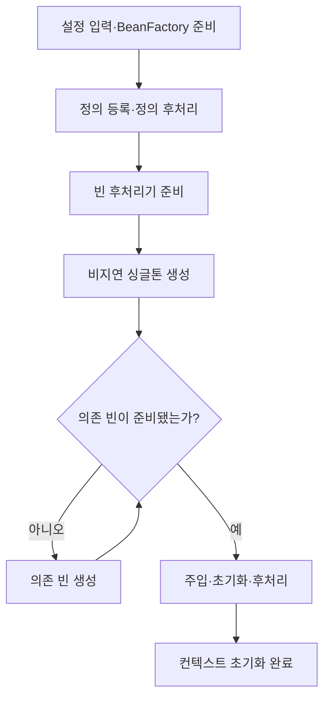
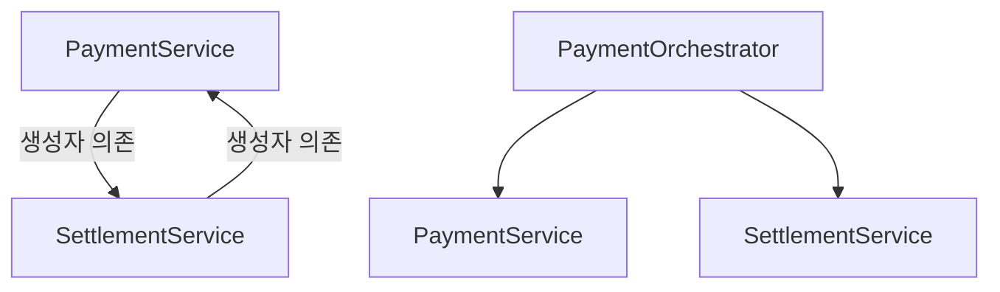
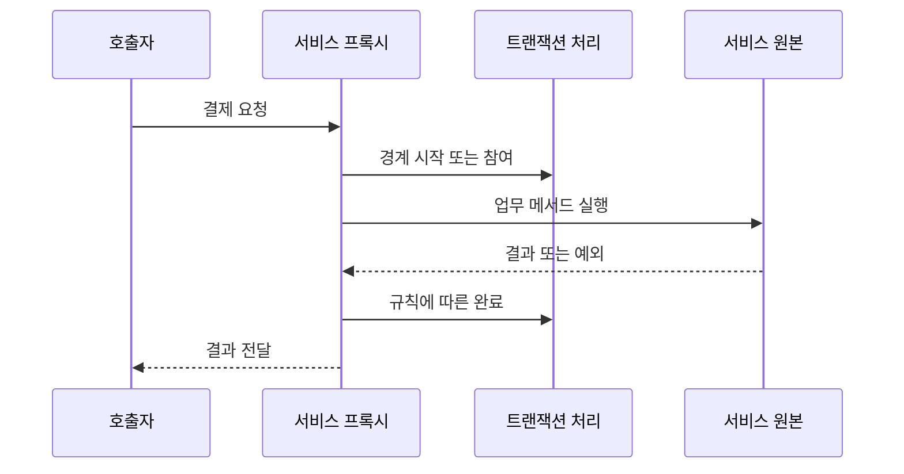

# 스프링 컨테이너와 빈 생성 원리

스프링으로 개발하다 보면 서비스에 `@Service`를 붙이고 생성자로 필요한 객체를 받는 코드를 자연스럽게 작성한다. 그런데 서버를 시작할 때 누가 이 객체들을 만들고, 어떤 순서로 연결하며, 같은 서비스를 여러 곳에서 주입받아도 왜 같은 객체를 사용하는지 설명하려면 생각보다 막히는 부분이 많다.

결제 서비스를 하나 구성한다고 가정하고 이 과정을 따라가 보자. 처음에는 평범한 자바 코드로 객체를 만들고, 여기에 컨테이너를 적용한 뒤 빈 정의 등록, 의존관계 주입, 초기화, 프록시, 종료까지 연결해서 살펴본다. 어노테이션 이름을 외우기보다 각 단계에서 실제로 어떤 객체가 존재하고 누가 그 객체를 사용하는지 이해하는 데 초점을 맞췄다.

예제는 Java 17 이상과 Spring Framework 6.x를 기준으로 한다. 코드에서 반환하는 승인 결과는 흐름을 설명하기 위한 가상 값이며, 실제 결제 API를 호출하지 않는다. 각 절의 비교 예제는 독립적으로 읽으면 된다.

## 1. 컨테이너가 해결하는 문제: 객체 사용과 조립의 분리

결제 서비스가 직접 PG 구현체를 생성하면 업무 코드가 구체적인 연동 방식에 묶인다.

```java
// 직접 조립: 서비스가 구현체 선택까지 책임진다.
class PaymentService {
    private final PgClient pgClient = new SandboxPgClient();
}
```

생성자로 필요한 객체를 받도록 바꾸면 결제 서비스는 승인 요청을 수행하고, 외부 구성 코드가 구현체를 결정할 수 있다.

```java
class PaymentService {
    private final PgClient pgClient;

    PaymentService(PgClient pgClient) {
        this.pgClient = pgClient;
    }
}
```

이 시점에는 Spring이 없어도 DI가 성립한다. Spring 컨테이너를 사용하면 객체 조립에 더해 생성 시점, 공유 범위, 초기화, 종료, 후처리를 일관되게 관리할 수 있다.

- **IoC**: 애플리케이션 코드가 모두 통제하던 객체 구성과 실행 흐름의 일부를 프레임워크에 맡긴다.
- **DI**: 사용할 협력 객체를 외부에서 전달받는다.
- **빈**: 컨테이너가 관리하는 객체다. 클래스에 어노테이션을 붙이는 것만으로 현재 컨테이너에 반드시 등록되는 것은 아니다.

예를 들어 스캔 범위 밖의 `@Service`는 자동 등록되지 않는다. 반대로 `@Bean` 메서드 안에서 `new`로 만든 객체도 반환되어 등록되면 빈이다.

### 1-1. 인터페이스를 사용해도 결합이 남는 이유

다음 필드의 선언 타입은 인터페이스지만, 오른쪽에는 구체적인 구현체가 남아 있다.

```java
private final PgClient pgClient = new SandboxPgClient();
```

운영 PG를 바꾸려면 PaymentService의 소스를 수정해야 한다. 결제 승인이라는 업무 책임과 “어느 PG를 사용할 것인가”라는 구성 책임이 한 클래스에 섞인 것이다.

생성자 주입을 사용하면 구현체 선택은 아래처럼 조립하는 쪽으로 이동한다.

```java
PgClient client = new SandboxPgClient();
PaymentService paymentService = new PaymentService(client);
```

이 코드는 Spring 없이도 동작한다. 이후 다른 PG를 사용하더라도 PgClient 계약을 지키는 구현체를 전달하면 된다. 서비스 코드는 인터페이스가 제공하는 기능에만 의존한다. 다만 실제 PG별 승인·취소 의미가 다르면 어댑터에서 그 차이를 처리해야 한다. 인터페이스 이름만 같다고 업무 의미까지 자동으로 통일되지는 않는다.

### 1-2. 그래도 컨테이너가 필요한 이유

서비스 두 개라면 직접 조립하기 어렵지 않다. 하지만 결제·취소·조회 서비스가 같은 PG 클라이언트, 연결 풀, 설정 객체를 함께 쓰기 시작하면 다음 결정을 반복하게 된다.

- 이 객체를 매번 만들 것인가, 하나를 공유할 것인가?
- 어떤 객체를 먼저 만들고 어디에 전달할 것인가?
- 사용 전에 설정 검증이나 자원 준비가 필요한가?
- 종료할 때 누가 연결이나 작업 스레드를 정리할 것인가?

Spring은 이 조립과 관리의 규칙을 공통으로 처리한다. 애플리케이션은 필요한 의존성을 선언하고, 컨테이너는 그 선언을 만족하는 객체를 준비한다.

**DI를 한다고 반드시 Spring이 필요한 것은 아니지만, Spring을 쓰면 DI와 생명주기 관리를 애플리케이션 전체에 일관되게 적용하기 쉬워진다.**


## 2. BeanFactory와 ApplicationContext

| 구분 | 역할 | 사용 관점 |
| --- | --- | --- |
| BeanFactory | 빈 조회·생성·의존관계 관리의 기본 계약 | 컨테이너 내부 동작 이해 |
| ApplicationContext | BeanFactory 기능에 이벤트·리소스·메시지 등 애플리케이션 기능 확장 | 일반적인 Spring 앱의 진입점 |
| BeanDefinition | 생성 방법·스코프·의존성 등 메타데이터 | 실제 객체가 아닌 정의 |
| BeanPostProcessor | 생성 중인 빈 인스턴스 후처리 | 초기화 콜백·프록시 등 확장 |

컨테이너를 단순히 Map 하나라고 생각하면 등록과 조회는 설명할 수 있지만, 의존성 해결과 생명주기까지 설명하기 어렵다. **객체의 생성 규칙과 실제 인스턴스를 구분해 관리하는 객체 조립 시스템**으로 이해하는 편이 정확하다.

### 2-1. 실제로 우리가 사용하는 것은 무엇인가?

```java
ApplicationContext context =
        new AnnotationConfigApplicationContext(PaymentConfig.class);
```

왼쪽 ApplicationContext는 사용할 기능의 계약이고, 오른쪽 AnnotationConfigApplicationContext는 자바 설정 클래스를 읽는 구체적인 구현이다. “ApplicationContext라는 클래스를 직접 생성한다”는 표현은 정확하지 않다.

BeanFactory의 핵심은 “이 이름 또는 타입에 해당하는 객체를 달라”는 요청을 처리하는 것이다. ApplicationContext는 여기에 애플리케이션을 구성할 때 필요한 기능을 묶는다.

| 추가 기능 | 결제 서비스에서 생각해 볼 사용 예 |
| --- | --- |
| Environment | 실행 환경에 따라 샌드박스·운영 설정 선택 |
| MessageSource | 사용자에게 보여줄 오류 메시지 다국어 처리 |
| ApplicationEventPublisher | 내부 이벤트 발행과 리스너 연결 |
| ResourceLoader | 클래스패스의 정책 파일 읽기 |

이벤트 발행 기능이 있다는 사실과 이벤트를 외부 메시지 브로커처럼 영속적으로 보관한다는 것은 다른 이야기다. 예를 들어 결제 완료 이벤트를 메모리에서 발행한 뒤 프로세스가 종료되면, 별도 저장·재처리 설계 없이는 전달을 복구하지 못할 수 있다.

### 2-2. getBean은 매번 new 하는 메서드가 아니다

```java
PaymentService a = context.getBean(PaymentService.class);
PaymentService b = context.getBean(PaymentService.class);
```

기본 singleton이라면 이미 준비한 객체를 재사용한다. 아직 생성되지 않은 lazy 빈이거나 prototype이면 생성 경로로 진입할 수 있다. 즉 getBean은 단순 조회처럼 보이지만 스코프와 생성 상태에 따라 객체 준비까지 수행하는 진입점이다.

업무 서비스가 매번 context.getBean을 호출하도록 작성할 필요는 없다. 일반적으로 생성자 주입으로 필요한 의존성을 명시하는 편이 테스트와 코드 파악에 유리하다. getBean은 이 문서처럼 컨테이너를 직접 관찰하거나 동적인 조회가 필요한 제한된 상황에서 사용한다.


## 3. 빈 정의 등록과 인스턴스 생성은 다르다

`@ComponentScan`, `@Bean`, XML 등은 서로 다른 등록 경로다. 등록된 정의에는 다음 정보가 담길 수 있다.

| 메타데이터 | 결제 예시 |
| --- | --- |
| 빈 이름 | paymentService |
| 클래스 또는 팩토리 메서드 | PaymentService 또는 PaymentConfig.paymentService |
| 스코프 | singleton |
| 생성자·팩토리 인자 | PgClient 빈 |
| 지연 생성 여부 | lazyInit |
| 초기화·종료 메서드 | initialize / close |

정의가 있다고 항상 객체가 이미 있는 것은 아니다. lazy singleton이나 prototype은 조회 등으로 실제 생성이 필요해지는 시점까지 미뤄질 수 있다.

### 컨테이너 기동 흐름

아래는 `ApplicationContext.refresh()`의 핵심 단계를 학습용으로 압축한 것이다. 모든 내부 호출을 표현한 것은 아니다.



실제로는 설정 파싱 과정 자체에서도 정의가 추가된다. 모든 정의가 첫 단계에서 완전히 확정된 뒤 단순히 차례로 객체를 만드는 구조는 아니다. 인프라 빈과 후처리기는 일반 업무 빈보다 이른 시점에 생성될 수 있다.

소스를 읽을 때는 다음 지점을 연결하면 흐름을 잡기 쉽다.

| 위치 | 확인할 내용 |
| --- | --- |
| AbstractApplicationContext.refresh | 전체 초기화 순서 |
| invokeBeanFactoryPostProcessors | 정의 등록·수정에 참여하는 후처리 |
| registerBeanPostProcessors | 인스턴스 후처리기 등록 |
| finishBeanFactoryInitialization | 남은 비지연 싱글톤 초기화 |
| finishRefresh | 컨텍스트 초기화 마무리·이벤트 |

이 순서는 **애플리케이션이 트래픽을 받을 준비가 됐다는 운영 판정**과는 구분한다. 외부 의존 시스템 상태나 Boot runner 작업 완료 여부는 별도 readiness 기준에 반영해야 한다.

### 3-1. 등록됐다는 말의 두 가지 의미

“빈이 등록됐다”라는 말을 사용할 때는 다음 두 상태를 구분하면 혼란이 줄어든다.

| 상태 | 컨테이너가 알고 있는 것 | 실제 PaymentService 객체 |
| --- | --- | --- |
| 정의만 등록 | 어떤 방식으로 만들어야 하는가 | 아직 없을 수 있음 |
| 생성 완료 | 정의와 사용 가능한 인스턴스 | 존재함 |

예를 들어 paymentService라는 이름이 목록에 있다고 해서 생성자와 초기화 메서드가 모두 실행됐다고 단정할 수 없다.

```java
try (var context = new AnnotationConfigApplicationContext()) {
    context.register(PaymentConfig.class);
    // 이 시점에는 설정 클래스가 등록됐다.
    // @Bean 메서드의 정의를 모두 처리하고 업무 빈을 만든 상태는 아니다.

    context.refresh();
    // 일반적인 비지연 singleton 생성까지 진행한다.

    System.out.println(context.containsBean("paymentService"));
}
```

인자를 받는 생성자와 달리 기본 생성자 뒤에 register와 refresh를 호출하면 설정 등록과 초기화 실행을 분리해서 볼 수 있다.

### 3-2. 왜 BeanDefinition으로 한 번 바꾸는가?

자바 설정과 XML을 빈 생성 로직이 매번 각각 해석한다면 입력 형식이 늘어날 때마다 생성 로직도 복잡해진다. 설정을 공통 메타데이터로 바꾸면 이후 단계에서는 그 정의를 중심으로 객체를 준비할 수 있다.

다만 “BeanDefinition에 모든 Java 실행 결과가 미리 저장된다”는 뜻은 아니다. @Bean 메서드의 본문은 팩토리 메서드가 실제 호출될 때 실행된다. 정의에는 어느 설정 객체의 어떤 메서드를 통해 생성할지와 같은 정보가 담길 수 있다.

예제에서 다음과 같이 확인할 수 있다.

```java
var definition = context.getBeanFactory()
        .getBeanDefinition("paymentService");

System.out.println(definition.getFactoryBeanName());
System.out.println(definition.getFactoryMethodName());
System.out.println(definition.isSingleton());
```

앞의 PaymentConfig 기준으로 팩토리 빈은 paymentConfig, 메서드는 paymentService, 싱글톤 여부는 true를 기대할 수 있다. 이름 생성 전략이나 등록 방식을 바꾸면 결과도 달라질 수 있다.

### 3-3. 파일에 적은 순서와 생성 순서는 다르다

paymentService 메서드를 pgClient보다 먼저 적어도 서비스 생성에 PgClient가 필요하면 컨테이너가 의존성을 먼저 해결한다. 소스 파일 위에서 아래로 생성된다고 생각하면 안 된다.

반대로 서로 의존하지 않는 두 빈의 상대적인 생성 순서에 업무 의미를 부여해서도 안 된다. “우연히 먼저 만들어지던 빈”에 기대는 대신, 꼭 필요한 의존관계를 코드에 나타내야 한다.


## 4. 결제 예제로 등록부터 종료까지 확인하기

아래 클래스들은 각각 별도 파일에 두고 같은 패키지를 사용한다. 실제 PG 호출 없이 생명주기만 관찰하는 예제다.

필요 라이브러리는 `spring-context`와 `jakarta.annotation-api`다. Boot 프로젝트라면 사용하는 Boot BOM에 맞춰 버전을 관리한다.

```java
// PgClient.java
public interface PgClient {
    String approve(String requestId, long amount);
}
```

```java
// SandboxPgClient.java
public class SandboxPgClient implements PgClient {
    public SandboxPgClient() {
        System.out.println("1. SandboxPgClient 생성");
    }

    @Override
    public String approve(String requestId, long amount) {
        // 실제 승인 결과가 아닌 학습용 값
        return "SIMULATED_APPROVED:" + requestId;
    }
}
```

```java
// PaymentService.java
import jakarta.annotation.PostConstruct;
import jakarta.annotation.PreDestroy;

public class PaymentService {
    private final PgClient pgClient;

    public PaymentService(PgClient pgClient) {
        this.pgClient = pgClient;
        System.out.println("2. PaymentService 생성·생성자 주입");
    }

    @PostConstruct
    public void initialize() {
        System.out.println("3. PaymentService 초기화");
    }

    public String approve(String requestId, long amount) {
        if (requestId == null || requestId.isBlank() || amount <= 0) {
            throw new IllegalArgumentException("invalid payment");
        }
        return pgClient.approve(requestId, amount);
    }

    @PreDestroy
    public void shutdown() {
        System.out.println("5. PaymentService 종료");
    }
}
```

```java
// PaymentConfig.java
import org.springframework.context.annotation.Bean;
import org.springframework.context.annotation.Configuration;

@Configuration(proxyBeanMethods = false)
public class PaymentConfig {
    @Bean
    public PgClient pgClient() {
        return new SandboxPgClient();
    }

    @Bean
    public PaymentService paymentService(PgClient pgClient) {
        // 메서드 인자에 컨테이너가 관리하는 PgClient를 주입
        return new PaymentService(pgClient);
    }
}
```

```java
// PaymentDemo.java
import org.springframework.context.annotation.AnnotationConfigApplicationContext;

public class PaymentDemo {
    public static void main(String[] args) {
        try (var context =
                     new AnnotationConfigApplicationContext(PaymentConfig.class)) {

            PaymentService first = context.getBean(PaymentService.class);
            PaymentService second = context.getBean(PaymentService.class);

            System.out.println("동일 빈: " + (first == second));
            System.out.println("4. " + first.approve("demo-001", 10_000));
        } // close() → 관리 대상 싱글톤의 종료 콜백
    }
}
```

예상 관찰 결과:

```text
1. SandboxPgClient 생성
2. PaymentService 생성·생성자 주입
3. PaymentService 초기화
동일 빈: true
4. SIMULATED_APPROVED:demo-001
5. PaymentService 종료
```

이는 실행 검증 결과가 아닌 예제의 예상 출력이다. 이 구성에서는 AOP를 활성화하지 않았으므로 조회한 객체가 트랜잭션 프록시라고 가정하지 않는다.

### 4-1. 위 코드에서 실제로 일어나는 일

PaymentDemo의 컨텍스트 생성 부분부터 따라가면 흐름이 분명해진다.

1. 컨테이너가 PaymentConfig를 구성 정보로 받는다.
2. @Bean 메서드로부터 pgClient와 paymentService의 정의를 준비한다.
3. paymentService를 생성하려면 메서드 인자인 PgClient가 필요하다는 사실을 확인한다.
4. 해당 후보를 찾고, 아직 없다면 pgClient 팩토리 메서드로 객체를 생성한다.
5. 준비한 PgClient 참조를 paymentService 메서드에 전달한다.
6. 메서드 본문이 PaymentService를 new 하면서 같은 참조를 생성자에 넘긴다.
7. PaymentService에 초기화 처리를 적용한 뒤 조회 가능한 상태로 노출한다.

컨테이너가 반드시 paymentService부터 생성을 시도한다는 뜻은 아니다. pgClient를 먼저 생성했더라도 4번에서는 이미 준비된 객체를 재사용하므로 최종 의존관계는 같다.

### 4-2. @Bean 메서드와 반환 객체를 구분하기

```java
@Bean
public PaymentService paymentService(PgClient pgClient) {
    return new PaymentService(pgClient);
}
```

@Bean이 붙는 대상은 메서드다. 관리할 객체는 그 메서드가 반환하는 PaymentService다. 이 코드에서 new는 Spring이 금지하는 연산이 아니라 객체를 실제로 만드는 정상적인 Java 연산이다.

다음 두 경우를 비교하면 차이가 명확하다.

| 코드 위치 | 생성된 객체의 취급 |
| --- | --- |
| @Bean 메서드의 반환값 | 컨테이너의 관리 대상 |
| 임의 업무 메서드 내부의 new | 별도 등록·처리를 하지 않는 한 일반 객체 |

결국 중요한 것은 new를 썼는지가 아니라 **생성된 객체가 컨테이너의 관리 경로를 거쳤는가**다.

### 4-3. 학습 코드와 운영 결제 코드의 경계

여기서는 객체 흐름을 보기 위해 System.out.println과 단순 문자열을 사용했다. 운영에서는 로그 프레임워크, 거래 식별자, 명시적인 승인 결과 모델을 사용해야 한다.

또한 같은 PaymentService 객체를 재사용한다는 것과 같은 결제 요청을 한 번만 처리한다는 것은 관계가 없다. 싱글톤은 객체 공유 정책이고, 결제 멱등성은 요청과 저장 상태를 기준으로 설계해야 하는 업무 규칙이다.


## 5. 빈 하나는 어떤 순서로 만들어질까?

일반적인 비순환 빈 생성 경로는 다음과 같이 이해할 수 있다.

1. 생성자 또는 팩토리 메서드에 필요한 의존성을 찾는다.
2. 의존 객체가 없으면 먼저 생성한다.
3. 생성자·팩토리 메서드로 대상 객체를 만든다.
4. 필요한 필드·setter 주입을 수행한다.
5. Aware 콜백과 초기화 전 후처리 등을 수행한다.
6. 초기화 콜백을 실행한다.
7. 초기화 후 후처리를 수행하고, 필요한 경우 프록시로 감싼다.
8. 최종 노출 객체를 조회자에게 반환하고 싱글톤이면 재사용한다.

**생성자 주입은 “객체를 먼저 만든 뒤 주입”하는 방식이 아니다.** 생성자 호출 시 이미 인자를 전달해야 하므로 의존성 해결이 객체 생성과 연결된다.

또한 `@PostConstruct`는 BeanPostProcessor의 초기화 전 처리 단계에서 실행된다. 이를 “모든 초기화 전 후처리가 끝난 다음 무조건 실행되는 별도 단계”라고 외우면 정확하지 않다.

여러 초기화 방식을 서로 다른 메서드로 함께 설정한 일반적인 경우는 다음 순서다.

| 초기화 | 종료 |
| --- | --- |
| @PostConstruct | @PreDestroy |
| InitializingBean.afterPropertiesSet | DisposableBean.destroy |
| 사용자 지정 initMethod | 사용자 지정 destroyMethod |

실무에서는 같은 목적의 콜백을 중복으로 구현하지 않는 편이 이해하기 쉽다. Spring 6 예제의 생명주기 어노테이션은 `jakarta.annotation` 패키지다.

생성 전 객체 대체, 순환 참조의 조기 노출 같은 확장 경로는 위 단순 흐름의 예외다. “모든 빈의 프록시는 항상 마지막에 처음 만들어진다”는 단정도 피한다.

### 5-1. “생성”과 “초기화”를 나누는 이유

객체 생성은 생성자를 호출해 인스턴스를 만드는 일이다. 초기화는 그 객체가 실제 역할을 수행할 준비를 하는 일이다.

이를 섞으면 setter나 필드로 전달할 값이 아직 없는 시점에 그 값을 사용하기 쉽다.

```java
// 잘못된 예: 필드 주입보다 생성자가 먼저 실행된다.
@Service
class InvalidPgGateway {
    @Autowired
    private PgClient pgClient;

    InvalidPgGateway() {
        System.out.println(pgClient); // null
        // pgClient.approve(...)를 호출하면 NullPointerException
    }
}
```

필드 주입은 객체가 있어야 수행할 수 있으므로 생성자가 먼저 실행되는 것이 자연스럽다. 어노테이션을 붙였다고 생성자 실행 이전에 필드가 채워지는 것은 아니다.

필수 의존성을 생성자로 받으면 이런 실수를 줄일 수 있다. 단, 생성자에 의존성이 준비됐다는 이유로 그 안에서 실제 결제나 무거운 외부 호출을 하는 것은 피한다. 객체 조립과 업무 실행이 뒤섞이기 때문이다.

### 5-2. 의존 빈 B를 받은 A는 무엇을 받는가?

일반적인 비순환 직접 주입에서는 A에 B를 넘기기 전에 B의 생성과 초기화가 완료된다. B에 AOP가 적용돼 있다면 A는 원본 B 대신 컨테이너가 노출하는 프록시를 받을 수 있다.

예외적으로 지연 프록시나 요청 스코프 프록시를 받는 경우는 실제 대상 생성·선택이 나중으로 미뤄진다. 따라서 “주입받은 참조가 있다”와 “그 뒤의 실제 대상이 지금 생성돼 있다”를 구분해야 한다.

### 5-3. 소스를 읽을 때 볼 메서드

Spring의 모든 내부 코드를 한 번에 이해할 필요는 없다. 일반 빈 생성 경로에서는 다음 세 구간부터 연결해 보면 된다.

| 내부 구간 | 읽어야 할 질문 |
| --- | --- |
| createBeanInstance | 생성자나 팩토리 메서드를 어떻게 선택하는가? |
| populateBean | 생성된 객체의 속성·필드 주입을 어떻게 처리하는가? |
| initializeBean | Aware·초기화 콜백·후처리를 어떻게 연결하는가? |

이 이름들은 AbstractAutowireCapableBeanFactory의 일반적인 생성 경로를 따라갈 때 만난다. 직접 코드를 수정하는 지점이 아니라 디버거로 생성 단계의 위치를 파악하기 위한 기준이다.


## 6. 생성자 주입과 자동 등록

컴포넌트 스캔을 사용한다면 설정 대신 다음과 같이 등록할 수 있다. 앞의 수동 등록 예제와 동시에 사용해 같은 서비스 빈을 중복 생성하지 않는다.

```java
import org.springframework.stereotype.Service;

@Service
public class PaymentFacade {
    private final PgClient pgClient;

    // 생성자가 하나라면 @Autowired 없이 주입 가능
    public PaymentFacade(PgClient pgClient) {
        this.pgClient = pgClient;
    }
}
```

필수 의존성이 코드에 드러나고 `final` 필드로 유지되므로 생성자 주입을 기본으로 선택하기 좋다. 다만 final은 참조 재할당을 막을 뿐, 참조하는 객체 내부의 동시성까지 보장하지는 않는다.

같은 타입의 PG 구현이 둘이라면 어느 구현을 사용할지 명시한다.

```java
public PaymentFacade(
        @org.springframework.beans.factory.annotation.Qualifier("primaryPgClient")
        PgClient pgClient) {
    this.pgClient = pgClient;
}
```

| 상황 | 판단 |
| --- | --- |
| 후보 없음 | 스캔 범위·프로파일·조건부 등록·타입 확인 |
| 후보 여러 개 | Qualifier·Primary 등 선택 기준 명시 |
| 구현체가 final | DI 자체와 프록시 생성 제약을 구분 |
| 테스트에서 직접 new | 단위 테스트 가능. 컨테이너 기능은 자동 적용되지 않음 |

### 6-1. 컴포넌트 스캔은 객체를 찾아다니는 기능이 아니다

스캔은 지정한 패키지의 클래스 메타데이터를 살펴보고 등록 대상 정의를 찾는 과정이다. 이미 어딘가에서 new 한 객체를 찾아서 관리 대상으로 데려오는 기능이 아니다.

@Service, @Repository, @Controller는 역할을 구분하기 위한 컴포넌트 어노테이션이다. 이들이 후보로 발견돼도 조건이나 중복 등록 문제 등으로 최종 구성이 달라질 수 있다.

예를 들어 아래 구성은 특정 패키지 아래를 스캔한다.

```java
@Configuration
@ComponentScan(basePackages = "com.example.payment")
public class PaymentScanConfig {
}
```

패키지 밖의 PgClient 구현체는 별도 @Bean·@Import 등의 등록이 없다면 발견되지 않는다. “어노테이션을 붙였는데 주입이 안 된다”면 첫 확인 대상은 스캔 범위와 실제 등록 여부다.

### 6-2. 생성자·setter·필드 주입 비교

| 방식 | 의존성 전달 시점 | 코드에서 드러나는 특성 |
| --- | --- | --- |
| 생성자 | 인스턴스 생성 시 | 필수 의존성이 생성 계약으로 드러남 |
| setter | 인스턴스 생성 후 | 재설정 가능한 구조 |
| 필드 | 인스턴스 생성 후 | 생성자만 보면 의존성이 보이지 않음 |

생성자 주입은 일반 단위 테스트에서도 유용하다.

```java
PgClient fakePg = (requestId, amount) -> "TEST_APPROVED";
PaymentService service = new PaymentService(fakePg);

String result = service.approve("test-001", 1_000);
```

이 테스트는 Spring을 띄우지 않고 업무 동작을 확인한다. 대신 @PostConstruct와 AOP 등 컨테이너 기능을 검증하지는 않는다. 그 기능까지 확인할 때는 컨텍스트를 사용하는 통합 테스트가 필요하다.

### 6-3. 후보가 둘이면 타입만으로는 부족하다

PgClient 구현이 국내 결제용과 해외 결제용 두 개라면 컨테이너는 “PgClient를 달라”는 말만으로 의도를 판단하기 어렵다.

- 보편적인 기본 구현을 정하려면 @Primary를 검토한다.
- 특정 역할의 구현을 명확히 지정하려면 @Qualifier를 사용한다.
- 여러 구현을 모두 사용하는 전략 구조라면 List 또는 Map 주입을 검토한다.

@Primary가 있어도 “여러 후보를 모두 받는 주입”에서 나머지 구현이 자동 제외된다고 생각하면 안 된다. 단일 후보를 선택하는 상황과 전체 후보를 주입하는 상황은 다르다.

결제 경로처럼 구현체 선택이 업무 의미를 가지면 필드명이나 매개변수명에 우연히 의존하기보다 한정자를 명확히 두는 편이 유지보수에 유리하다.


## 7. @Configuration의 프록시는 왜 필요한가?

기본 `@Configuration`에서는 컨테이너가 관리하는 설정 클래스의 `@Bean` 메서드 간 호출을 가로채 빈 재사용 규칙을 적용한다.

```java
@Configuration
public class FullPaymentConfig {
    @Bean
    public PgClient pgClient() {
        return new SandboxPgClient();
    }

    @Bean
    public PaymentService paymentService() {
        return new PaymentService(pgClient());
    }
}
```

반대로 `proxyBeanMethods = false`에서 위처럼 직접 호출하면 평범한 Java 메서드 호출이 된다. 반환한 객체가 등록된 pgClient와 다른 인스턴스가 될 수 있다.

그래서 4절에서는 다음 패턴을 사용했다.

```java
@Bean
public PaymentService paymentService(PgClient pgClient) {
    return new PaymentService(pgClient);
}
```

**proxyBeanMethods=false는 “빈이 싱글톤이 아니다”라는 뜻이 아니다.** 컨테이너의 싱글톤 관리는 그대로이고, 설정 메서드 직접 호출을 가로채는 기능이 꺼지는 것이다.

설정 클래스 프록시와 `@Transactional`을 위한 업무 빈 AOP 프록시는 목적이 다르다.

### 7-1. pgClient()를 여러 번 호출하는데 왜 객체는 하나일까?

다음과 같이 결제와 취소 서비스가 같은 팩토리 메서드를 직접 호출한다고 가정하자.

```java
@Configuration
class SharedPgConfig {
    @Bean
    public PgClient pgClient() {
        return new SandboxPgClient();
    }

    @Bean
    public PaymentService paymentService() {
        return new PaymentService(pgClient());
    }

    @Bean
    public CancelService cancelService() {
        return new CancelService(pgClient());
    }
}

class CancelService {
    private final PgClient pgClient;

    CancelService(PgClient pgClient) {
        this.pgClient = pgClient;
    }
}
```

평범한 Java 코드라면 pgClient()의 본문을 실행할 때마다 new가 실행된다. 하지만 기본 설정 클래스는 컨테이너가 CGLIB로 확장한 인스턴스로 관리한다. 그 객체를 통한 메서드 호출은 컨테이너의 빈 조회·생성 규칙으로 연결된다.

이 예제에서 기본 singleton인 pgClient를 이미 만들었다면 같은 객체가 돌아온다. 따라서 결제와 취소 서비스가 같은 클라이언트 참조를 받는다.

### 7-2. false로 바꾸면 정확히 무엇이 달라지는가?

위 코드의 설정만 proxyBeanMethods=false로 바꾸면 두 서비스가 호출한 pgClient()는 일반 메서드가 된다.

| 객체 | 생성 경로 | 관리되는 pgClient와 동일한가? |
| --- | --- | --- |
| 컨테이너의 pgClient | 컨테이너가 @Bean 메서드 실행 | 기준 객체 |
| PaymentService 내부의 클라이언트 | paymentService 본문에서 직접 호출 | 다른 객체 |
| CancelService 내부의 클라이언트 | cancelService 본문에서 직접 호출 | 다른 객체 |

이 구성은 각 팩토리 호출이 새 객체를 반환하므로 총 세 개의 SandboxPgClient가 생길 수 있다. 서비스 내부에서 직접 만든 두 객체는 pgClient라는 빈으로 각각 등록된 것이 아니다. 해당 객체에 자원 정리 콜백이 필요하다면 관리 누락 문제로 이어질 수 있다.

**컨테이너에서 pgClient 빈을 두 번 조회하면 여전히 같은 singleton을 받는다.** 잘못된 부분은 컨테이너의 싱글톤 저장소가 아니라, 설정 코드가 관리 경로 밖의 객체를 추가로 만들었다는 데 있다.

### 7-3. 가장 읽기 쉬운 구성

@Bean 메서드의 인자로 의존성을 받으면 직접 호출의 의미를 고민할 필요가 줄어든다.

```java
@Bean
public CancelService cancelService(PgClient pgClient) {
    return new CancelService(pgClient);
}
```

이제 “컨테이너가 결정한 PgClient를 사용한다”는 의도가 코드에 드러난다. 또한 개발자가 직접 new SharedPgConfig()를 만든 경우에는 @Configuration 어노테이션이 있더라도 컨테이너가 확장한 객체가 아니므로 메서드 가로채기를 기대할 수 없다.


## 8. BeanFactoryPostProcessor와 BeanPostProcessor

| 구분 | 주 대상 | 대표 용도 |
| --- | --- | --- |
| BeanDefinitionRegistryPostProcessor | 빈 정의 레지스트리 | 정의 추가·설정 클래스 처리 |
| BeanFactoryPostProcessor | 빈 정의 메타데이터 | 생성 전에 설정 보정 |
| BeanPostProcessor | 실제 빈 객체 | 초기화 처리·객체 래핑 |

BeanFactoryPostProcessor에서 업무 빈을 성급히 `getBean()`으로 꺼내면 정상적인 후처리 준비 전에 생성할 수 있다. 후처리기 자체와 그 의존성은 일반 서비스보다 일찍 초기화될 수 있으므로 의존관계를 작게 유지한다.

다음은 paymentService가 초기화 후 처리에 도달했는지 확인하는 학습용 후처리기다. 기존 PaymentConfig에 메서드로 추가할 수 있다.

```java
@Bean
public static org.springframework.beans.factory.config.BeanPostProcessor
        paymentLifecycleTracer() {
    return new org.springframework.beans.factory.config.BeanPostProcessor() {
        @Override
        public Object postProcessAfterInitialization(
                Object bean, String beanName) {
            if ("paymentService".equals(beanName)) {
                System.out.println("초기화 후 관찰: " + bean.getClass().getName());
            }
            return bean;
        }
    };
}
```

여기서 관찰한 타입이 모든 후처리를 마친 최종 타입이라는 보장은 없다. 뒤에 실행되는 후처리기가 다시 래핑할 수 있다.

운영에서 모든 빈의 `toString()`을 출력하는 식의 추적은 피한다. 연결 설정이나 민감 정보가 노출되거나 불필요한 작업을 유발할 수 있다.

### 8-1. 이름은 비슷하지만 작업 시점이 다르다

결제 클라이언트를 만드는 공장에 비유하면 BeanFactoryPostProcessor는 생성 지시서를 수정하는 단계이고, BeanPostProcessor는 실제 만들어진 객체를 검사하거나 포장하는 단계다.

예를 들어 빈 정의의 설정을 바꾸는 작업과, 생성한 서비스에 공통 로깅 프록시를 씌우는 작업은 대상 자체가 다르다. 전자는 아직 객체가 없어도 할 수 있지만 후자는 객체를 받아 다룬다.

| 질문 | 정의 후처리 | 인스턴스 후처리 |
| --- | --- | --- |
| 대상이 무엇인가? | BeanDefinition 등 생성 정보 | 생성 중인 객체 |
| 생성자를 이미 호출했는가? | 일반 업무 빈은 아직 아닐 수 있음 | 대상 객체는 존재함 |
| 객체를 프록시로 바꿀 수 있는가? | 직접적인 역할이 아님 | 가능 |
| 업무 메서드를 실행해도 되는가? | 조기 생성 위험 | 초기화 중 부작용 위험 |

### 8-2. @Autowired와 @PostConstruct도 누군가 해석한다

어노테이션 자체가 코드를 실행하지는 않는다. 관련 처리기가 그 메타데이터를 읽고 필요한 동작을 수행한다.

필드·메서드의 @Autowired는 주입을 담당하는 후처리기가 처리한다. @PostConstruct도 생명주기 어노테이션을 담당하는 후처리기가 호출한다. 생성자 선택은 객체 생성 전 의존성 해결 단계와 연결된다.

그래서 같은 클래스라도 단순히 new로 생성한 객체에서는 필드 자동 주입이나 초기화 콜백이 저절로 실행되지 않는다.

### 8-3. 후처리기에서 업무 서비스를 받으면 생기는 문제

커스텀 후처리기가 PaymentService를 생성자 의존성으로 받는다고 하자. 후처리기를 먼저 준비하려면 PaymentService를 일찍 만들어야 한다. 그런데 전체 후처리 체인이 아직 준비되지 않았다면 그 서비스는 일부 처리를 받지 못할 수 있다.

이것이 “일부 BeanPostProcessor의 처리 대상이 아니다”라는 경고를 가볍게 넘기면 안 되는 이유다. 특히 트랜잭션이나 비동기 프록시를 기대한 서비스라면 실제 적용 여부를 확인해야 한다.

후처리기는 가능한 한 가벼운 인프라 기능으로 유지하고, 특정 업무 서비스 호출에 의존하지 않도록 설계한다.


## 9. 싱글톤: 하나의 객체를 여러 요청이 공유한다

Spring 싱글톤은 **컨테이너별·빈 정의별** 공유다. 같은 클래스라도 서로 다른 이름의 정의로 두 번 등록하면 두 객체가 될 수 있다. JVM 전체 또는 6대 WAS 전체에서 하나라는 의미가 아니다.

아래 코드는 결제 금액이 요청 사이에 섞일 수 있다.

```java
// 잘못된 예: 싱글톤 필드에 요청별 값을 저장
class UnsafePaymentService {
    private long currentAmount;

    public long prepare(long amount) {
        this.currentAmount = amount;
        // 다른 요청이 currentAmount를 바꿀 수 있는 구간
        return this.currentAmount;
    }
}
```

요청별 값은 메서드 인자·지역 변수·요청 DTO로 유지한다.

```java
class SafePaymentCalculation {
    public long calculateTotal(long amount, long fee) {
        if (amount <= 0 || fee < 0) {
            throw new IllegalArgumentException("invalid amount");
        }
        return Math.addExact(amount, fee);
    }
}
```

단, 지역 변수가 공유 가변 객체를 참조하면 그 객체의 안전성은 따로 검토해야 한다. 서비스가 무상태여도 DB 중복 결제·잔액 경합이 자동 해결되지는 않는다. DB 제약, 원자적 갱신, 멱등성 설계는 별개다.

### 9-1. 같은 객체를 사용한다는 것을 요청 순서로 보기

UnsafePaymentService에 두 요청이 동시에 들어온다고 가정하자.

| 순서 | 요청 A | 요청 B | 공유 필드 currentAmount |
| --- | --- | --- | --- |
| 1 | 10,000원 저장 | 대기 | 10,000 |
| 2 | 잠시 실행 중단 | 50,000원 저장 | 50,000 |
| 3 | currentAmount 반환 | 실행 중 | 50,000 |

A가 전달한 금액은 10,000원이지만 반환값은 B의 금액이 될 수 있다. 스레드마다 메서드를 실행한다고 해서 인스턴스 필드까지 따로 생기지는 않는다.

현업에서는 금액뿐 아니라 MID, 고객 ID, 거래번호, 마지막 응답 코드 등을 서비스 필드에 보관할 때 비슷한 문제가 발생할 수 있다.

### 9-2. 모든 필드가 나쁜 것은 아니다

무상태 서비스라는 말은 필드가 하나도 없어야 한다는 뜻이 아니다. 생성자로 받은 저장소·클라이언트 참조와 변하지 않는 설정은 필드로 유지할 수 있다.

검토 대상은 **요청마다 달라지는 상태를 공유 객체의 필드에 저장하는가**다. 공유 캐시처럼 가변 상태가 꼭 필요하다면 자료구조의 원자성·동시성·수명 정책을 별도로 설계해야 한다.

### 9-3. 멀티 인스턴스에서는 또 다른 문제가 생긴다

6개 WAS가 각각 컨텍스트를 가지고 있다면 일반적으로 각 컨텍스트에 PaymentService가 존재한다. 한 JVM의 singleton 필드를 수정해도 다른 WAS의 값은 바뀌지 않는다.

따라서 다음 기능을 구분해야 한다.

- 한 WAS의 모든 요청이 같은 객체를 쓰는 것: 싱글톤.
- 여러 스레드가 공유 상태를 안전하게 변경하는 것: 동시성 제어.
- 여러 WAS가 같은 상태를 보는 것: 공유 저장소 또는 상태 동기화.

로컬 메모리의 “최근 결제 요청 ID 목록”만으로 전체 WAS의 중복 결제를 막을 수 없는 이유도 여기에 있다.


## 10. 스코프와 지연 생성

| 설정 | 생성·공유 기준 | 주의할 점 |
| --- | --- | --- |
| singleton | 컨테이너 내 해당 정의의 공유 인스턴스 | 요청 데이터 필드 저장 금지 |
| prototype | 컨테이너가 요청받을 때 새 인스턴스 | 종료 콜백 자동 관리 안 함 |
| request | HTTP 요청 범위 | 웹 컨텍스트 필요 |
| session | HTTP 세션 범위 | 동시 요청이 가능하므로 자동 thread-safe 아님 |
| @Lazy | 필요한 시점으로 생성 지연 | 스코프 자체를 바꾸지 않음 |

싱글톤 생성자에 prototype을 직접 주입하면 주입 시 받은 하나를 계속 사용한다. 매번 새 객체가 필요하면 `ObjectProvider.getObject()` 같은 조회 방식을 검토한다.

지연 빈도 비지연 싱글톤이 실제 의존 객체로 필요로 하면 기동 중 생성될 수 있다. 지연 참조 프록시를 사용하는 방식과 빈 정의의 지연 초기화를 구분한다.

운영 판단 예: 필수 결제 설정의 오류를 기동 시 발견하고 싶다면 무분별한 lazy 적용이 오히려 첫 결제 요청까지 장애를 숨길 수 있다.

### 10-1. prototype을 주입했는데 왜 계속 같은 객체인가?

싱글톤 서비스가 만들어질 때 prototype 의존성을 한 번 요청했다고 하자. 컨테이너는 새 prototype을 만들어 전달한다. 그 이후 서비스 메서드를 호출하는 것은 컨테이너에 prototype을 다시 요청하는 행위가 아니다.

즉 다음 두 시점이 다르다.

| 동작 | 새 prototype 생성 요청인가? |
| --- | --- |
| 컨테이너가 싱글톤의 생성자 인자를 준비 | 예 |
| 이미 만들어진 싱글톤의 메서드를 호출 | 자동으로는 아님 |
| ObjectProvider.getObject 호출 | 해당 빈이 prototype이면 예 |

단순 결제 DTO라면 굳이 prototype 빈으로 만들 필요가 없다. 요청마다 new로 만들거나 요청 바인딩 객체를 쓰는 편이 단순하다. Spring이 조립해야 할 의존성을 가진 작업 객체가 정말 필요한 경우에 prototype과 Provider를 검토한다.

### 10-2. request scope는 프록시가 필요한 이유가 있다

싱글톤 Controller는 서버 기동 때 만들어질 수 있지만, 요청별 객체는 HTTP 요청이 있어야 대상을 정할 수 있다. 서로 생성 시점이 맞지 않는다.

요청 스코프 프록시를 주입하면 Controller는 일단 대리 객체를 받고, 실제 호출 시 현재 요청의 대상 객체로 연결된다. 이 프록시는 “아무 동작도 하지 않는 mock”이 아니라 실제 요청 문맥을 찾아 위임하는 객체다.

요청 문맥이 없는 일반 배치나 비동기 스레드에서 사용하면 실패할 수 있다. 필요한 요청 값은 명시적으로 복사해서 넘기는 방식이 더 적합한 경우가 많다.

### 10-3. lazy와 prototype은 다른 질문에 답한다

lazy는 “언제 만들 것인가”에 가깝고, scope는 “만든 객체를 어느 범위에서 재사용할 것인가”에 가깝다.

lazy singleton을 처음 조회해서 생성한 뒤에는 다음 조회에서도 같은 객체를 받는다. 반면 prototype은 컨테이너에 새로운 인스턴스를 요청할 때마다 새 대상을 만든다.

외부 결제 클라이언트를 lazy로 만들면 서버 기동은 성공했지만 첫 승인 요청에서 설정 오류가 터질 수 있다. 기동 시간을 줄이는 이점과 장애를 발견하는 시점이 늦어지는 비용을 함께 판단해야 한다.


## 11. 순환 참조: 생성 순서보다 책임 분리를 먼저 본다



위쪽은 서로 먼저 만들어져야 하는 구조다. 일반적인 직접 생성자 순환 의존은 생성할 수 없어 오류가 발생한다.

아래쪽처럼 상위 조정 서비스를 두거나 공통 기능을 추출해 의존 방향을 정리하는 것이 우선이다. `@Lazy`나 setter 변경은 일부 생성 문제를 우회할 수 있지만 업무 책임의 순환까지 없애지는 않는다.

운영 결제에서 이벤트로 의존을 분리할 때는 같은 트랜잭션인지, 커밋 후 실행인지, 실패 시 재처리가 필요한지까지 결정해야 한다. 단순 메모리 이벤트를 영속적인 작업 전달로 간주하면 안 된다.

### 11-1. 생성자 순환 의존을 순서대로 따라가기

PaymentService를 만들려면 SettlementService가 필요하다. SettlementService를 만들려면 다시 PaymentService가 필요하다. 두 객체 모두 생성자 호출을 완료하지 못했기 때문에 먼저 넘겨줄 완성 객체가 없다.

필드나 setter 주입에서는 인스턴스 생성과 주입을 분리할 여지가 있지만, 그래서 순환 참조를 허용하는 것이 좋은 설계라는 결론이 나오지는 않는다. 설정·스코프·프록시 조합에 따라 동작 가능 여부도 달라진다.

### 11-2. 결제와 정산이 서로 호출한다면

다음처럼 역할을 다시 나눠 볼 수 있다.

- PaymentService: 결제 상태를 변경한다.
- SettlementService: 정산 대상과 계산을 관리한다.
- PaymentOrchestrator: 결제 결과에 따라 정산 등록까지 이어갈지 결정한다.

이렇게 상위 계층이 둘을 조정하면 두 서비스가 서로를 알아야 할 필요가 줄어든다. 다만 로컬 트랜잭션으로 함께 확정할지, 커밋 후 비동기 작업으로 이어갈지는 별도의 결정이다. 클래스 의존성이 사라졌다고 데이터 일관성이 자동 해결되는 것은 아니다.

### 11-3. @Lazy는 무엇을 미루는가?

지연 프록시를 주입하면 실제 대상 조회를 나중으로 미뤄 일부 순환 생성 문제를 피할 수 있다. 그러나 초기화 중 그 프록시를 바로 호출하면 다시 생성 문제에 부딪힐 수 있다.

급한 기동 오류를 우회하는 것과 구조를 고치는 것을 구분해야 한다. 순환 참조를 발견했다면 먼저 “이 두 서비스가 왜 서로의 업무를 알아야 하는가”를 확인한다.


## 12. @PostConstruct에서 결제 호출을 하면 안 되는 이유

초기화 콜백은 해당 빈을 사용할 준비를 하는 단계다. 실제 결제·송금을 실행하는 지점으로 사용하지 않는다.

- 재배포·재기동마다 호출되므로 거래가 반복될 수 있다.
- 여러 WAS가 동시에 기동하면 인스턴스별로 실행될 수 있다.
- 외부 PG 지연이 기동 지연으로 이어질 수 있다.
- 자기 자신의 초기화 메서드에 붙인 트랜잭션 어노테이션이 정상 AOP 호출처럼 적용된다고 기대하면 안 된다.

초기화에는 가벼운 설정 검증 등을 두고, 필수 외부 연결 확인이 필요하다면 타임아웃·실패 시 기동 정책을 명시한다. 정산 실행·복구 작업은 별도 배치 또는 명시적인 작업 진입점으로 분리한다.

정상 종료 콜백도 강제 종료나 프로세스 장애 시 항상 실행되는 것은 아니다. “종료될 때만 DB에 반영”하는 결제 상태 설계는 피한다.

### 12-1. 생명주기 콜백을 선택하는 기준

| 방식 | 사용하기 좋은 상황 | 고려할 점 |
| --- | --- | --- |
| @PostConstruct / @PreDestroy | 직접 작성한 클래스의 준비·정리 | 어노테이션 처리 환경 필요 |
| @Bean의 initMethod / destroyMethod | 수정하기 어려운 외부 라이브러리 | 실제 메서드와 소유권 확인 |
| InitializingBean / DisposableBean | 프레임워크 확장·인프라 컴포넌트 | Spring 인터페이스 의존 |

예를 들어 외부 라이브러리가 open과 close를 제공하면 설정에서 연결할 수 있다.

```java
// VendorChannel은 별도 라이브러리에 존재한다고 가정한 설명용 코드
@Bean(initMethod = "open", destroyMethod = "close")
public VendorChannel vendorChannel() {
    return new VendorChannel();
}
```

@Bean은 일정한 조건에서 종료 메서드를 추론하기도 한다. 따라서 같은 자원을 별도 종료 훅과 빈 종료 콜백 양쪽에서 닫도록 구성하지 않았는지 확인한다. 자원의 소유자와 종료 책임은 한 곳에서 분명히 관리하는 편이 좋다.

### 12-2. 초기화 성공과 서비스 준비 완료를 구분하기

PaymentService의 @PostConstruct가 끝났다는 것은 그 빈의 초기화가 진행됐다는 의미다. 다른 빈의 초기화, 전체 앱의 후속 기동 작업, 외부 시스템의 정상 상태까지 보장하는 신호는 아니다.

운영에서는 다음을 나누어 본다.

1. 설정 형식이 올바른가?
2. 필수 자원을 사용할 수 있는가?
3. 업무 요청을 받아도 되는 상태인가?
4. 장애 시 재시도·제한 모드·기동 실패 중 어떤 정책을 적용할 것인가?

예를 들어 PG 연결 검사를 무한 대기로 두면 애플리케이션이 기동 중에 멈출 수 있다. 반대로 모든 실패를 무시하고 준비 완료로 표시하면 첫 결제 요청에서 바로 장애가 드러난다. 초기화 코드에도 타임아웃과 실패 정책이 필요하다.

### 12-3. 종료는 가장 마지막 방어선이다

@PreDestroy는 정상 종료 시 정리할 기회를 제공한다. 거래의 영속성을 보장하는 장치가 아니다.

결제 결과를 메모리에만 모아 두었다가 종료할 때 한 번에 저장하면 강제 종료나 장애 때 잃을 수 있다. 중요한 상태는 업무 트랜잭션으로 적시에 저장하고, 종료 콜백은 연결 풀·작업자 등 자원의 정리에 사용한다.


## 13. AOP 프록시와 기존 트랜잭션 문서 연결

컨테이너가 서비스 원본을 만들고 초기화한 뒤, 적용 가능한 advisor가 있으면 프록시를 노출할 수 있다. 그러므로 주입받은 객체가 원본 클래스 그 자체라는 가정은 위험하다.



기본 프록시 방식에서 `this.otherMethod()`는 프록시를 다시 통과하지 않는다. `new PaymentService(...)`로 직접 만든 객체 역시 컨테이너가 제공하는 트랜잭션 처리 객체로 자동 변환되지 않는다.

관련 상세: [트랜잭션 전파: 결제·송금 Java 예제](transaction-propagation.md)

### 13-1. 주입받은 객체가 원본이 아닐 수 있다

결제 서비스를 주입받은 호출자는 PaymentService 기능을 사용한다고 생각하지만, 실제 참조는 프록시일 수 있다. 프록시는 호출을 받은 뒤 트랜잭션·로깅 같은 공통 동작을 수행하고 원본 메서드로 위임한다.

일반적인 동기 트랜잭션 호출에서는 원본 메서드가 반환된 뒤 커밋 단계에서 실패할 수도 있다. 따라서 원본 내부에서 “메서드 마지막 줄까지 왔다”는 로그와 호출자에게 성공이 확정됐다는 사실은 다를 수 있다.

### 13-2. 내부 호출은 어디를 지나가는가?

```java
@Service
class PaymentWorkflow {
    public void pay() {
        this.writeLedger();
    }

    @Transactional
    public void writeLedger() {
        // 원장 기록
    }
}
```

호출자가 pay를 호출한 뒤 원본 내부에서 this.writeLedger로 이동하면 프록시를 새로 거치지 않는다. 기본 프록시 방식에서는 writeLedger에 붙인 설정이 이 내부 호출 때문에 새로 적용되지 않는다.

반대로 pay 자체에 트랜잭션이 적용돼 있다면 writeLedger의 DB 작업도 그 실행 문맥 안에서 수행될 수 있다. “내부 호출이면 트랜잭션이 무조건 없다”가 아니라 **내부 메서드의 어노테이션을 해석하는 새 프록시 경계를 통과하지 않았다**고 이해해야 한다.

### 13-3. 세 가지 프록시를 혼동하지 않기

| 프록시 | 해결하는 문제 |
| --- | --- |
| @Configuration 프록시 | @Bean 메서드 간 호출을 컨테이너 관리로 연결 |
| AOP 프록시 | 메서드 호출에 트랜잭션 등 공통 기능 적용 |
| 스코프 프록시 | 현재 요청 등 적절한 범위의 실제 대상 선택 |

클래스 이름에 CGLIB 관련 문자열이 보인다고 셋을 같은 기능으로 판단하면 안 된다. 어떤 목적으로 생성됐고 호출을 어디로 위임하는지를 확인해야 한다.


## 14. 운영 문제를 생성 단계에 연결하기

| 증상 | 먼저 확인할 내용 |
| --- | --- |
| 필요한 빈을 찾지 못함 | 패키지 스캔, 프로파일, 조건, 컨텍스트 계층 |
| 동일 타입 후보가 여러 개 | Qualifier·Primary와 중복 등록 |
| BeanCreationException | 가장 안쪽 원인과 실패한 빈의 의존 경로 |
| 시작이 오래 걸림 | 생성자·초기화 콜백의 외부 통신, 대량 캐시 적재 |
| 일부 빈에 AOP 미적용 경고 | 후처리기 의존성으로 인한 조기 생성 |
| 결제 요청 값이 간헐적으로 섞임 | 싱글톤의 가변 필드 |
| 종료 시 자원 정리가 안 됨 | 스코프, 컨텍스트 close, 강제 종료 여부 |
| WAS별 캐시 값이 다름 | JVM별 싱글톤·로컬 캐시라는 특성 |

`@Order`를 임의의 빈 생성 순서를 강제하는 만능 설정으로 쓰지 않는다. 객체가 필요하면 의존관계로 표현하고, 주입 없이 선행 초기화가 필요한 경우에 한해 `@DependsOn`의 필요성을 검토한다.

이 문서의 권장 확인 항목은 다음과 같다.

1. 같은 컨텍스트에서 같은 singleton 빈을 두 번 조회하면 같은 객체인지 확인한다.
2. 의존 빈이 준비된 뒤 서비스 생성자가 실행되는지 관찰한다.
3. close 시 종료 콜백이 실행되는지 확인한다.
4. proxyBeanMethods=false에서 직접 호출과 인자 주입 결과를 비교한다.
5. 프록시 적용 여부와 내부 호출의 차이를 별도 통합 테스트로 확인한다.


### 14-1. 기동 오류는 가장 바깥 예외에서 멈추지 않기

예를 들어 로그에 PaymentController 생성 실패가 보이더라도 실제 원인은 아래쪽 PgClient 설정 오류일 수 있다.

```text
PaymentController 생성 실패
  원인: PaymentService 의존성 준비 실패
  원인: PgClient 생성 실패
  원인: endpoint 설정 누락
```

이 경우 Controller에 어노테이션을 추가하는 것으로는 해결되지 않는다. 실패한 빈의 의존 경로를 따라가서 처음으로 의미 있는 원인을 찾아야 한다.

### 14-2. 확인 순서를 정해 두면 빠르다

1. **정의가 있는가?** 스캔 범위·프로파일·조건·빈 이름을 본다.
2. **후보를 하나로 정할 수 있는가?** 타입 중복과 한정자를 본다.
3. **객체를 만들 수 있는가?** 생성자·팩토리 메서드 예외를 본다.
4. **초기화가 끝나는가?** 콜백의 외부 통신과 설정 검증을 본다.
5. **원하는 객체가 노출됐는가?** 프록시 적용과 잘못된 직접 생성을 본다.
6. **공유 범위가 맞는가?** 싱글톤 가변 상태와 요청 스코프를 본다.

이 순서는 빈 등록 문제와 업무 실행 문제를 섞지 않게 해 준다. “스프링이 주입을 못 한다”는 증상을 어느 단계에서 실패했는지로 바꾸면 확인할 코드가 좁혀진다.

### 14-3. 읽고 나서 설명해 볼 질문

- 인터페이스를 사용했는데도 구체 구현체에 결합될 수 있는 이유는 무엇인가?
- BeanDefinition이 있는데 실제 객체는 아직 없을 수 있는가?
- 생성자 주입과 필드 주입에서 객체 생성 순서는 어떻게 다른가?
- proxyBeanMethods=false여도 getBean으로 조회한 singleton은 같은가?
- 싱글톤 서비스에 거래번호를 필드로 두면 왜 위험한가?
- prototype을 싱글톤에 한 번 주입한 뒤 계속 사용하면 어떻게 되는가?
- 초기화 콜백과 실제 결제 실행을 분리해야 하는 이유는 무엇인가?

각 질문을 위 결제 예제의 객체와 호출 순서로 설명할 수 있다면, 빈 생성 과정을 어노테이션 목록이 아닌 실제 동작으로 이해한 것이다.

---

예제는 컨테이너 동작을 설명하기 위한 코드다. 표시한 출력은 예상 결과이며, 실제 컴파일·실행 및 WAS 검증은 수행하지 않았다.
