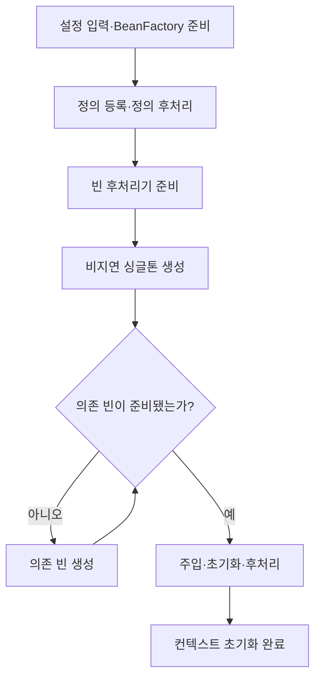
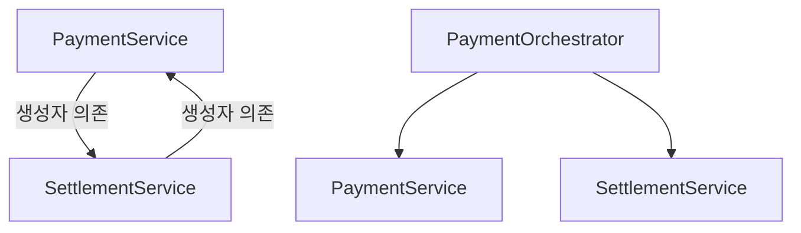
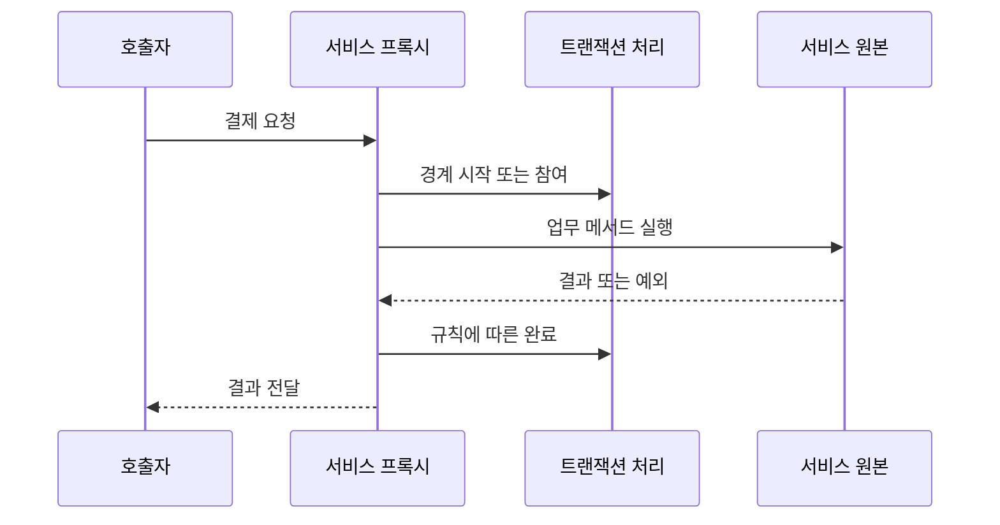

# 스프링 컨테이너와 빈 생성 원리

> 김영한님의 「스프링 핵심 원리 - 기본편」 공개 소개·커리큘럼을 학습 범위의 참고 자료로 사용했다. 유료 영상·교안을 열람하거나 재현한 문서가 아니다.
> 기술 설명은 Spring 공식 문서와 공개 소스를 바탕으로 독립적으로 작성했고, 결제 예제와 운영 사례는 직접 구성했다.
> Java 17+, Spring Framework 6.x의 일반적인 JVM·명령형 애플리케이션을 전제로 한다. AOT·네이티브 이미지와 특수 커스텀 컨테이너 경로는 제외한다. 코드는 학습용이며 운영 결제 구현이 아니다.

## 1. 컨테이너가 해결하는 문제: 객체 사용과 조립의 분리

결제 서비스가 직접 PG 구현체를 생성하면 업무 코드가 구체적인 연동 방식에 묶인다.

```java
// 직접 조립: 서비스가 구현체 선택까지 책임진다.
class PaymentService {
    private final PgClient pgClient = new SandboxPgClient();
}
```

생성자로 필요한 객체를 받도록 바꾸면 결제 서비스는 승인 요청을 수행하고, 외부 구성 코드가 구현체를 결정할 수 있다.

```java
class PaymentService {
    private final PgClient pgClient;

    PaymentService(PgClient pgClient) {
        this.pgClient = pgClient;
    }
}
```

이 시점에는 Spring이 없어도 DI가 성립한다. Spring 컨테이너를 사용하면 객체 조립에 더해 생성 시점, 공유 범위, 초기화, 종료, 후처리를 일관되게 관리할 수 있다.

- **IoC**: 애플리케이션 코드가 모두 통제하던 객체 구성과 실행 흐름의 일부를 프레임워크에 맡긴다.
- **DI**: 사용할 협력 객체를 외부에서 전달받는다.
- **빈**: 컨테이너가 관리하는 객체다. 클래스에 어노테이션을 붙이는 것만으로 현재 컨테이너에 반드시 등록되는 것은 아니다.

예를 들어 스캔 범위 밖의 `@Service`는 자동 등록되지 않는다. 반대로 `@Bean` 메서드 안에서 `new`로 만든 객체도 반환되어 등록되면 빈이다.

## 2. BeanFactory와 ApplicationContext

| 구분 | 역할 | 사용 관점 |
| --- | --- | --- |
| BeanFactory | 빈 조회·생성·의존관계 관리의 기본 계약 | 컨테이너 내부 동작 이해 |
| ApplicationContext | BeanFactory 기능에 이벤트·리소스·메시지 등 애플리케이션 기능 확장 | 일반적인 Spring 앱의 진입점 |
| BeanDefinition | 생성 방법·스코프·의존성 등 메타데이터 | 실제 객체가 아닌 정의 |
| BeanPostProcessor | 생성 중인 빈 인스턴스 후처리 | 초기화 콜백·프록시 등 확장 |

컨테이너를 단순히 Map 하나라고 생각하면 등록과 조회는 설명할 수 있지만, 의존성 해결과 생명주기까지 설명하기 어렵다. **객체의 생성 규칙과 실제 인스턴스를 구분해 관리하는 객체 조립 시스템**으로 이해하는 편이 정확하다.

## 3. 빈 정의 등록과 인스턴스 생성은 다르다

`@ComponentScan`, `@Bean`, XML 등은 서로 다른 등록 경로다. 등록된 정의에는 다음 정보가 담길 수 있다.

| 메타데이터 | 결제 예시 |
| --- | --- |
| 빈 이름 | paymentService |
| 클래스 또는 팩토리 메서드 | PaymentService 또는 PaymentConfig.paymentService |
| 스코프 | singleton |
| 생성자·팩토리 인자 | PgClient 빈 |
| 지연 생성 여부 | lazyInit |
| 초기화·종료 메서드 | initialize / close |

정의가 있다고 항상 객체가 이미 있는 것은 아니다. lazy singleton이나 prototype은 조회 등으로 실제 생성이 필요해지는 시점까지 미뤄질 수 있다.

### 컨테이너 기동 흐름

아래는 `ApplicationContext.refresh()`의 핵심 단계를 학습용으로 압축한 것이다. 모든 내부 호출을 표현한 것은 아니다.[2]



실제로는 설정 파싱 과정 자체에서도 정의가 추가된다. 모든 정의가 첫 단계에서 완전히 확정된 뒤 단순히 차례로 객체를 만드는 구조는 아니다. 인프라 빈과 후처리기는 일반 업무 빈보다 이른 시점에 생성될 수 있다.

소스를 읽을 때는 다음 지점을 연결하면 흐름을 잡기 쉽다.

| 위치 | 확인할 내용 |
| --- | --- |
| AbstractApplicationContext.refresh | 전체 초기화 순서 |
| invokeBeanFactoryPostProcessors | 정의 등록·수정에 참여하는 후처리 |
| registerBeanPostProcessors | 인스턴스 후처리기 등록 |
| finishBeanFactoryInitialization | 남은 비지연 싱글톤 초기화 |
| finishRefresh | 컨텍스트 초기화 마무리·이벤트 |

이 순서는 **애플리케이션이 트래픽을 받을 준비가 됐다는 운영 판정**과는 구분한다. 외부 의존 시스템 상태나 Boot runner 작업 완료 여부는 별도 readiness 기준에 반영해야 한다.

## 4. 결제 예제로 등록부터 종료까지 확인하기

아래 클래스들은 각각 별도 파일에 두고 같은 패키지를 사용한다. 실제 PG 호출 없이 생명주기만 관찰하는 예제다.

필요 라이브러리는 `spring-context`와 `jakarta.annotation-api`다. Boot 프로젝트라면 사용하는 Boot BOM에 맞춰 버전을 관리한다.

```java
// PgClient.java
public interface PgClient {
    String approve(String requestId, long amount);
}
```

```java
// SandboxPgClient.java
public class SandboxPgClient implements PgClient {
    public SandboxPgClient() {
        System.out.println("1. SandboxPgClient 생성");
    }

    @Override
    public String approve(String requestId, long amount) {
        // 실제 승인 결과가 아닌 학습용 값
        return "SIMULATED_APPROVED:" + requestId;
    }
}
```

```java
// PaymentService.java
import jakarta.annotation.PostConstruct;
import jakarta.annotation.PreDestroy;

public class PaymentService {
    private final PgClient pgClient;

    public PaymentService(PgClient pgClient) {
        this.pgClient = pgClient;
        System.out.println("2. PaymentService 생성·생성자 주입");
    }

    @PostConstruct
    public void initialize() {
        System.out.println("3. PaymentService 초기화");
    }

    public String approve(String requestId, long amount) {
        if (requestId == null || requestId.isBlank() || amount <= 0) {
            throw new IllegalArgumentException("invalid payment");
        }
        return pgClient.approve(requestId, amount);
    }

    @PreDestroy
    public void shutdown() {
        System.out.println("5. PaymentService 종료");
    }
}
```

```java
// PaymentConfig.java
import org.springframework.context.annotation.Bean;
import org.springframework.context.annotation.Configuration;

@Configuration(proxyBeanMethods = false)
public class PaymentConfig {
    @Bean
    public PgClient pgClient() {
        return new SandboxPgClient();
    }

    @Bean
    public PaymentService paymentService(PgClient pgClient) {
        // 메서드 인자에 컨테이너가 관리하는 PgClient를 주입
        return new PaymentService(pgClient);
    }
}
```

```java
// PaymentDemo.java
import org.springframework.context.annotation.AnnotationConfigApplicationContext;

public class PaymentDemo {
    public static void main(String[] args) {
        try (var context =
                     new AnnotationConfigApplicationContext(PaymentConfig.class)) {

            PaymentService first = context.getBean(PaymentService.class);
            PaymentService second = context.getBean(PaymentService.class);

            System.out.println("동일 빈: " + (first == second));
            System.out.println("4. " + first.approve("demo-001", 10_000));
        } // close() → 관리 대상 싱글톤의 종료 콜백
    }
}
```

예상 관찰 결과:

```text
1. SandboxPgClient 생성
2. PaymentService 생성·생성자 주입
3. PaymentService 초기화
동일 빈: true
4. SIMULATED_APPROVED:demo-001
5. PaymentService 종료
```

이는 실행 검증 결과가 아닌 예제의 예상 출력이다. 이 구성에서는 AOP를 활성화하지 않았으므로 조회한 객체가 트랜잭션 프록시라고 가정하지 않는다.

## 5. 빈 하나는 어떤 순서로 만들어질까?

일반적인 비순환 빈 생성 경로는 다음과 같이 이해할 수 있다.[3][4]

1. 생성자 또는 팩토리 메서드에 필요한 의존성을 찾는다.
2. 의존 객체가 없으면 먼저 생성한다.
3. 생성자·팩토리 메서드로 대상 객체를 만든다.
4. 필요한 필드·setter 주입을 수행한다.
5. Aware 콜백과 초기화 전 후처리 등을 수행한다.
6. 초기화 콜백을 실행한다.
7. 초기화 후 후처리를 수행하고, 필요한 경우 프록시로 감싼다.
8. 최종 노출 객체를 조회자에게 반환하고 싱글톤이면 재사용한다.

**생성자 주입은 “객체를 먼저 만든 뒤 주입”하는 방식이 아니다.** 생성자 호출 시 이미 인자를 전달해야 하므로 의존성 해결이 객체 생성과 연결된다.

또한 `@PostConstruct`는 BeanPostProcessor의 초기화 전 처리 단계에서 실행된다. 이를 “모든 초기화 전 후처리가 끝난 다음 무조건 실행되는 별도 단계”라고 외우면 정확하지 않다.

여러 초기화 방식을 서로 다른 메서드로 함께 설정한 일반적인 경우는 다음 순서다.[4]

| 초기화 | 종료 |
| --- | --- |
| @PostConstruct | @PreDestroy |
| InitializingBean.afterPropertiesSet | DisposableBean.destroy |
| 사용자 지정 initMethod | 사용자 지정 destroyMethod |

실무에서는 같은 목적의 콜백을 중복으로 구현하지 않는 편이 이해하기 쉽다. Spring 6 예제의 생명주기 어노테이션은 `jakarta.annotation` 패키지다.

생성 전 객체 대체, 순환 참조의 조기 노출 같은 확장 경로는 위 단순 흐름의 예외다. “모든 빈의 프록시는 항상 마지막에 처음 만들어진다”는 단정도 피한다.

## 6. 생성자 주입과 자동 등록

컴포넌트 스캔을 사용한다면 설정 대신 다음과 같이 등록할 수 있다. 앞의 수동 등록 예제와 동시에 사용해 같은 서비스 빈을 중복 생성하지 않는다.

```java
import org.springframework.stereotype.Service;

@Service
public class PaymentFacade {
    private final PgClient pgClient;

    // 생성자가 하나라면 @Autowired 없이 주입 가능
    public PaymentFacade(PgClient pgClient) {
        this.pgClient = pgClient;
    }
}
```

필수 의존성이 코드에 드러나고 `final` 필드로 유지되므로 생성자 주입을 기본으로 선택하기 좋다. 다만 final은 참조 재할당을 막을 뿐, 참조하는 객체 내부의 동시성까지 보장하지는 않는다.

같은 타입의 PG 구현이 둘이라면 어느 구현을 사용할지 명시한다.

```java
public PaymentFacade(
        @org.springframework.beans.factory.annotation.Qualifier("primaryPgClient")
        PgClient pgClient) {
    this.pgClient = pgClient;
}
```

| 상황 | 판단 |
| --- | --- |
| 후보 없음 | 스캔 범위·프로파일·조건부 등록·타입 확인 |
| 후보 여러 개 | Qualifier·Primary 등 선택 기준 명시 |
| 구현체가 final | DI 자체와 프록시 생성 제약을 구분 |
| 테스트에서 직접 new | 단위 테스트 가능. 컨테이너 기능은 자동 적용되지 않음 |

## 7. @Configuration의 프록시는 왜 필요한가?

기본 `@Configuration`에서는 컨테이너가 관리하는 설정 클래스의 `@Bean` 메서드 간 호출을 가로채 빈 재사용 규칙을 적용한다.[5]

```java
@Configuration
public class FullPaymentConfig {
    @Bean
    public PgClient pgClient() {
        return new SandboxPgClient();
    }

    @Bean
    public PaymentService paymentService() {
        return new PaymentService(pgClient());
    }
}
```

반대로 `proxyBeanMethods = false`에서 위처럼 직접 호출하면 평범한 Java 메서드 호출이 된다. 반환한 객체가 등록된 pgClient와 다른 인스턴스가 될 수 있다.

그래서 4절에서는 다음 패턴을 사용했다.

```java
@Bean
public PaymentService paymentService(PgClient pgClient) {
    return new PaymentService(pgClient);
}
```

**proxyBeanMethods=false는 “빈이 싱글톤이 아니다”라는 뜻이 아니다.** 컨테이너의 싱글톤 관리는 그대로이고, 설정 메서드 직접 호출을 가로채는 기능이 꺼지는 것이다.

설정 클래스 프록시와 `@Transactional`을 위한 업무 빈 AOP 프록시는 목적이 다르다.

## 8. BeanFactoryPostProcessor와 BeanPostProcessor

| 구분 | 주 대상 | 대표 용도 |
| --- | --- | --- |
| BeanDefinitionRegistryPostProcessor | 빈 정의 레지스트리 | 정의 추가·설정 클래스 처리 |
| BeanFactoryPostProcessor | 빈 정의 메타데이터 | 생성 전에 설정 보정 |
| BeanPostProcessor | 실제 빈 객체 | 초기화 처리·객체 래핑 |

BeanFactoryPostProcessor에서 업무 빈을 성급히 `getBean()`으로 꺼내면 정상적인 후처리 준비 전에 생성할 수 있다. 후처리기 자체와 그 의존성은 일반 서비스보다 일찍 초기화될 수 있으므로 의존관계를 작게 유지한다.[3]

다음은 paymentService가 초기화 후 처리에 도달했는지 확인하는 학습용 후처리기다. 기존 PaymentConfig에 메서드로 추가할 수 있다.

```java
@Bean
public static org.springframework.beans.factory.config.BeanPostProcessor
        paymentLifecycleTracer() {
    return new org.springframework.beans.factory.config.BeanPostProcessor() {
        @Override
        public Object postProcessAfterInitialization(
                Object bean, String beanName) {
            if ("paymentService".equals(beanName)) {
                System.out.println("초기화 후 관찰: " + bean.getClass().getName());
            }
            return bean;
        }
    };
}
```

여기서 관찰한 타입이 모든 후처리를 마친 최종 타입이라는 보장은 없다. 뒤에 실행되는 후처리기가 다시 래핑할 수 있다.

운영에서 모든 빈의 `toString()`을 출력하는 식의 추적은 피한다. 연결 설정이나 민감 정보가 노출되거나 불필요한 작업을 유발할 수 있다.

## 9. 싱글톤: 하나의 객체를 여러 요청이 공유한다

Spring 싱글톤은 **컨테이너별·빈 정의별** 공유다. 같은 클래스라도 서로 다른 이름의 정의로 두 번 등록하면 두 객체가 될 수 있다. JVM 전체 또는 6대 WAS 전체에서 하나라는 의미가 아니다.[6]

아래 코드는 결제 금액이 요청 사이에 섞일 수 있다.

```java
// 잘못된 예: 싱글톤 필드에 요청별 값을 저장
class UnsafePaymentService {
    private long currentAmount;

    public long prepare(long amount) {
        this.currentAmount = amount;
        // 다른 요청이 currentAmount를 바꿀 수 있는 구간
        return this.currentAmount;
    }
}
```

요청별 값은 메서드 인자·지역 변수·요청 DTO로 유지한다.

```java
class SafePaymentCalculation {
    public long calculateTotal(long amount, long fee) {
        if (amount <= 0 || fee < 0) {
            throw new IllegalArgumentException("invalid amount");
        }
        return Math.addExact(amount, fee);
    }
}
```

단, 지역 변수가 공유 가변 객체를 참조하면 그 객체의 안전성은 따로 검토해야 한다. 서비스가 무상태여도 DB 중복 결제·잔액 경합이 자동 해결되지는 않는다. DB 제약, 원자적 갱신, 멱등성 설계는 별개다.

## 10. 스코프와 지연 생성

| 설정 | 생성·공유 기준 | 주의할 점 |
| --- | --- | --- |
| singleton | 컨테이너 내 해당 정의의 공유 인스턴스 | 요청 데이터 필드 저장 금지 |
| prototype | 컨테이너가 요청받을 때 새 인스턴스 | 종료 콜백 자동 관리 안 함 |
| request | HTTP 요청 범위 | 웹 컨텍스트 필요 |
| session | HTTP 세션 범위 | 동시 요청이 가능하므로 자동 thread-safe 아님 |
| @Lazy | 필요한 시점으로 생성 지연 | 스코프 자체를 바꾸지 않음 |

싱글톤 생성자에 prototype을 직접 주입하면 주입 시 받은 하나를 계속 사용한다. 매번 새 객체가 필요하면 `ObjectProvider.getObject()` 같은 조회 방식을 검토한다.[6]

지연 빈도 비지연 싱글톤이 실제 의존 객체로 필요로 하면 기동 중 생성될 수 있다. 지연 참조 프록시를 사용하는 방식과 빈 정의의 지연 초기화를 구분한다.

운영 판단 예: 필수 결제 설정의 오류를 기동 시 발견하고 싶다면 무분별한 lazy 적용이 오히려 첫 결제 요청까지 장애를 숨길 수 있다.

## 11. 순환 참조: 생성 순서보다 책임 분리를 먼저 본다



위쪽은 서로 먼저 만들어져야 하는 구조다. 일반적인 직접 생성자 순환 의존은 생성할 수 없어 오류가 발생한다.[7]

아래쪽처럼 상위 조정 서비스를 두거나 공통 기능을 추출해 의존 방향을 정리하는 것이 우선이다. `@Lazy`나 setter 변경은 일부 생성 문제를 우회할 수 있지만 업무 책임의 순환까지 없애지는 않는다.

운영 결제에서 이벤트로 의존을 분리할 때는 같은 트랜잭션인지, 커밋 후 실행인지, 실패 시 재처리가 필요한지까지 결정해야 한다. 단순 메모리 이벤트를 영속적인 작업 전달로 간주하면 안 된다.

## 12. @PostConstruct에서 결제 호출을 하면 안 되는 이유

초기화 콜백은 해당 빈을 사용할 준비를 하는 단계다. 실제 결제·송금을 실행하는 지점으로 사용하지 않는다.

- 재배포·재기동마다 호출되므로 거래가 반복될 수 있다.
- 여러 WAS가 동시에 기동하면 인스턴스별로 실행될 수 있다.
- 외부 PG 지연이 기동 지연으로 이어질 수 있다.
- 자기 자신의 초기화 메서드에 붙인 트랜잭션 어노테이션이 정상 AOP 호출처럼 적용된다고 기대하면 안 된다.

초기화에는 가벼운 설정 검증 등을 두고, 필수 외부 연결 확인이 필요하다면 타임아웃·실패 시 기동 정책을 명시한다. 정산 실행·복구 작업은 별도 배치 또는 명시적인 작업 진입점으로 분리한다.

정상 종료 콜백도 강제 종료나 프로세스 장애 시 항상 실행되는 것은 아니다. “종료될 때만 DB에 반영”하는 결제 상태 설계는 피한다.

## 13. AOP 프록시와 기존 트랜잭션 문서 연결

컨테이너가 서비스 원본을 만들고 초기화한 뒤, 적용 가능한 advisor가 있으면 프록시를 노출할 수 있다. 그러므로 주입받은 객체가 원본 클래스 그 자체라는 가정은 위험하다.



기본 프록시 방식에서 `this.otherMethod()`는 프록시를 다시 통과하지 않는다. `new PaymentService(...)`로 직접 만든 객체 역시 컨테이너가 제공하는 트랜잭션 처리 객체로 자동 변환되지 않는다.

관련 상세: [트랜잭션 전파: 결제·송금 Java 예제](transaction-propagation.md)

## 14. 운영 문제를 생성 단계에 연결하기

| 증상 | 먼저 확인할 내용 |
| --- | --- |
| 필요한 빈을 찾지 못함 | 패키지 스캔, 프로파일, 조건, 컨텍스트 계층 |
| 동일 타입 후보가 여러 개 | Qualifier·Primary와 중복 등록 |
| BeanCreationException | 가장 안쪽 원인과 실패한 빈의 의존 경로 |
| 시작이 오래 걸림 | 생성자·초기화 콜백의 외부 통신, 대량 캐시 적재 |
| 일부 빈에 AOP 미적용 경고 | 후처리기 의존성으로 인한 조기 생성 |
| 결제 요청 값이 간헐적으로 섞임 | 싱글톤의 가변 필드 |
| 종료 시 자원 정리가 안 됨 | 스코프, 컨텍스트 close, 강제 종료 여부 |
| WAS별 캐시 값이 다름 | JVM별 싱글톤·로컬 캐시라는 특성 |

`@Order`를 임의의 빈 생성 순서를 강제하는 만능 설정으로 쓰지 않는다. 객체가 필요하면 의존관계로 표현하고, 주입 없이 선행 초기화가 필요한 경우에 한해 `@DependsOn`의 필요성을 검토한다.

이 문서의 권장 확인 항목은 다음과 같다.

1. 같은 컨텍스트에서 같은 singleton 빈을 두 번 조회하면 같은 객체인지 확인한다.
2. 의존 빈이 준비된 뒤 서비스 생성자가 실행되는지 관찰한다.
3. close 시 종료 콜백이 실행되는지 확인한다.
4. proxyBeanMethods=false에서 직접 호출과 인자 주입 결과를 비교한다.
5. 프록시 적용 여부와 내부 호출의 차이를 별도 통합 테스트로 확인한다.

Java 예제의 컴파일·실행 및 실제 WAS 검증은 수행하지 않았다. 예상 동작과 운영 적용 여부를 구분해서 사용한다.

## 참고 자료

1. [김영한 — 스프링 핵심 원리 - 기본편 공식 강의 소개·커리큘럼](https://www.inflearn.com/course/스프링-핵심-원리-기본편): 학습 범위 참고.
2. [Spring 소스 — AbstractApplicationContext](https://github.com/spring-projects/spring-framework/blob/main/spring-context/src/main/java/org/springframework/context/support/AbstractApplicationContext.java): refresh 흐름. main은 변경될 수 있으므로 실제 디버깅은 사용 버전 태그로 확인.
3. [Spring — Container Extension Points](https://docs.spring.io/spring-framework/reference/core/beans/factory-extension.html)
4. [Spring — Customizing the Nature of a Bean](https://docs.spring.io/spring-framework/reference/core/beans/factory-nature.html)
5. [Spring — @Bean and @Configuration](https://docs.spring.io/spring-framework/reference/core/beans/java/basic-concepts.html)
6. [Spring — Bean Scopes](https://docs.spring.io/spring-framework/reference/core/beans/factory-scopes.html)
7. [Spring — Dependency Injection](https://docs.spring.io/spring-framework/reference/6.2/core/beans/dependencies/factory-collaborators.html)

공식 레퍼런스의 버전 없는 URL은 최신판으로 바뀔 수 있다. 이 글은 6.x에서 일반적으로 사용하는 생명주기 개념을 설명하며, 버전별 세부 생성 경로·기본 설정은 해당 버전 문서와 소스로 확인한다.
