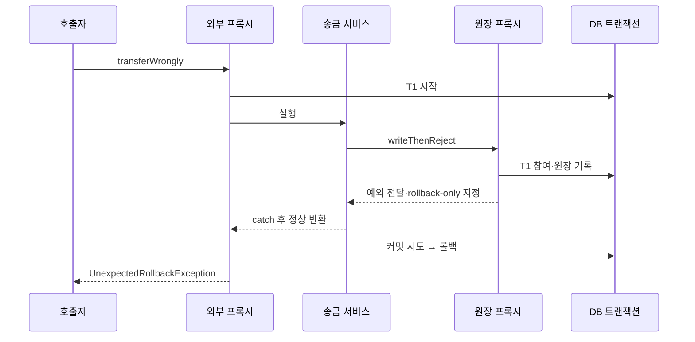
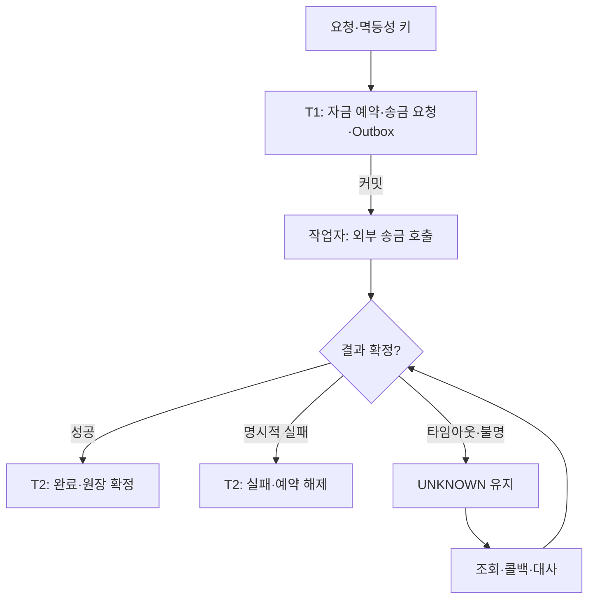

# Spring 트랜잭션 전파: 결제·송금 예제로 이해하기

> Java 17 이상, Spring Framework 6.1 계열의 명령형 JDBC 트랜잭션을 기준으로 한 학습 문서다.
> 모든 Java 코드는 설명용 발췌이며, 실행 가능한 완성 프로젝트가 아니다.
> 표준 기본 롤백 규칙을 전제하며 커스텀 트랜잭션 매니저 설정은 제외한다.

## 1. 전파와 격리는 다른 문제다

**전파(propagation)**는 메서드를 호출할 때 이미 진행 중인 트랜잭션을 참여·중단·거절할지 결정한다.
**격리(isolation)**는 서로 다른 트랜잭션이 동시에 접근할 때 어떤 데이터를 볼 수 있는지 결정한다.

송금 메서드가 출금·입금·원장 서비스를 호출할 때 전파를 결정한다. 다른 송금 요청이 같은 계좌를 갱신하는 문제에는 격리 수준, 조건부 UPDATE, 잠금, 멱등성이 필요하다. REQUIRED를 붙이는 것만으로 중복 송금이 방지되지는 않는다.

```java
@Transactional(
    transactionManager = "paymentTxManager",
    propagation = Propagation.REQUIRED,
    isolation = Isolation.READ_COMMITTED
)
public void transfer(TransferCommand command) {
    // 전파: 기존 트랜잭션 참여 또는 새로 시작
    // 격리: 새 물리 트랜잭션을 만들 때 적용
}
```

기존 트랜잭션에 참여하면 내부 메서드의 isolation·timeout이 독립적으로 적용되지 않는다. 상위 트랜잭션 속성과 충돌을 검증하도록 매니저를 설정할 수 있지만, 다른 격리 수준이 필요하다는 이유만으로 돈의 이동을 REQUIRES_NEW로 쪼개면 원자성이 깨질 수 있다.[1][2]

## 2. 7가지 전파 한눈에 보기

여기서 '기존 트랜잭션'은 **선택한 트랜잭션 매니저가 현재 실행 문맥에서 인식하는 트랜잭션**이다.

| 전파 | 기존 트랜잭션 없음 | 기존 트랜잭션 있음 | 핀테크 사용 예 |
| --- | --- | --- | --- |
| REQUIRED | 신규 시작 | 참여 | 출금·입금·원장 일괄 처리 |
| REQUIRES_NEW | 신규 시작 | 기존 것을 중단하고 독립 신규 시작 | 본 거래 실패와 별개로 남길 시도 감사 |
| NESTED | 신규 시작 | savepoint 기반 중첩 처리 | 실패해도 본 결제를 유지할 선택적 부가 기록 |
| SUPPORTS | 트랜잭션 없이 실행 | 참여 | 상위 문맥을 따르는 단순 조회 |
| NOT_SUPPORTED | 트랜잭션 없이 실행 | 기존 것을 중단하고 실행 | 별도 조회성 외부 호출 |
| MANDATORY | 예외 | 참여 | 상위 거래 없이는 실행하면 안 되는 원장 작성 |
| NEVER | 트랜잭션 없이 실행 | 예외 | DB 트랜잭션 안에서 호출되면 안 되는 외부 API 진입점 |

SUPPORTS의 비트랜잭션 실행도 매니저의 synchronization 설정에 따라 자원을 공유할 수 있어, 아무 어노테이션도 없는 것과 내부 자원 동작까지 항상 같지는 않다.[3]

## 3. 예제 전제와 공통 타입

- 같은 DataSource를 JdbcTemplate과 paymentTxManager가 사용한다.
- 서비스는 Spring Bean이며 다른 Bean의 public 메서드를 프록시를 통해 호출한다.
- 각 public 클래스는 별도 파일에 둔다. 예제에서는 반복을 줄이기 위해 Lombok 생성자 주입을 사용한다.
- 공통 import는 org.springframework.stereotype.Service, org.springframework.transaction.annotation.Transactional, org.springframework.transaction.annotation.Propagation, org.springframework.transaction.annotation.Isolation, lombok.RequiredArgsConstructor다.
- JPA Repository의 자체 트랜잭션이 설명을 혼동시키지 않도록 JDBC 저장소를 전제로 한다.
- 예제 금액은 원화의 정수 최소 단위 long이다. 다중 통화는 통화 코드·소수 자릿수·반올림 정책을 추가해야 한다.
- 감사·선택적 부가 기록은 테스트에서 본 거래와 별도 테이블을 사용한다.

```java
public record TransferCommand(
    String requestId, long fromAccountId, long toAccountId, long amount
) {
    public TransferCommand {
        if (requestId == null || requestId.isBlank()) {
            throw new IllegalArgumentException("requestId required");
        }
        if (amount <= 0 || fromAccountId == toAccountId) {
            throw new IllegalArgumentException("invalid transfer");
        }
    }
}

public class InsufficientBalanceException extends RuntimeException {
    public InsufficientBalanceException() { super("insufficient balance"); }
}

public class LedgerRejectedException extends RuntimeException {
    public LedgerRejectedException() { super("ledger rejected"); }
}

public class OptionalBenefitException extends RuntimeException {
    public OptionalBenefitException() { super("optional benefit rejected"); }
}
```

이 문서의 예제용 저장소 계약이다. 구현 시 SQL과 스키마를 별도로 작성해야 한다.

```java
public interface AccountRepository {
    // 잔액이 충분할 때만 차감. 갱신 건수 반환.
    int debitIfEnough(long accountId, long amount);
    int credit(long accountId, long amount);
}
public interface TransferRepository {
    // request_id UNIQUE. 중복이면 기존 결과 조회/응답 정책으로 처리.
    void insert(TransferCommand command);
}
public interface LedgerRepository {
    // 동일 DB에 출금/입금 양쪽 원장 기록.
    void insertBalancedEntries(TransferCommand command);
}
public interface AuditRepository {
    // 미커밋 거래 행을 FK로 참조하지 않는 독립 감사 저장.
    void insert(String requestId, String eventCode);
}
public interface PaymentRepository {
    void insert(String paymentId, long amount);
    long findAmount(String paymentId);
}
public interface BenefitRepository {
    void insertReservation(String paymentId);
}
public interface BankClient {
    // 예제는 조회 전용. 실제 송금 실행 API와 구분.
    String fetchTransferStatus(String requestId);
}
```

조건부 출금 SQL 예시:

```sql
UPDATE account
SET balance = balance - :amount
WHERE account_id = :accountId
  AND balance >= :amount;
```

갱신 0건은 계좌 없음 또는 잔액 부족 등을 정책에 맞게 구분한다. 금액 양수 검증은 SQL 호출 전 수행한다. 실제 양방향 송금에서 교착을 줄이려면 두 계좌를 일정 순서로 잠그는 전략도 검토한다. 입금 한도·숫자 범위도 별도 검증 대상이다.

## 4. REQUIRED: 돈의 이동을 하나로 묶는다

기본 전파다. 각 프록시 메서드에 논리적 범위가 생겨도 같은 물리 트랜잭션에 참여할 수 있다.[1]

```java
@Service
@RequiredArgsConstructor
public class TransferService {
    private final AccountRepository accounts;
    private final TransferRepository transfers;
    private final LedgerService ledger;

    @Transactional(transactionManager = "paymentTxManager")
    public void transfer(TransferCommand command) {
        transfers.insert(command); // UNIQUE request_id로 중복 진입 검출

        if (accounts.debitIfEnough(
                command.fromAccountId(), command.amount()) != 1) {
            throw new InsufficientBalanceException();
        }
        if (accounts.credit(
                command.toAccountId(), command.amount()) != 1) {
            throw new IllegalStateException("recipient account not found");
        }
        ledger.write(command); // 다른 Bean의 프록시 호출
    }
}

@Service
@RequiredArgsConstructor
public class LedgerService {
    private final LedgerRepository repository;

    @Transactional(
        transactionManager = "paymentTxManager",
        propagation = Propagation.REQUIRED
    )
    public void write(TransferCommand command) {
        repository.insertBalancedEntries(command);
    }
}
```

### 결과

| 상황 | 출금 | 입금 | 거래·원장 |
| --- | --- | --- | --- |
| 모두 성공 | 커밋 | 커밋 | 커밋 |
| 입금 처리 중 RuntimeException | 롤백 | 롤백 | 롤백 |
| 원장 처리 중 RuntimeException이 밖으로 전달 | 롤백 | 롤백 | 롤백 |

내부 REQUIRED 메서드가 반환된 것은 최종 커밋이 아니다. 가장 바깥의 물리 트랜잭션이 성공적으로 종료돼야 확정된다.

### catch했는데 UnexpectedRollbackException이 발생하는 이유

아래는 의도적으로 실패하는 학습용 반례다.

```java
@Service
@RequiredArgsConstructor
public class RejectingLedgerService {
    private final LedgerRepository repository;

    @Transactional(transactionManager = "paymentTxManager")
    public void writeThenReject(TransferCommand command) {
        repository.insertBalancedEntries(command);
        throw new LedgerRejectedException();
    }
}

@Service
@RequiredArgsConstructor
public class CatchingTransferService {
    private final TransferRepository transfers;
    private final RejectingLedgerService ledger;

    @Transactional(transactionManager = "paymentTxManager")
    public void transferWrongly(TransferCommand command) {
        transfers.insert(command);
        try {
            ledger.writeThenReject(command);
        } catch (LedgerRejectedException ignored) {
            // 메서드 흐름만 계속될 뿐, rollback-only는 제거되지 않는다.
        }
    }
}
```



내부 RuntimeException이 **내부 트랜잭션 프록시 경계를 통과**해 공유 트랜잭션에 rollback-only가 표시됐기 때문이다. 이미 실패한 거래를 정상 커밋으로 오인하지 않도록 호출자에게 실패를 알린다.[1]

예외를 같은 메서드 안에서 잡아 프록시 밖으로 전혀 내보내지 않았다면 Spring이 그 예외를 기준으로 롤백을 결정하지 못할 수 있다. 반대로 DB·JPA 공급자가 자체적으로 실패 상태를 지정했을 수도 있다. 'catch하면 커밋' 또는 '예외가 한 번 나면 무조건 롤백' 모두 부정확하다.

## 5. REQUIRES_NEW: 본 거래와 독립된 감사 기록

외부 T1을 중단하고 별도의 T2를 시작한다. T2가 커밋된 뒤 T1이 롤백돼도 T2는 남는다.[1]

```java
@Service
@RequiredArgsConstructor
public class AttemptAuditService {
    private final AuditRepository audits;

    @Transactional(
        transactionManager = "paymentTxManager",
        propagation = Propagation.REQUIRES_NEW
    )
    public void recordAttempt(String requestId) {
        audits.insert(requestId, "TRANSFER_ATTEMPTED");
    }
}

@Service
@RequiredArgsConstructor
public class AuditedTransferService {
    private final AttemptAuditService audit;
    private final TransferService transferService;

    @Transactional(transactionManager = "paymentTxManager")
    public void transfer(TransferCommand command) {
        audit.recordAttempt(command.requestId()); // T2 독립 커밋
        transferService.transfer(command);        // T1 참여
    }
}
```

출금이 실패하면 본 거래는 롤백되지만 TRANSFER_ATTEMPTED는 남는다. 이 기록을 SUCCESS로 쓰면 안 된다. 기록하는 사실은 시도이며 최종 결과가 아니다.

| 상황 | 감사 T2 | 송금 T1 |
| --- | --- | --- |
| 감사 성공, 송금 실패 | 유지 | 롤백 |
| 감사 실패가 외부로 전파 | 롤백 | 예외의 롤백 규칙에 따라 롤백 |
| 감사 실패를 외부에서 catch | 롤백 | 외부가 정상 상태라면 계속 가능 |

독립 트랜잭션이라는 뜻은 **예외 전파까지 차단한다는 뜻이 아니다.** 위 예제는 감사 저장 실패 시 본 거래도 중단하는 정책이다. 감사 실패를 허용하려면 명시적인 catch와 대체 기록·알람 정책을 설계한다.

### 운영에서 조심할 점

- 실제로 T1이 커넥션을 점유한 상태에서 T2가 추가 커넥션을 필요로 할 수 있다. 외부 동시 작업 수만큼만 풀을 잡으면 모두 내부 커넥션을 기다릴 수 있다.
- 풀 크기는 중첩 깊이·동시성·다른 업무 사용량을 반영한다. '무조건 두 배'라는 공식으로 확정하지 않는다.
- T1이 잠근 행을 T2가 수정하면 T1은 T2 종료를 기다리고 T2는 T1 잠금을 기다릴 수 있다. 풀 증설로 해결되지 않는 대기다.
- 미커밋 송금 행을 T2에서 조회하거나 FK로 참조하면 조회 불가·잠금 대기가 발생할 수 있다. 감사에는 독립적인 요청 ID와 필요한 값만 전달한다.
- 출금을 T1, 입금을 T2에 두면 입금만 확정되는 등 돈의 이동이 분리될 수 있다. 핵심 원장에는 무분별하게 사용하지 않는다.

## 6. NESTED: 같은 거래의 일부만 되돌린다

아래는 JDBC savepoint를 지원하는 매니저·드라이버를 전제로 한다. 필수 정산 기록이 아니라 **실패 시 생략해도 되는 프로모션 부가 기록**을 예로 든다.

```java
@Service
@RequiredArgsConstructor
public class OptionalBenefitService {
    private final BenefitRepository benefits;

    @Transactional(
        transactionManager = "paymentTxManager",
        propagation = Propagation.NESTED
    )
    public void reserveThenReject(String paymentId) {
        benefits.insertReservation(paymentId);
        // 부분 롤백을 관찰하기 위한 의도적 실패
        throw new OptionalBenefitException();
    }
}

@Service
@RequiredArgsConstructor
public class PaymentWithBenefitService {
    private final PaymentRepository payments;
    private final OptionalBenefitService benefits;

    @Transactional(transactionManager = "paymentTxManager")
    public void pay(String paymentId, long amount) {
        if (amount <= 0) throw new IllegalArgumentException("amount");
        payments.insert(paymentId, amount);
        try {
            benefits.reserveThenReject(paymentId);
        } catch (OptionalBenefitException ignored) {
            // 선택적 혜택 실패만 허용한다. 모든 DB 예외를 삼키지 않는다.
        }
        // 본 결제 기록은 이후 커밋 가능
    }
}
```

T1 시작 → 결제 기록 → savepoint S1 → 혜택 기록 → 예외 → S1까지 롤백 → 외부가 catch → T1 커밋.
결과는 결제 기록 1건, 혜택 기록 0건이다.

### REQUIRES_NEW와 비교

| 항목 | REQUIRES_NEW | NESTED |
| --- | --- | --- |
| 물리 트랜잭션 | 별도 T2 | 같은 T1 |
| 내부 성공 후 외부 롤백 | 내부 커밋 유지 | 내부 변경도 롤백 |
| 내부 실패를 외부가 처리 | T2만 롤백, T1 계속 가능 | savepoint로 부분 롤백, T1 계속 가능 |
| 독립 커밋 | 가능 | 불가 |
| JDBC 커넥션 | 추가 확보 가능성 | 보통 기존 커넥션 |
| 의도 | 독립적인 지속성 | 부분 실패 복구 |

내부 예외가 외부 프록시까지 전달되면 외부도 기본 규칙에 따라 롤백된다. NESTED를 붙였다고 자동으로 외부 성공이 보장되지 않는다.

DataSourceTransactionManager는 JDBC savepoint 기반 중첩을 지원한다.[4] **JpaTransactionManager의 nestedTransactionAllowed를 켜도 JPA 엔티티 상태까지 savepoint에 맞춰 복원되는 것이 아니다.** JPA 자체의 중첩 트랜잭션 지원으로 해석하지 않는다.[5]

DB가 전체 트랜잭션을 실패 상태로 만드는 오류, 커넥션 단절 등은 일반적인 부분 롤백 사례와 구분한다. NESTED를 범용 장애 복구 수단으로 사용하지 않는다.

## 7. SUPPORTS: 상위 문맥을 따르는 결제 조회

```java
@Service
@RequiredArgsConstructor
public class PaymentQueryService {
    private final PaymentRepository payments;

    @Transactional(
        transactionManager = "paymentTxManager",
        propagation = Propagation.SUPPORTS,
        readOnly = true
    )
    public long findAmount(String paymentId) {
        return payments.findAmount(paymentId);
    }
}
```

Controller에서 트랜잭션 없이 호출하면 새 물리 트랜잭션을 강제하지 않는다. 송금 서비스의 T1 안에서 호출하면 T1에 참여한다.

여러 SELECT가 반드시 같은 스냅샷을 봐야 하거나, 조회 후 갱신까지 원자적으로 처리해야 한다면 SUPPORTS만으로 그 요구를 충족하지 못한다. readOnly=true도 쓰기를 무조건 차단하는 보안 장치가 아니다. 실제 효과는 매니저·DB 설정에 따른다.[2][3]

## 8. NOT_SUPPORTED: 현재 트랜잭션을 잠시 중단한다

```java
@Service
@RequiredArgsConstructor
public class BankStatusQueryService {
    private final BankClient bank;

    @Transactional(
        transactionManager = "paymentTxManager",
        propagation = Propagation.NOT_SUPPORTED
    )
    public String query(String requestId) {
        return bank.fetchTransferStatus(requestId);
    }
}
```

T1에서 호출하면 해당 실행 동안 T1을 중단한다. **T1이 커밋되거나 기존 잠금이 풀리는 것은 아니다.** T1이 이미 커넥션·잠금을 보유했다면 외부 조회 시간 동안 계속 보유할 수 있다.

따라서 'HTTP 호출에 NOT_SUPPORTED만 붙이면 긴 DB 트랜잭션이 해결된다'는 결론은 잘못이다. 외부 orchestrator 자체를 비트랜잭션으로 두고 DB 단계만 짧게 묶는 편이 경계를 명확히 한다.

비트랜잭션 구간에서 JDBC를 여러 번 갱신하면 하나로 롤백되지 않을 수 있다. 하위 서비스가 REQUIRED라면 그 지점에서 새 트랜잭션이 시작될 수도 있다. 이 전파는 호출 트리 전체에서 트랜잭션 사용을 금지하는 기능이 아니다.[3]

## 9. MANDATORY: 원장은 반드시 상위 거래 안에서

```java
@Service
@RequiredArgsConstructor
public class MandatoryLedgerService {
    private final LedgerRepository ledger;

    @Transactional(
        transactionManager = "paymentTxManager",
        propagation = Propagation.MANDATORY
    )
    public void write(TransferCommand command) {
        ledger.insertBalancedEntries(command);
    }
}
```

출금·입금을 묶는 서비스에서 호출하면 같은 트랜잭션에 참여한다.
트랜잭션 없는 배치나 Controller에서 직접 호출하면 본문 실행 전에 IllegalTransactionStateException이 발생한다.

호출 구조의 계약을 강제할 때 유용하다. REQUIRED와 달리 '실수로 단독 호출해도 알아서 신규 트랜잭션이 생기는 동작'을 허용하지 않는다. 단, 내부 호출로 프록시를 우회하면 이 검사도 적용되지 않는다.

## 10. NEVER: 트랜잭션 안의 호출 자체를 거절한다

```java
@Service
@RequiredArgsConstructor
public class BankStatusGateway {
    private final BankClient bank;

    @Transactional(
        transactionManager = "paymentTxManager",
        propagation = Propagation.NEVER
    )
    public String query(String requestId) {
        return bank.fetchTransferStatus(requestId);
    }
}
```

비트랜잭션 orchestrator에서 호출하면 실행된다. T1 안에서 호출하면 IllegalTransactionStateException이 발생한다.

NOT_SUPPORTED는 T1을 중단하고 실행하지만, NEVER는 호출자의 잘못된 트랜잭션 경계를 빠르게 드러낸다. 선택한 매니저 기준 검사이므로 서로 다른 매니저·스레드·원격 서버의 트랜잭션까지 탐지하는 전역 장치는 아니다.

## 11. 설정 예시: NESTED를 명확히 검증하는 JDBC 구성

```java
@Configuration
@EnableTransactionManagement
public class PaymentTxConfig {
    @Bean("paymentTxManager")
    public PlatformTransactionManager paymentTxManager(DataSource dataSource) {
        DataSourceTransactionManager manager =
                new DataSourceTransactionManager(dataSource);
        manager.setNestedTransactionAllowed(true);
        manager.setValidateExistingTransaction(true);
        return manager;
    }

    @Bean
    public JdbcTemplate jdbcTemplate(DataSource dataSource) {
        return new JdbcTemplate(dataSource);
    }
}
```

추가 import: org.springframework.context.annotation.Bean/Configuration,
org.springframework.transaction.PlatformTransactionManager,
org.springframework.transaction.annotation.EnableTransactionManagement,
org.springframework.jdbc.datasource.DataSourceTransactionManager,
org.springframework.jdbc.core.JdbcTemplate, javax.sql.DataSource.

javax.sql.DataSource는 JDK API이므로 Spring 6에서도 jakarta.sql로 바꾸지 않는다.
JDBC 예제 설정을 JPA 애플리케이션에 그대로 추가해 서로 다른 매니저를 섞지 않는다.
운영 WAS의 JTA, 다중 DataSource, DB 드라이버에 따라 중단·savepoint 지원을 별도로 확인한다.[4][5]

## 12. 실무에서 자주 깨지는 경계

### 내부 호출: this.audit()에는 REQUIRES_NEW가 적용되지 않는다

```java
@Service
public class WrongPaymentService {
    @Transactional
    public void pay() {
        this.audit(); // 기본 proxy 방식에서는 프록시를 통과하지 않는다.
    }

    @Transactional(propagation = Propagation.REQUIRES_NEW)
    public void audit() {
        // 독립 트랜잭션이라고 가정하면 안 된다.
    }
}
```

audit를 별도 Bean으로 분리해 주입받거나 TransactionTemplate으로 경계를 명시한다. public이라는 이유만으로 내부 호출이 프록시 호출로 바뀌지 않는다. 이 설명은 기본 proxy 방식이며 AspectJ weaving은 별도 방식이다.[6]

### checked exception과 rollbackFor

```java
public class ComplianceRejectedException extends Exception {
    public ComplianceRejectedException(String message) { super(message); }
}

@Transactional(
    transactionManager = "paymentTxManager",
    rollbackFor = ComplianceRejectedException.class
)
public void reserveTransfer(TransferCommand command)
        throws ComplianceRejectedException {
    // 검증·DB 예약 중 위 checked exception이 발생하면 롤백
}
```

표준 기본값에서는 RuntimeException/Error와 checked exception의 롤백 동작이 다르다. 예외를 반환 코드로 바꾸기 전에 DB를 확정해도 되는지 판단한다. noRollbackFor는 이미 rollback-only가 된 상태를 복구하지 못한다.[7]

### @Async·멀티 인스턴스

명령형 트랜잭션은 일반적으로 현재 스레드 문맥에 연결된다. 새 스레드에 자동 전달되지 않는다.[7]
@Async 작업에서 별도 Bean의 REQUIRED 메서드를 호출하면 작업 스레드에서 새 트랜잭션을 시작할 수 있지만 원래 거래와 같은 커밋 단위는 아니다. 다른 WAS나 HTTP 호출에도 전파 enum이 그대로 전달되지 않는다.

### 트랜잭션 매니저가 다르면

원장 DB와 정산 DB를 서로 다른 로컬 매니저가 관리한다면 REQUIRED라는 이름이 같아도 하나의 원자적 커밋이 되지 않는다. paymentTxManager와 settlementTxManager의 경계를 표시하고, 필요에 따라 분산 트랜잭션 또는 상태 기반 복구를 설계한다.

## 13. 외부 송금 API는 DB 롤백으로 취소되지 않는다

다음은 추가 설계 분석이다. 상대 은행의 HTTP 송금 성공은 로컬 DB 트랜잭션의 일부가 아니다.

| 사건 | 실제 위험 |
| --- | --- |
| 외부 송금 성공 후 우리 DB 커밋 실패 | 외부는 송금됐지만 내부 상태는 미완료 |
| 외부 타임아웃 | 외부 실패인지 성공 후 응답 유실인지 불명 |
| 동일 요청 재시도 | 외부 멱등성이 없으면 중복 송금 위험 |

따라서 본문 예제의 계좌 간 내부 이체와 실제 은행·PG 연동을 구분한다. 실무 구조의 한 예는 다음과 같다.



- 자금 예약은 가용 잔액을 줄이는 별도 상태다. 외부 타임아웃만으로 예약을 즉시 풀지 않는다.
- Outbox는 요청 상태와 같은 로컬 트랜잭션에 저장한다. 작업자는 중복 실행될 수 있으므로 외부 멱등성 키와 내부 상태 전이를 함께 설계한다.
- 제공자가 멱등성을 지원하지 않으면 무조건 재호출하지 말고 조회·대사·운영 복구 규칙이 필요하다.
- 외부 성공 후 T2 실패는 복구 대상으로 남겨 재처리한다. REQUIRES_NEW만 붙여서는 이 간극이 사라지지 않는다.
- 단순 메모리 이벤트나 커밋 후 콜백만으로 영속적인 작업 전달이 보장되지는 않는다.

### TransactionTemplate으로 짧은 DB 구간을 표현하기

```java
@Service
public class TransferStateWriter {
    private final TransactionTemplate tx;

    public TransferStateWriter(
            @Qualifier("paymentTxManager") PlatformTransactionManager manager) {
        this.tx = new TransactionTemplate(manager);
        this.tx.setPropagationBehavior(
                TransactionDefinition.PROPAGATION_REQUIRED);
    }

    public void writeState(Runnable jdbcWork) {
        tx.executeWithoutResult(status -> jdbcWork.run());
    }
}
```

import: org.springframework.beans.factory.annotation.Qualifier,
org.springframework.transaction.support.TransactionTemplate,
org.springframework.transaction.TransactionDefinition.

이 예제는 DB 경계 표현만 보여준다. 실제 서비스에는 임의 Runnable 대신 예약·완료 등 명시적인 메서드를 둔다. REQUIRED template 역시 호출자 트랜잭션이 있으면 참여하므로, **짧은 독립 구간을 의도했다면 비트랜잭션 orchestrator에서 호출한다는 전제**를 검증한다.[8]

## 14. 커밋 결과로 확인하는 통합 테스트

mock으로 서비스가 호출됐는지만 확인해서는 전파를 검증할 수 없다. Spring 프록시와 실제 테스트 DB를 사용하고, 서비스 호출이 끝난 뒤 새 조회 문맥에서 테이블을 확인한다.

| 테스트 | 기대 DB 상태/예외 |
| --- | --- |
| REQUIRED 내부 원장 실패 | 출금·입금·원장·요청 모두 원복 |
| REQUIRED 내부 예외 catch | 외부 커밋 시 UnexpectedRollbackException, 전체 원복 |
| REQUIRES_NEW 감사 성공 후 송금 실패 | 감사 유지, 송금 원복 |
| REQUIRES_NEW 감사 실패 미처리 | 감사·외부 모두 원복 |
| NESTED 부가 기록 실패 catch | 결제 유지, 부가 기록 없음 |
| NESTED 성공 후 외부 실패 | 결제·부가 기록 모두 원복 |
| MANDATORY 단독 호출 | IllegalTransactionStateException, 기록 없음 |
| NEVER를 T1에서 호출 | IllegalTransactionStateException |
| SUPPORTS 단독/외부 호출 | 신규 물리 TX 미생성/외부 참여 각각 확인 |
| NOT_SUPPORTED를 T1에서 호출 | 내부 실제 TX 비활성, 복귀 후 T1 재개 |
| this로 내부 호출 | 의도한 새 전파 경계가 생기지 않음 |
| checked 예외 + rollbackFor | 지정 예외에 전체 원복 |

테스트 메서드의 @Transactional이 별도 외부 트랜잭션을 만들면 관찰 결과가 달라질 수 있다. 위 서비스 경계를 검증할 때는 테스트 자체에 트랜잭션을 붙이지 않는 구성을 우선한다. REQUIRES_NEW로 커밋한 테스트 데이터는 외부 테스트 롤백으로 지워지지 않으므로 정리 절차가 필요하다.

H2 테스트는 빠른 학습용이고 운영 DB의 잠금·FK·savepoint·오류 동작을 대체하지 않는다. 커넥션 풀 고갈과 상하위 동일 행 잠금은 타임아웃을 설정한 별도 동시성 시험으로 검증한다.

## 15. 선택 기준

- 출금·입금·원장처럼 함께 확정돼야 하는 작업: REQUIRED.
- 상위 거래 없이는 호출 자체를 막아야 하는 원장 기능: MANDATORY.
- 본 거래와 독립적으로 남길 시도 감사: REQUIRES_NEW, 단 잠금·FK·풀 검토.
- 실패해도 본 거래를 유지할 선택적 JDBC 부가 작업: NESTED, 단 savepoint 지원 확인.
- 상위 문맥을 따라도 되는 조회: SUPPORTS.
- 기존 거래를 중단하고 실행해야 하는 구간: NOT_SUPPORTED, 기존 자원이 해제되는 것은 아님.
- 트랜잭션 내부 호출 자체가 설계 오류인 진입점: NEVER.

핵심 질문은 **이 기록이 실패했을 때 어떤 돈·상태가 반드시 함께 되돌아가야 하는가**, 그리고 **외부 시스템에 이미 발생한 사실을 어떻게 복구할 것인가**다.

## 참고 자료

1. [Spring — Transaction Propagation](https://docs.spring.io/spring-framework/reference/data-access/transaction/declarative/tx-propagation.html)
2. [Spring 6.1.6 — TransactionDefinition](https://docs.spring.io/spring-framework/docs/6.1.6/javadoc-api/org/springframework/transaction/TransactionDefinition.html)
3. [Spring — Propagation enum](https://docs.spring.io/spring-framework/docs/current/javadoc-api/org/springframework/transaction/annotation/Propagation.html)
4. [Spring — DataSourceTransactionManager](https://docs.spring.io/spring-framework/docs/current/javadoc-api/org/springframework/jdbc/datasource/DataSourceTransactionManager.html)
5. [Spring — JpaTransactionManager](https://docs.spring.io/spring-framework/docs/current/javadoc-api/org/springframework/orm/jpa/JpaTransactionManager.html)
6. [Spring — Using @Transactional](https://docs.spring.io/spring-framework/reference/data-access/transaction/declarative/annotations.html)
7. [Spring 6.1.6 — Transactional](https://docs.spring.io/spring-framework/docs/6.1.6/javadoc-api/org/springframework/transaction/annotation/Transactional.html)
8. [Spring — Programmatic Transaction Management](https://docs.spring.io/spring-framework/reference/data-access/transaction/programmatic.html)

공식 문서의 current 링크는 버전이 바뀔 수 있다. 이 문서는 6.1 계열 기본 규칙을 기준으로 작성했다. 최신 버전의 전역 rollback 정책 변경 기능을 레거시 환경에 그대로 적용하지 않는다.
